# About this guide

This guide is for the people who run **Retail & Business Management Suite (RBMS)** as a service: platform owners, operations and support. It explains the **Admin console**, the control room where you create the picture of what each shop gets: which app it runs on, which trade (solution) it belongs to, which plan it pays for and which features are switched on.

Shop owners and cashiers have their own manual. This guide does not repeat it. It points to it where a support task happens inside a shop's own app.

::: callout
**Only what exists is described.** Every screen and button here was checked against the running Admin console. Where something is done outside the console (by the technical team, or by the shop owner in their own app), the guide says so. A short list of things that are not available is at the end of chapter 9.
:::

## Who should read what

| If you are... | Start with |
|---|---|
| **A super-admin** setting up shops and plans | Chapters 1 to 6 |
| **In support** helping a shop owner | Chapters 2, 8 and 9, then 10 |
| **Preparing a demo or a sales visit** | Chapter 7 |
| **On the technical team** | Chapter 10 and the appendix |

## The parts of RBMS

| Part | What it is |
|---|---|
| **Admin console** | The platform super-admin app described in this guide. It lives at its own address, for example `admin.your-domain`. |
| **Billing app** | GST billing, stock, credit book, purchases and reports for shops that bill. |
| **Online Store** | The customer-facing shop website, at `<shop>.your-domain`, plus the owner's screens to run it. |
| **Pharmacy app, Restaurant app, Services app** | The same system with extra screens for medicine batches, tables and kitchen, or appointments and job cards. |
| **POS terminal** | The counter screen on a paired device, unlocked by a cashier PIN. |
| **Business mobile app** | The Android app for owners and staff. |

## Words used in this guide

- **Shop** is one business on the platform. The Admin console calls it a **tenant** or a **workspace**; they mean the same thing.
- **App** is a product: Billing (BL), Ecommerce (EC), Pharmacy (PH), Restaurant (RS) or Services (SV). Each app has its own plans and its own list of features.
- **Solution** is a trade built on an app, for example "Hardware and building materials" or "Salon". Choosing a solution gives a shop its look, starter categories and starting features.
- **Plan** is what a shop pays for. Each app has four tiers: Free, Starter, Pro and Enterprise.
- **Feature** is one switchable capability, for example "Credit book" or "POS terminals".
- **Super-admin** is a platform role that opens the **Platform** menu.

# 1. The Admin console {pb}

## Who can sign in

Anyone with an account can sign in to the Admin console, but what they see depends on their role:

- A **super-admin** sees the **Platform** menu: Tenants, Users, Plans, Subscriptions, Apps & features, Solutions, Privacy requests and KYC review.
- Everyone else sees only the workspace pages of the shop they belong to (overview, members, branding, plan and usage, settings, features and so on). Platform pages show "Only platform super-admins can open this page."

A person becomes a super-admin when another super-admin gives them the role (chapter 6), or when the technical team seeds the very first one (appendix).

## Signing in

There are no passwords. The console sends a one-time code.

1. Open the Admin console address.
2. Type your **mobile number or email** and tap **Send code**. For a phone number you can choose to receive it by **SMS** or **WhatsApp**. Indian numbers can be typed without +91.
3. Type the 6-digit code. It expires after a few minutes. **Resend code** appears after a short wait.
4. You land on **Tenants** if you are a super-admin who is not yet a member of any shop. Otherwise the console opens your last shop, or asks you to pick one.

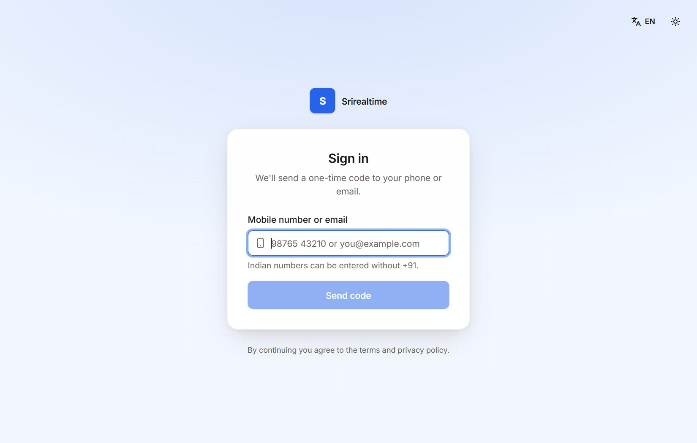

## The layout

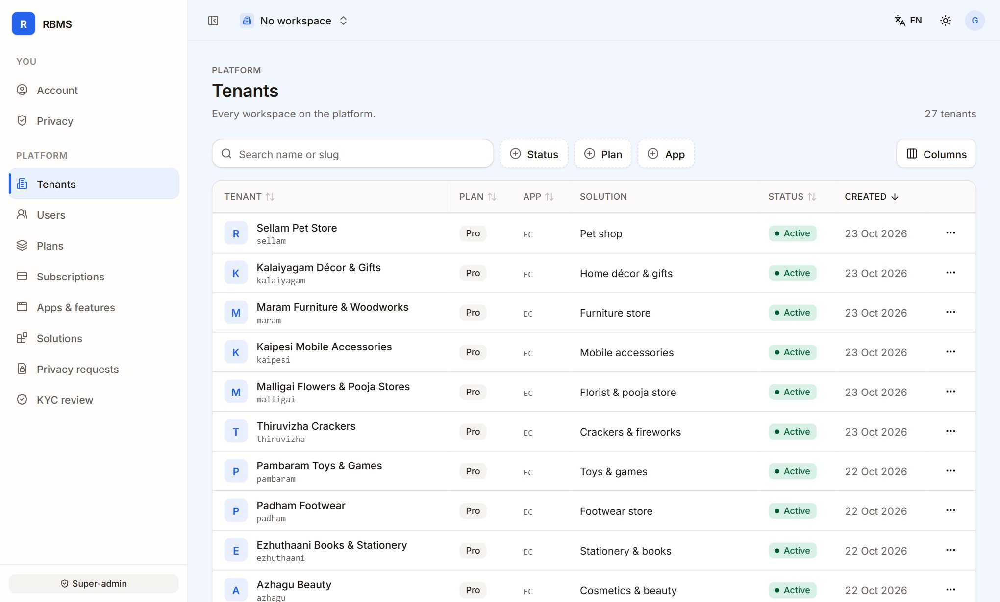

- **Left menu.** *You* (Account, Privacy) and *Platform* (the eight platform pages). When a shop is open, a *Workspace* section is added above them. The grey **Super-admin** badge at the bottom confirms your role. The small arrow at the top of the menu collapses it to icons.
- **Top bar.** The **workspace switcher** (it says "No workspace" when you are on platform pages). It has a **search box**, so with hundreds of workspaces you type a few letters of the name instead of scrolling; the language switch (English and Tamil), the **theme** button (light, dark or system) and your account menu.
- **Tables.** Every list has a search box, filter chips, a **Columns** button to hide columns, sortable headers and paging. The filters you pick stay in the page address, so you can copy the address to send someone the same view.
- **Messages.** A green message at the bottom confirms each change ("Plan changed", "Kumar Stores suspended"). Red messages explain what went wrong.

# 2. Shops {pb}

Open **Platform, Tenants**. This is the list of every shop on the platform.

## Find a shop

- **Search** matches the shop name or its short name (the slug).
- **Status**, **Plan** and **App** filters narrow the list. The Plan and App filters also have "Default plan" and "No app" choices for shops that have none set.
- Click a column header to sort. The newest shops come first by default.

Each row shows the shop name and short name, its **Plan**, its **App** code, its **Solution** (with "app default" in grey when the shop never chose one), its **Status** and the date it was created.


## The row menu

The three dots at the end of a row open the actions for that shop.

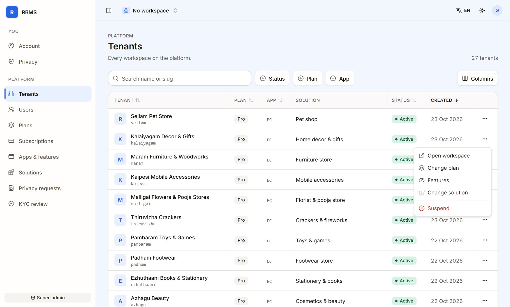

| Action | What it does |
|---|---|
| **Open workspace** | Switches the console into that shop. The *Workspace* menu appears and shows that shop's overview, members, branding, plan and usage, settings and so on, exactly as the owner sees them. |
| **Change plan** | Sets the shop's plan. See below. |
| **Features** | Opens a read-only panel that shows every feature and why it is on or off. See chapter 4. |
| **Change solution** | Moves the shop to another trade and, if you choose, another app. See below. |
| **Suspend** or **Reactivate** | Blocks or restores the shop's members. |

## Suspend and reactivate

**Suspend** asks you to confirm. After it, the shop's members cannot use the workspace until it is reactivated. **No data is deleted.** A POS terminal of a suspended shop is also refused. **Reactivate** restores access at once. Both actions are written to the audit trail with the before and after value.

## Change the plan of one shop

1. Row menu, **Change plan**.
2. Pick a plan from the list. It shows only the plans of the shop's own app, with the monthly price, and marks private plans. "Default plan" removes the shop's own setting, and the shop falls back to its app's Free plan.
3. Tap **Save**.

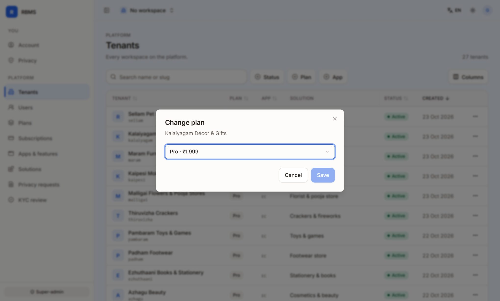

The change applies at once and the feature check is refreshed. This is a platform override. It does not start a payment. To give a shop a paid plan without charging, use **Comp plan** in chapter 5. To follow a shop's real subscription, use the Subscriptions page.

## Change the solution of a shop, and move it to another app

A shop's **solution** is its trade: look, starter categories and starting features.

1. Row menu, **Change solution**.
2. Pick a solution. Each choice shows its app code, and a one-line description appears under the list.
3. Choose what to apply:
   - **Apply the (look name) look** replaces the shop's colours, fonts and store layout.
   - **Add starter categories and home page** adds them only if the shop has none of its own. Nothing is overwritten.
   - **Also move the shop from X to Y** appears only when the solution belongs to a different app. Tick it to move the shop. The shop's features then follow the new app's profile, and its subscription moves to the same tier of the new app's plans.
4. Tap **Apply**.

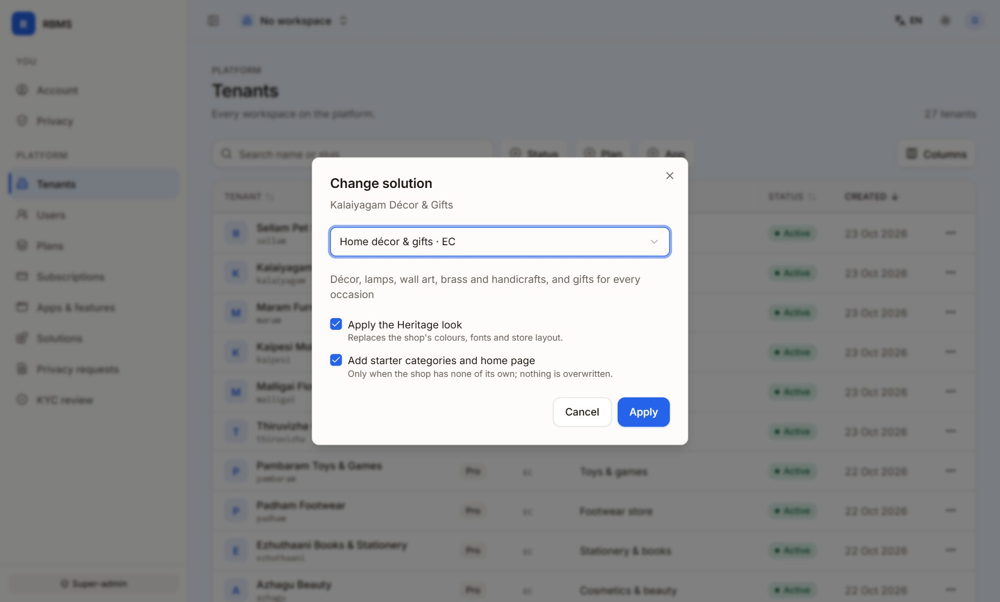

::: callout
**Think before you move a shop to another app.** The shop's features follow the new app. Anything the new app does not offer disappears from the shop's menu (the data stays). A Razorpay subscription keeps charging the old plan's price until its next change. Move a shop only after talking to the owner.
:::

The solution's **feature preset** is applied too: the optional features a new shop of that trade starts with (chapter 3).

## Custom domains

A shop that has the **Custom domain** feature (Pro plans of the apps that offer it) adds its own domain in the Online Store settings. The owner is shown the DNS records to create. The platform checks them automatically every 30 minutes until the domain is verified, and a verified domain then opens that shop.

The Admin console has no screen for domains. If a domain does not verify, check the DNS records with the owner. The technical team can force-verify a domain for a super-admin; this is not done from the console.

## Looking inside a shop

There is no impersonation. To see what an owner sees, use **Open workspace** (inside the Admin console), or **Open shop** on the Subscriptions page (it opens the shop's own app in a new tab, where you sign in as yourself, so you must be a member of that shop).

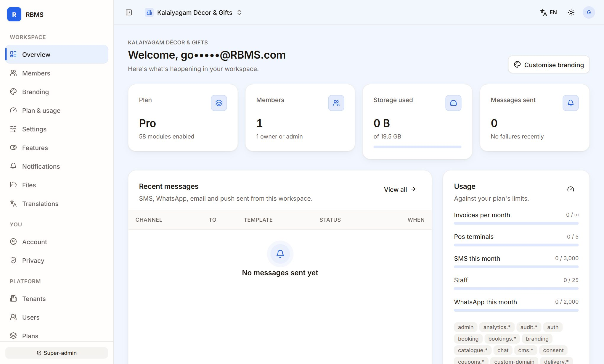

# 3. Solutions {pb}

Open **Platform, Solutions**. It lists every ready-made solution you offer, grouped by app, with the shop count of each.

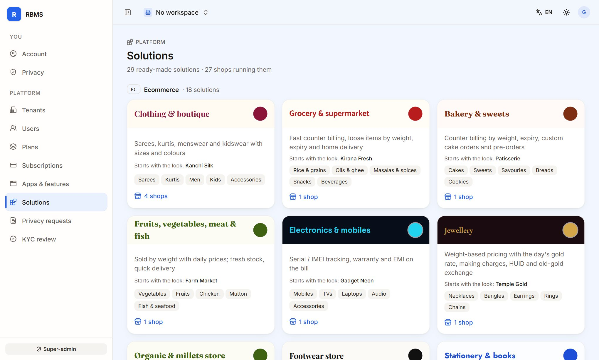

Each card shows:

- the name in English and Tamil, in the look's own colours and heading font;
- a one-line description of the trade;
- **Starts with the look**: the store look that is applied to new shops of that trade;
- the first starter **categories**;
- **the number of shops** running it. Click it to go to Tenants.

There are 29 solutions today, spread over the five apps (Ecommerce has the most, with 18). The page is for reading. You change a shop's solution from Tenants (chapter 2). You change what a solution's new shops start with from **Apps & features** (below).

## What a solution contains

A solution is a ready-made package for one trade:

- **The app it runs on.** The sign-up screen offers every solution, with the chosen app's first.
- **A store look.** Ten general looks (for example Heritage, Boutique, Fresh, Care, Bistro) plus a look for every trade and one for each demo store. Each look sets the header, hero, product cards, buttons, density, section style, motif and headings, not just colours.
- **The shop's words**, in English and Tamil: search box, "new arrivals", hero text, call to action, categories title.
- **Starter categories** and a **starter home page**.
- **Trade options**: for example the clothing size guide shows only for fashion and sports shoes, and the "Made in Tamil Nadu" badge only for crackers and similar trades.
- **A feature preset**: which optional features start on.

When a new shop signs up, the platform saves its trade, applies the preset, creates the starter categories and publishes the starter home page. Each step is skipped if the shop already has its own.

## Feature presets: "Apps & features"

A solution's preset is the list of the app's **optional** features that start on for a new shop of that trade. For example a gym starts without job cards, and a grocery starts with weighing scales and the weighing station switched on.

To edit a preset:

1. Open **Platform, Apps & features** and pick the app tab.
2. Under **Solutions on (app)**, click the solution card. A panel opens with every optional feature as a switch, grouped by module.
3. Use **Search features** and the **All / On / Changed** filter to find what you need. The header says how many are on and how many differ from the default.
4. Switch features on or off. **Reset to default** restores the preset that comes from the trade itself.
5. Tick **Also apply to the N shops running this solution** if you want existing shops set to this preset now. This **replaces the owners' own switches**, so use it deliberately.
6. Tap **Save**.

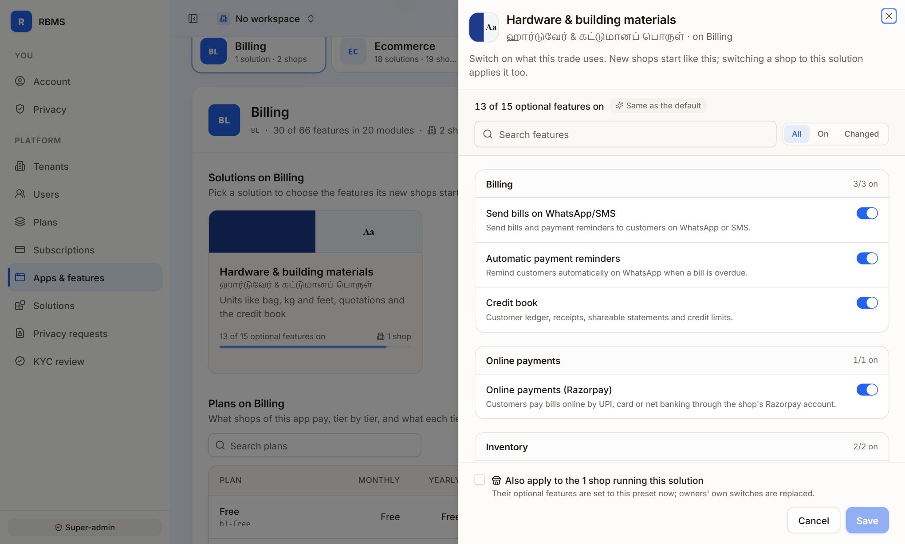

A preset changes only features the owner can switch. Features the owner cannot switch are the same for every solution of the app. A card marked **Customised** has a preset that differs from the trade's default.

A preset is applied in three situations: when a shop is created, when you choose **Change solution** for a shop, and when you save with "Also apply" ticked.

# 4. Apps and features {pb}

Open **Platform, Apps & features**. The strip at the top explains the idea, and the tabs below it let you pick an app.

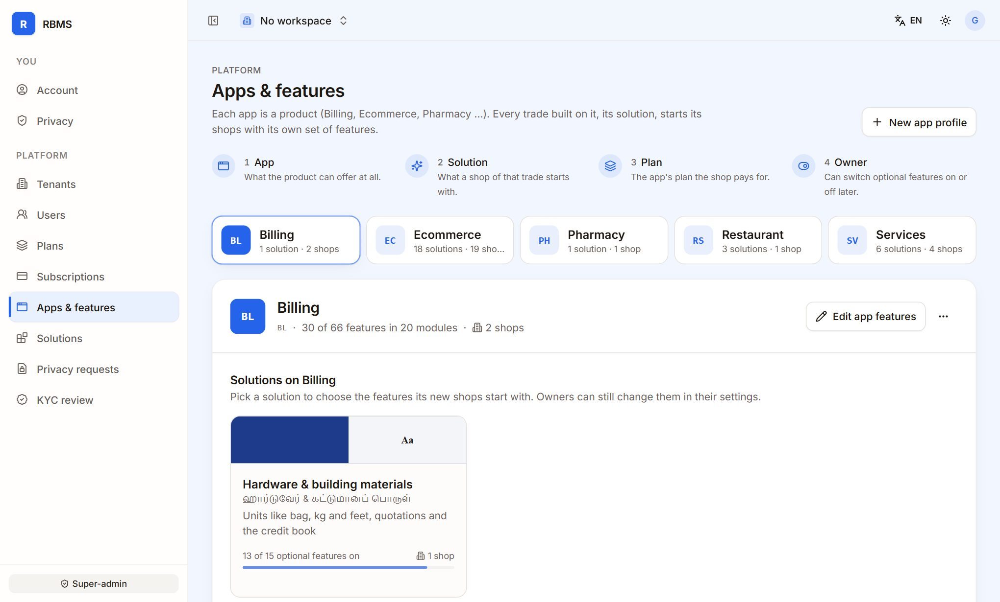

## How a shop's features are decided

A feature is on for a shop only when every level allows it:

1. **App.** What the product can offer at all. You set this here.
2. **Solution.** What a shop of that trade starts with (the preset in chapter 3).
3. **Plan.** What the shop's subscription includes (chapter 5).
4. **Owner.** The owner can switch **optional** features off and on later, in Settings, Features.

In short: the feature must be offered by the app, included in the plan, switched on by the owner (if it is an optional one), and every feature it depends on must be on too.

Two keys help you read the lists:

- A key such as `invoices.credit-book` is one feature. `invoices.*` means every feature of the invoices module, including ones added later.
- Dependencies are not implied. If "Reminders" needs "Send bills on WhatsApp", both must be granted. The editor adds a feature's dependencies for you.

If a shop has no app, every registered feature passes the app level. If it has no plan, it gets the Free plan of its app.

## App profiles

Each app tab shows how many solutions and shops it has. The header reads, for example, "30 of 66 features in 20 modules". Under **What this app offers**, a green dot means a whole module is offered and amber means part of it. A line below lists the modules the app does not offer.

- **Edit app features** opens a panel with every feature of every module. Switch features on or off, or use **All on** and **All off** for a module. The panel shows "Affects N shops".
- **New app profile** creates a profile. The App ID is 2 to 8 capital letters or digits, starting with a letter, and cannot be changed later.
- The row menu next to Edit has **Delete**. The warning tells you how many shops are on the app. Do not delete an app that has shops.

Feature changes are remembered for up to a minute before every shop sees them, so a change may take a moment to show.

## Seeing one shop's features

On Tenants, row menu, **Features** opens a read-only panel for that shop.

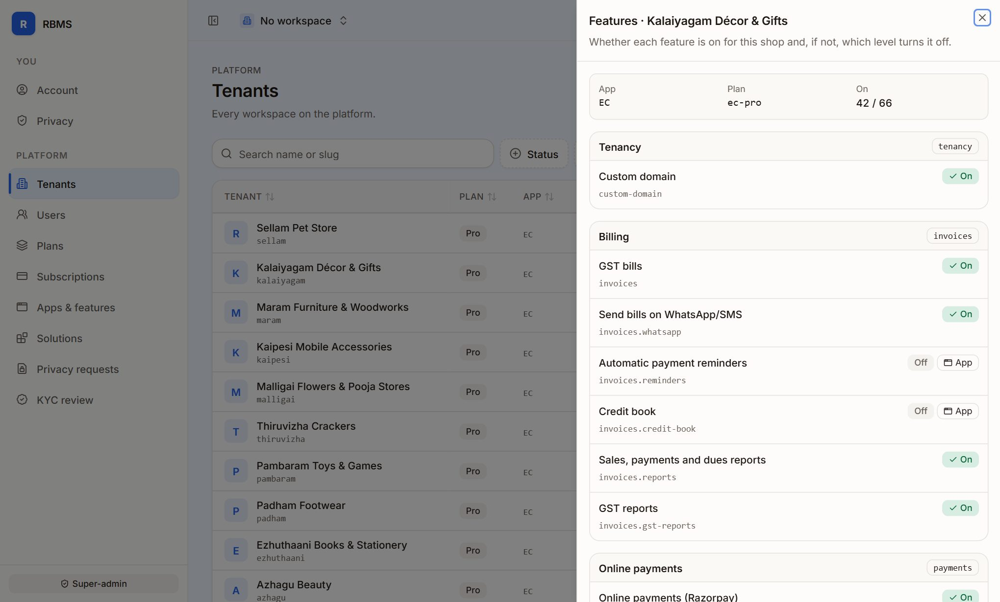

At the top you see the shop's **App**, **Plan** and how many features are **On** (for example 42 of 66). Every feature shows **On**, or **Off** with a tag that says which level turned it off: **App**, **Plan**, **Shop switch** or **Needs another feature**. This is the quickest way to answer "why can't this shop see the credit book?".

# 5. Plans and subscriptions {pb}

## Plans per app

Open **Platform, Plans**, or the **Plans on (app)** section of Apps & features. Each app has its own plans, one for each tier: **Free, Starter, Pro and Enterprise**. A plan id combines the app and the tier, for example `sv-pro`.

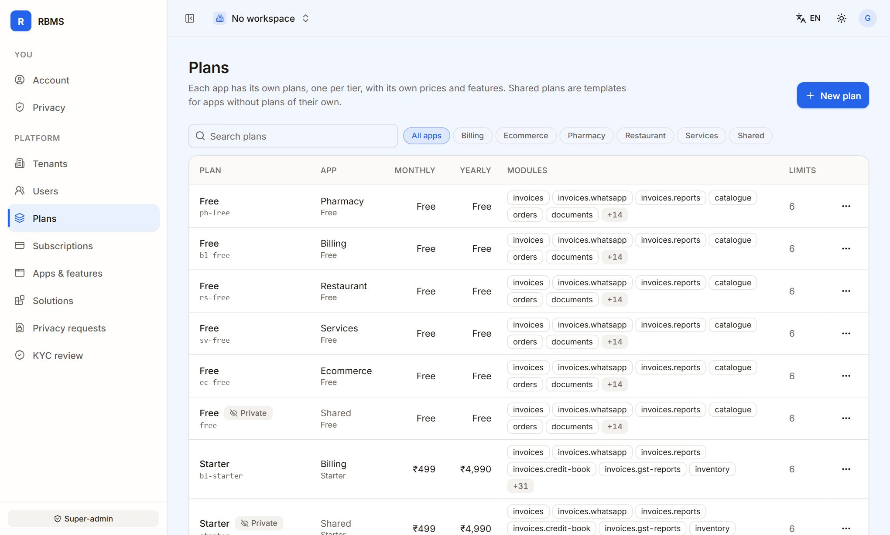

Each plan has:

- **Prices**: monthly and yearly, in rupees, **excluding GST**.
- **Modules and features** it grants.
- **Limits**, as numbers where -1 means unlimited. Examples are staff, storage and invoices per month, and **POS terminals**.
- **Public** or **Private**. Public plans show on pricing pages and to shops. Private plans can only be given (comped).
- A short description that shops see.

The seeded POS terminal limits are: Free 1, Starter 2, Pro 5 and Enterprise unlimited. Creating a terminal over the limit is refused with a "plan limit" message, and the shop owner sees an upgrade hint. The POS terminal feature is part of Starter and above on the Billing, Ecommerce, Pharmacy and Restaurant apps.

The seeded prices are **placeholders**. For example Billing Starter is shown as ₹499 a month. Set the real prices before you sell.

Practical rules:

- A shop can only change to, check out, or be comped a plan of **its own app**.
- A plan id and its app cannot be changed after creation.
- Deleting a plan drops the shops on it back to their default plan. Prefer making a plan private.
- If you change a price, new payments use a new payment-provider plan. Existing subscriptions keep what they were charged until they change.
- Plans without an app are shared templates. Only apps without plans of their own are offered them.

## Add-ons

Add-ons are paid extras on top of a plan. They are managed in **Apps & features, (app), Add-ons**. There are three kinds:

| Kind | What it does |
|---|---|
| **Adds to a limit** | Adds an amount to a limit for each unit bought, for example more staff. |
| **Unlocks features** | Unlocks features the plan lacks, but only ones the app offers. |
| **Credits pack** | A one-time pack of credits (for example messages) that is used after the monthly allowance. |

Each add-on has a code (the id is the app plus the code), the tiers it is for (empty means every tier), a minimum and maximum quantity, and prices per month, per year or once. Prices are placeholders until you set them. A private add-on can only be given.

How a shop's allowance is worked out: the plan, then any override on the shop, then add-on limits (unlimited stays unlimited), then feature add-ons, and the shop's own "remove" overrides last.

## The Subscriptions page

Open **Platform, Subscriptions**.

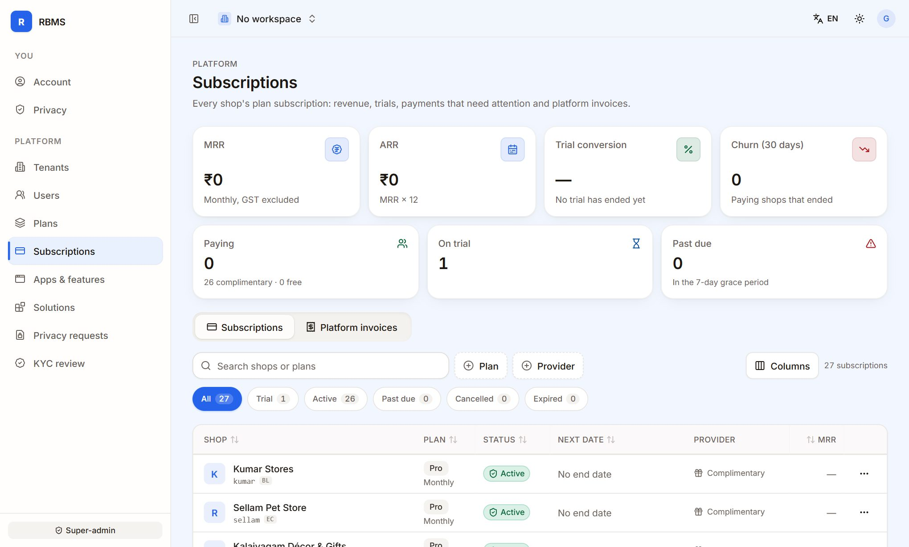

The tiles show:

| Tile | Meaning |
|---|---|
| **MRR** and **ARR** | Monthly recurring revenue excluding GST, and MRR times 12. |
| **Paying** | Shops that pay, with the number of complimentary and free shops. |
| **On trial** | Shops in their trial. |
| **Past due** | Shops in the 7-day grace period after a failed payment. |
| **Churn (30 days)** | Paying shops that ended. |
| **Trial conversion** | How many ended trials became paying. |

Below, filter by **Plan**, **Provider** and status chips (All, Trial, Active, Past due, Cancelled, Expired). Each row shows the shop, plan and interval, status, the next date (trial ends, renews, grace until, comp until), the payment provider and the shop's MRR contribution. Add-ons are listed under the plan.

The **Platform invoices** tab lists every invoice the platform has issued: number, shop, date, total, GST (CGST + SGST within the state, IGST across states) and status. You can **Download PDF**. **Void invoice** keeps the invoice in the series but marks it void, asks for a reason that is kept in the audit log, and cannot be undone.

## Row actions on a subscription

| Action | What it does |
|---|---|
| **Extend trial** | Adds 1 to 365 days to the trial end. An ended trial reopens for that many days from today. |
| **Comp plan** | Gives the shop a plan **without charge**. Pick the plan and an optional end date. A running payment mandate is cancelled. After the end date, the daily lifecycle job moves the shop to Free. |
| **Add-ons** | Shows the shop's add-ons. You can **give an add-on** free (with an optional end date), or **end** one now. |
| **Open shop** | Opens the shop's own app in a new tab. |
| **Open in admin** | Opens the shop's workspace in the Admin console. |

## How a subscription behaves

- A new sign-up on a paid plan starts a **14-day trial**. A free plan starts active with no payment. A second shop from the same owner phone or email starts without a trial.
- The shop owner pays from Plan & billing in their own app. The owner needs the right permission.
- A failed payment makes the subscription **past due** for **7 days**. After that it **expires** and the shop drops to the Free plan.
- An **upgrade** applies at once. A **downgrade** or **cancel** applies at the end of the paid period. Cancelling can be undone before then (**Resume**).
- A daily job at 09:00 IST sends trial reminders 3 days and 1 day before the end, expires trials that never set up payment, expires shops past their grace, and applies pending downgrades.
- **Downgrading never deletes data.** Limits and features simply stop allowing new use.
- When a plan with add-ons is downgraded or cancelled, add-ons the new plan cannot have end at the period end, with a notice to the owner.

## Payment provider: test and live

Plan payments use **Razorpay**, with the platform's own account.

- In the Provider column, **Razorpay** means a real provider subscription, **Mock** means the built-in test provider, **Complimentary** means comped by you, and **Free** means no payment.
- The test provider is used when the platform's Razorpay keys are **not** set, and only outside production. It lets you try sign-up and plan changes without real money.
- In production, when the keys are not set, online plan payments answer "service unavailable" instead of faking a payment.
- Live and test Razorpay keys are chosen by the technical team in the server's settings (all three platform Razorpay values together, or none). The Admin console has no switch and no label that tells you whether the keys are test or live. Ask the technical team, and always check one small real payment after changing keys.
- Every successful charge creates a platform invoice with a PDF, and the owner is emailed a copy.

# 6. Users, KYC, privacy and the audit trail {pb}

## Users

Open **Platform, Users** for everyone with an account.

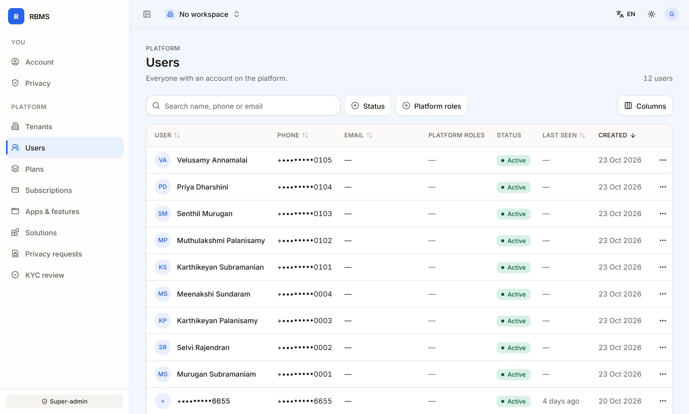

Columns: user, phone, email, **platform roles**, status, last seen and created. Search by name, phone or email, and filter by **Status** and **Platform roles**.

The row menu has:

- **Make super-admin** or **Remove super-admin.** This gives or removes access to the Platform menu. A confirmation says it applies across all workspaces.
- **Disable account** or **Enable account.** A disabled account is blocked and its sessions end. This is the way to cut off a compromised account. A deleted account cannot be re-enabled.

Both actions are written to the audit trail.

A shop's own members and roles (owner, admin, manager, cashier and so on) are managed by the owner in the shop. As a super-admin you can see them under **Open workspace, Members**.

## KYC review queue

Open **Platform, KYC review**. It lists identity checks across every shop that a person must look at, usually a low name match on a payout account.

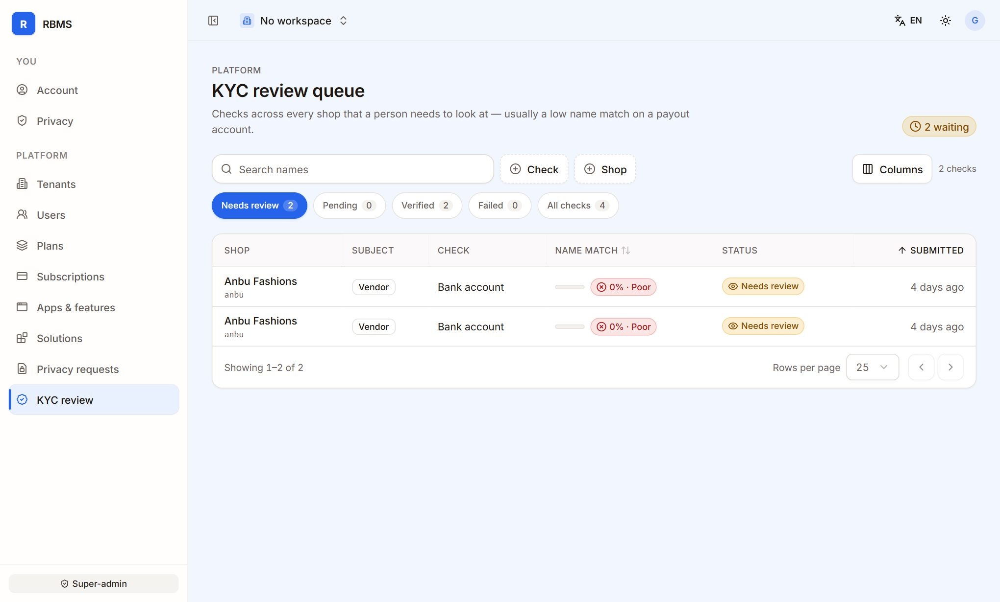

Check types are PAN, GSTIN, bank account, UPI, Aadhaar (DigiLocker) and selfie. Status chips are **Needs review** (the default), Pending, Verified, Failed and All checks.

To review a check, click its row:

1. Read the details. Identifiers are **masked**. Full numbers are never stored or shown.
2. For bank and UPI checks, compare the name on record with the verified PAN name. A score at or above the pass mark passes by itself. Below it, a person decides. Initials and word order lower the score only a little.
3. **Approve** marks the check verified and recalculates the subject's KYC status. The reason is optional and is kept in the audit log, for example "Name differs only by initial".
4. **Reject** marks it failed. The reason is **required and shown to the shop**, so say what to fix. The shop can then submit again.

A check that is no longer waiting cannot be reviewed again. Every decision is recorded with who made it, but never the document numbers.

## Privacy requests

Open **Platform, Privacy requests** for data export and account deletion requests from all users. Each row shows the request type, the user, the status and the scheduled date.

**Process due now** processes every request whose date has come, and reports how many it processed ("Nothing was due" if none). Use it when someone is waiting.

## The audit trail

The platform records security-relevant events. Platform-level events (a sign-in with no shop, platform roles, plan definitions) are kept apart from shop events. Each entry names the actor, the action and a before and after summary. Summaries never contain secrets, OTP codes or tokens.

| What happened | Recorded as |
|---|---|
| Sign-in | `auth.login` |
| Login handoff (create, redeem) | `auth.handoff.create`, `auth.handoff.redeem` |
| Platform role or user status changed | `auth.user.platform_roles`, `auth.user.status` |
| Shop plan, status or app changed by you | `tenancy.tenant.plan`, `tenancy.tenant.status`, `tenancy.tenant.app` |
| Plan or add-on definitions | `plans.plan.upsert`, `plans.plan.delete` |
| Subscription admin actions | `subscription.comp`, `subscription.extend_trial`, `subscription.invoice_void` |
| KYC decisions | `kyc.review.approve`, `kyc.review.reject` |
| Staff roles and POS | `staff.*`, `pos.terminal.*`, `pos.pin.*` |
| API keys | `developer.key.create`, `developer.key.rename`, `developer.key.revoke` |

**Where to see it.** A shop's own events appear in its **Activity log** (Settings in the shop's app, or through Open workspace). The Admin console has **no screen for the platform-level audit list yet**. The technical team can read it from the platform audit endpoint (appendix). When you suspect misuse, ask them to filter by action and actor.

# 7. Demo shops and showcase {pb}

The platform ships with ready demo shops so a sales visit or a training session never starts from an empty screen. They are created by the **seed command**, and their trading history by the **history generator** (both in the appendix).

All demo shops are owned by the **demo owner**, the identity the technical team configured when seeding. Sign in to the Admin console or to a shop's app with that identity's phone or email and the one-time code. On a development machine the technical team can set a fixed test code for test identities. This is switched off in production, so in production the code arrives by SMS, WhatsApp or email as usual.

## Online store series: 16 shops, one look each

All run on the Ecommerce app and the Pro plan. Each has its own catalogue with photos, home page, pages, menus, offers and delivery. Open one at `<shop>.your-domain` on the Online Store.

| Shop | Trade | What it shows off |
|---|---|---|
| **Murugan Hardwares** | Hardware | The "industrial" look. Bulk units and a trade-style catalogue. |
| **Porunai Sweets & Bakery** | Bakery | The "mithai" look and a scalloped motif. Sweets by weight. |
| **Cauvery Fresh Market** | Fresh produce | Crisp greens. Loose goods sold by weight. |
| **Vayal Organics** | Organic | An earthy look. Organic groceries. |
| **Thari Silks** | Fashion (silk) | A zari look. Sarees and size handling. |
| **Arasan Menswear** | Fashion (men) | A tailored look with the clothing size guide. |
| **Azhagu Beauty** | Cosmetics | A bold berry look for beauty products. |
| **Padham Footwear** | Footwear | A footwear look with the shoe size chart. |
| **Ezhuthaani Books & Stationery** | Stationery | A copybook look. Books and school supplies. |
| **Pambaram Toys & Games** | Toys | A playful toybox look. |
| **Thiruvizha Crackers** | Crackers | A starburst look and the "made locally" badge. |
| **Malligai Flowers & Pooja Stores** | Florist and pooja | A kumkum-and-turmeric look. Flowers by weight and garlands by the muzham. |
| **Kaipesi Mobile Accessories** | Mobile accessories | A carbon look for phone accessories. |
| **Maram Furniture & Woodworks** | Furniture | A walnut and linen look for big-ticket items. |
| **Kalaiyagam Décor & Gifts** | Home décor | A polished-brass look for gifts and décor. |
| **Sellam Pet Store** | Pet shop | A lagoon look for pet food and accessories. |

::: callout
**Count.** Earlier notes spoke of 14 stores in this series. The seed data in this version contains **16**, and the Tenants list shows all of them. The figure above is the one to use.
:::

## Billing and trade showcases

| Shop | App and trade | What it demonstrates |
|---|---|---|
| **Kumar Stores** | Billing app, grocery, Starter plan | Counter billing for a grocery, the credit book, and (after the history generator) 90 days of trading. |
| **Raja Textiles** | Billing app, fashion, Pro plan | Billing for a clothing shop. |
| **Thunai Pharmacy & Wellness** | Pharmacy app | Medicine batches with expiry, Schedule H and H1 prescriptions. |
| **Arusuvai Unavagam** | Restaurant app | Tables, kitchen tickets (KOT), split bills, takeaway and delivery. |
| **Lakshmi Jewellers** | Ecommerce app, jewellery, Pro plan | Daily gold and silver rates, tagged pieces with weight and making charges, old-gold exchange. |
| **TechZone Mobiles** | Ecommerce app, electronics | Serial numbers, IMEI and warranty. |
| **Glow Salon & Spa**, **QuickFix Mobile Care**, **IronFit Gym** | Services app | Appointments, job cards and memberships. |
| **Anbu Fashions** | Ecommerce app, fashion | A boutique store with a full catalogue. It also holds the sample checks you see in the KYC queue. |

On the Subscriptions page the demo shops show as **Complimentary**, which is why MRR reads ₹0 on a demo database.

## Trading history for a demo

A demo shop looks alive when it has traded for weeks. The **history generator** creates **90 days** of bills, payments, receipts, credit notes, till sessions, purchases, expenses and customers for one shop. Everything is made through the real billing services, so GST reports, stock, the credit book and the dashboard agree with each other.

How it behaves:

- **Dates.** Every record is dated inside the chosen window and never after now. Only today's real time shows in a few "created" columns, so lists sorted that way show "today".
- **The same every time.** A shop with the same data gets the same history. A longer window gives the same days, only more of them.
- **Top-up.** A day that already has a till session is done and skipped. Run it again tomorrow and it fills only the missing days. Today is generated up to the current time, and the day's drawer stays open like a live shop. The next run counts and closes it first.
- **No undo.** Issued bills can never be deleted. To regenerate, start from a fresh shop.
- **Nothing is sent.** Messaging is switched off for the run. Customers use the fake phone range **+91 9999 00xxxx**, so no real person is contacted.
- **Plan quota is not used**, so history does not eat the month's invoice allowance.
- **Trade profiles** exist for grocery, pharmacy, restaurant, jewellery, textiles, hardware and services. The generator picks one from the shop's trade. Festivals (Pongal, Tamil New Year, Akshaya Tritiya, Navaratri, Deepavali and others) lift sales on the right dates.
- **Staff names are labels only.** They are not people who can sign in.

To refresh a demo before a visit: run the seed command (safe to repeat), then the history generator for each showcase shop. A dry-run option prints what would be created without writing anything.

# 8. Support tasks {pb}

This chapter lists the common requests and where each is done. Most shop-level tasks are done by the shop's own manager or owner in their app. The platform team's job is to guide them, or to open the shop and see it.

| Request | Where and how |
|---|---|
| **"I cannot see feature X."** | Tenants, row menu, **Features**. The tag beside the feature says which level turned it off: App, Plan, Shop switch or Needs another feature. |
| **"Upgrade me but I haven't paid yet."** | Subscriptions, row menu, **Comp plan**, with an end date. |
| **"My trial ended too soon."** | Subscriptions, row menu, **Extend trial**. |
| **"We need more staff or messages."** | Subscriptions, row menu, **Add-ons**, then give an add-on, with or without an end date. |
| **"Lock this shop out."** | Tenants, row menu, **Suspend**. Reactivate when it is resolved. |
| **"This person should not have access."** | Users, row menu, **Disable account**. |
| **"Change our trade or look."** | Tenants, row menu, **Change solution**. Tick the look to re-apply it. |
| **"Our store look got changed and we want the starting look back."** | Same as above. Ticking the look replaces colours, fonts and layout. Starter content never overwrites the shop's own. |
| **"Payment failed."** | Subscriptions, filter **Past due**. The 7-day grace period runs, then the shop drops to Free. |
| **"Wrong invoice."** | Subscriptions, **Platform invoices**, **Void invoice** with a reason. Issue a new one if needed. |
| **"Name-match check failed on our bank account."** | KYC review. Approve or reject with a reason. |
| **"Delete my data."** | Privacy requests. **Process due now** when the date has come. |
| **"Custom domain will not verify."** | Ask the owner to check the DNS records shown in the Online Store settings. Records are re-checked every 30 minutes. Forced verification is done by the technical team. |

## POS terminals, PINs and pairing codes

Terminals, pairing codes and staff PINs are managed by the shop's **owner or a manager** in their own app, under **Settings, POS terminals** and **Settings, Team & roles**. The Admin console has no screen for them. Guide the owner:

- **Pairing code.** Created when a terminal is added. It has 8 characters, works for **15 minutes** and works once. If it has expired, the owner taps **New code** on the terminal. A "Wrong or expired code" message on the device means exactly this.
- **Unpair a terminal.** In the terminal's menu, **Unpair device**. The device stops working at once and its cashier is signed out. The terminal stays and a new device can be paired. **Pair new device** replaces the old device without unpairing first.
- **Reset a staff PIN.** In **Team & roles**, the key button on the member's row sets, resets or removes a PIN. It needs the **POS devices** permission, which managers have. A PIN is 4 to 6 digits, must not be all the same digit or a simple sequence, and must be unique in the shop.
- **A cashier is locked out.** After 5 wrong PINs in a row on a terminal, it locks for 5 minutes. A correct PIN afterwards resets the count.
- **"POS terminals are off" or "plan limit".** The owner must switch the feature on in Settings, Features, or upgrade. You can confirm the cause in the shop's **Features** panel and its plan's POS terminals limit.

All of these actions are recorded as `pos.*` events in the shop's activity log, and never include the PIN, code or token.

# 9. Operations {pb}

## Health and monitoring

The API exposes four routes for monitoring. They sit outside the sign-in pipeline, so they answer even when sign-in is slow.

| Route | Use | Answer |
|---|---|---|
| `/health` | Is the process alive? | 200 `{"ok":true}`. Touches no dependency. Use it for the container health check. |
| `/ready` | Can it serve? Checks the database, Redis and the job queue, each with its response time. | 200 when all are fine, 503 with the failing dependency named. Use it for the load balancer. |
| `/version` | Which build is running. | Build id, build time, start time and environment. |
| `/metrics` | Prometheus metrics: requests, job outcomes and queue depth, database connections, memory and event-loop lag. | Needs a bearer token. Not available at all when no token is set. |

Every web app also answers `/api/health` with its name and build id. Every API response carries an `x-request-id`. When a user sends a screenshot of "Something went wrong", the id on it finds the exact log line and error report.

**What to do when something looks wrong:**

1. Check `/ready`. It names the failing dependency. If the database fails, restarting the API will not help; look at the database host. If Redis or the queue fails, reads and writes keep working but jobs (messages, webhooks, reports) wait, and they catch up when Redis returns.
2. If `/health` is fine but `/ready` is 503, the load balancer has correctly taken the task out. Fix the dependency.
3. If errors spike, look at the error reports by request id, shop and route. Ask whether it is one shop or all, and whether it began with a release (`/version`).
4. If jobs pile up, find the job name in the reports, fix the cause, then re-run it (the technical team does this).

Errors are reported automatically for server errors (never for a user's mistakes), for jobs that fail their final attempt, and for crashes. Secrets, OTP codes, PINs and tokens are scrubbed before anything is logged or sent.

## Backups and the restore drill

- A **backup** is a full copy of the database, compressed. It can go to cloud storage or to a local folder. Old backups are pruned: the newest of each of the last 7 days and the last 12 months are kept, and the newest overall is always kept.
- A **restore** goes into a separate scratch database first, never straight over the live one. The script refuses a target that is not clearly a scratch database unless it is forced for a real recovery.
- The **restore drill** proves the backup works. It takes a snapshot, backs it up, restores it into a fresh copy, and checks that every table's row count, the schema history and a sample shop match exactly. It then deletes the copy. A pass prints "RESTORE DRILL PASSED" with timings.

**When to run what:**

- Run a **backup** before any risky change (a data fix or a schema change).
- Run the **drill** after schema changes, and **at least monthly** in production against a scratch database. Keep the report. Its duration is your restore-time estimate.
- To **recover production**: restore into the scratch database, check it, stop the API and worker, swap the databases (or restore over the live one with the force options), start again and check `/ready`.

The exact commands are in the appendix.

## Environment notes

These settings live with the technical team, not in the console:

- **Payment keys.** All three platform Razorpay values together, or none.
- **Messaging providers.** SMS, email, WhatsApp and push each need their own credentials. Without them, messages go only to the server log, and nothing reaches anyone.
- **Monitoring.** An error-reporting address (Sentry-compatible) and a metrics token.
- **Test sign-in code.** A fixed code for named test identities. It is ignored in production.
- **Storage.** Local disk in development, cloud object storage in production.

## What is not in the Admin console

So that nobody looks for it:

- A shop **detail page**. Use the row menu and Open workspace.
- **Impersonation** of a shop owner.
- A screen for **custom domains**, **POS terminals** and **staff PINs**.
- A screen for the **platform audit trail**.
- A live **test or live** indicator for payment keys.
- A tool for **fixing a stuck order**. Order status is changed by the shop in its own Orders screen. If an order cannot move, a technical person must investigate with the request id and the shop's activity log.

# 10. For your technical team (appendix) {pb}

Commands are written with placeholders. Replace `<api>` with the name of the API package in your repository, and `<shop>` with a shop's short name. Run them from the repository root.

## Local setup essentials

| Item | What to know |
|---|---|
| **Database and Redis** | Run them in Docker. Postgres is on port **5432** and Redis on **6379**. Use **127.0.0.1**, not the machine-name alias for it, in the database and Redis addresses. On some Windows machines that alias resolves to the IPv6 address first, and Docker's IPv6 forward resets connections, so the API's job workers loop on connection errors. |
| **After a PC restart** | Docker may be stopped. Start it, then bring the services up again with the infrastructure command. |
| **One API instance only** | Start exactly one API dev server. Duplicate watchers fight over port 4000 and look like random restarts. |
| **Admin console address** | Open it on the same host name the API allows (the dev Admin console expects the machine-name alias for this computer, on port 3000, not the numeric address). A different host name makes the browser block the API calls as cross-origin and the console shows loading placeholders forever. |
| **Store dev server cache** | Never run a production build of the Online Store app while its dev server is running. They share one build folder, which causes stale and hydration errors. Stop the server, delete its build folder and start again. |
| **A framework patch** | The repository applies one patch to the web framework (the React hydration fix) when you install dependencies. The patch is tied to the framework version. After you upgrade the framework, check that the patch still applies and re-create it if it does not. |
| **Ports** | Admin 3000, Billing 3001, shop owner app for the Ecommerce app 3002, Online Store 3003, seller 3004, marketing site 3005, Pharmacy 3006, Restaurant 3007, Services 3008, API 4000. |
| **Test sign-in** | The API accepts a fixed code (`TEST_OTP_CODE`) for the identities in `TEST_OTP_TARGETS`, in development only. |
| **Sign-in tokens** | The web apps store the session in the browser under the keys `sr_token` (session) and `sr_tenant` (current shop). |

## Seed and history commands

```
# plans, app profiles, the first super-admin, demo shops and the 16 demo stores (safe to repeat)
pnpm --filter <api> seed

# only the demo stores, all or named; re-apply a home or a look after editing its files
pnpm --filter <api> seed:stores [<shop> ...] [--refresh-home] [--refresh-look]

# 90 days of trading for one demo shop (top-up, deterministic, nothing sent)
pnpm --filter <api> seed:history <shop> [--days 90] [--profile <name>] [--dry-run]

# a scheduled job, run by hand
pnpm --filter <api> job <name>

# database migrations
pnpm --filter <api> db:migrate
```

Notes:

- `seed` needs the demo owner's phone or email in the `SEED_SUPERADMIN` setting. Set `SEED_DEMO=false` to seed only plans and app profiles. Run `seed` once before `seed:stores`.
- `--profile` accepts: kirana, pharmacy, restaurant, jewellery, textiles, hardware, services. `--days` accepts 1 to 400.
- `seed:history` runs in its own process with all messaging credentials blanked and an in-memory Redis, so it can run while the API is up and never sends anything.
- `seed:e2e` creates test shops and also **makes its owner a super-admin**. Never run it against a shared or production database.

## Backup, restore and drill commands

```
pnpm ops:backup                       # back up now
pnpm ops:backup -- --dry-run-prune    # back up, then show what retention would delete
pnpm ops:restore -- latest --target <scratch-db-url> --fresh
pnpm ops:restore -- <file-or-storage-key> --target <scratch-db-url>
pnpm ops:drill                        # prove the latest data restores
```

A scratch database name must end in `_restore`. Backup storage, retention and the default restore target come from environment settings read from the environment or the API's settings file.

## Monitoring and audit commands

```
curl -s https://api.your-domain/ready
curl -s https://api.your-domain/version
curl -s -H "Authorization: Bearer <metrics-token>" https://api.your-domain/metrics
```

The platform-level audit list is read by a signed-in super-admin from the API's platform audit endpoint, filtered by action and actor. Forced verification of a custom domain is done by a super-admin through the API's domain verify call with the force option.

## The next patch note

When you release the next patch, record these in the release note: the build id (shown at `/version` and `/api/health`), any database migration (run it before starting the new API), any change to seed data (re-run the seed, which is safe to repeat), and whether the web framework patch was touched. After the release check `/ready` and one sign-in.
