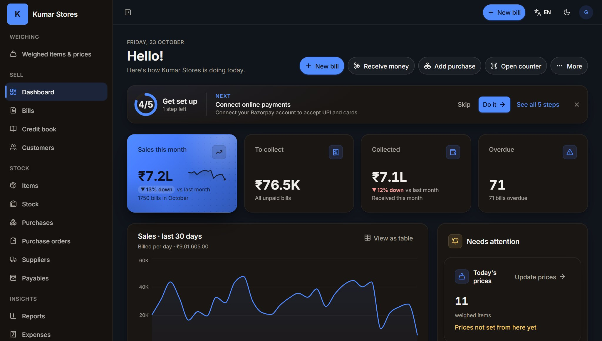
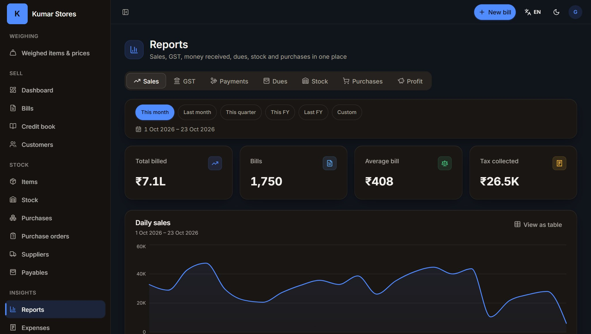

# At a glance

**Retail & Business Management Suite (RBMS)** is one connected system for running a shop. You give GST bills at the counter, keep your stock, track who owes you money, sell online through your own store, and see how the business is doing from your phone. Every part shares the same information, so you type each thing once.

::: callout
**In one line:** one account, one stock list, one customer list, and many ways to sell — at the counter, on a weighing scale, through a table QR code, on WhatsApp, or in your own online store.
:::

## What you get

| For your shop | What it does |
|---|---|
| **Billing app** | GST bills and invoices, credit book, stock, purchases, expenses, reports. Works on any computer or phone browser. |
| **POS terminal** | A fast counter screen with barcode and camera scanning, held bills, returns, till sessions, and PIN unlock for each cashier. |
| **Weighing station** | Weigh loose goods, print a ticket with a barcode, and let the cashier scan it. No re-typing, no price mistakes. |
| **Online Store** | Your own website in Tamil and English, installable on a customer's phone like an app, with delivery, coupons and online payment. |
| **Business mobile app** | Bill, check stock, orders, customers and the credit book from your phone (Android first). |
| **Pharmacy, Restaurant and Services apps** | The same system, with extra tools for medicine batches, kitchen and tables, or appointments and job cards. |
| **Admin console** | For the RBMS team and partners: set up apps, plans and shops. |

## Why shop owners choose it

- **Right for your trade.** 29 ready-made trade setups, from kirana and textiles to pharmacy, jewellery and salons. You start with sensible categories, words and a home page already prepared.
- **GST-ready.** GST bills with HSN codes, tax summaries for filing, and the new price-based GST rule for clothes and footwear.
- **Tamil and English.** Your store, and much of the system, works in both languages.

# Who it is for {pb}

RBMS is designed around how Tamil Nadu businesses actually trade. When you sign up you choose your trade, and RBMS prepares the shop: starter categories, the look of your online store, the right tools switched on, and a home page in English and Tamil. You can change all of it later.

## The 29 trades

**Food and daily needs**

- Grocery and supermarket (kirana)
- Bakery and sweets
- Fruits, vegetables, meat and fish
- Organic and millets store
- Restaurant and café
- Cloud kitchen
- Tea stall and juice bar

**Fashion, home and gifts**

- Clothing and boutique (including textiles)
- Footwear store
- Jewellery
- Cosmetics and beauty
- Home décor and gifts
- Furniture store
- Florist and pooja store
- Crackers and fireworks

**Health and personal care**

- Pharmacy
- Optical store
- Salon
- Spa and wellness
- Gym and fitness

**Tools, tech and everyday retail**

- Hardware and building materials
- Electronics and mobiles
- Mobile accessories
- Mobile and electronics repair
- Stationery and books
- Toys and games
- Sports store
- Pet shop
- Tailoring and stitching

::: callout
**Not on the list?** A general setup is available, and RBMS records the trade you tell us about, so we know what to build next.
:::

# How the apps fit together {pb}

RBMS is a family of apps that share one shop account. What you see depends on your trade and your plan.

<b>Online Store</b>Customers order from their phone

<b>POS terminal</b>Counter billing, scanner, PIN unlock

<b>Weighing station</b>Weigh ticket with barcode

<b>Business mobile app</b>Owner and staff on the phone

&#9660; &nbsp; &#9660; &nbsp; &#9660; &nbsp; &#9660;

<b>Your shop account</b>One list of items and stock &middot; one list of customers &middot; one set of bills, payments and reports &middot; one team with roles

&#9650; &nbsp; &#9650; &nbsp; &#9650; &nbsp; &#9650;

<b>Billing app</b>Bills, credit book, stock, purchases, reports

<b>Pharmacy app</b>Batches, expiry, H1 register

<b>Restaurant app</b>Tables, KOT, kitchen screen

<b>Services app</b>Appointments, job cards, memberships

**Billing app** is the heart of the system. The **Pharmacy**, **Restaurant** and **Services** apps are the same system with extra screens for those trades. The **Online Store** is each shop's public website. The **POS terminal** and **Weighing station** are counter screens that you pair to a computer, tablet or phone. The **Admin console** is used by the RBMS team, not by shop owners.

Because everything shares one account, a sale on the Online Store reduces the same stock the counter uses, and a customer who buys online shows up in your customer list and credit book.

# GST billing and invoices

The Billing app makes a proper GST bill in a few taps.

- **GST bills** with your shop details, GSTIN, HSN codes and tax split (CGST, SGST or IGST). GST is the Goods and Services Tax; HSN is the product code that decides the tax rate.
- **Bills for every situation:** draft, issued, part-paid, paid, overdue and cancelled. Credit notes handle returns.
- **Share by WhatsApp** or SMS. The customer gets a link to a clean bill, and you can switch automatic payment reminders on for unpaid bills.
- **Print or download** a PDF bill.
- **E-invoice and e-way bill** support for businesses that need them, on higher plans, once you connect your GST account.

::: callout
**Clothes and footwear: price-band GST.** Since September 2025, clothing and footwear are taxed at 5% up to ₹2,500 per piece and 18% above it. RBMS applies the rule for you, piece by piece, after any discount on the bill. For tax-inclusive (MRP) prices it also warns you when a price falls in the zone between ₹2,625 and ₹2,950 where no single rate fits, so you can re-price.
:::

# The counter (POS terminal)

The POS terminal is the fast screen for a busy counter. It runs in a browser on a computer or tablet, and you can pair a phone too.

## Selling fast

- **Scan or search.** Scan a barcode with a scanner, use the phone or laptop camera, or type a name or code.
- **Quick items and favourites** for the things you sell all day.
- **Hold and resume bills** while a customer looks for their wallet.
- **Returns and credit notes** right at the counter.
- **Add a new item on the spot** when a scanned code is not in your list, and sell open items that have no code.
- **Customer by phone number** to bill on credit, give loyalty points or send the bill on WhatsApp.
- **Keyboard shortcuts** for search, customer, hold and pay.

## More than one counter, with staff PINs

Each counter is a **terminal** with its own name, such as "Counter 1" or "Weighing 1".

1. The owner adds a terminal and gets an 8-character **pairing code** and a QR code. It works for 15 minutes.
2. At the counter device, the code is typed or the QR scanned. The device is now that terminal.
3. Each cashier has a **4 to 6 digit PIN**. They unlock the counter with the PIN, with no phone OTP needed.
4. Pairing a new device replaces the old one, and the owner can unpair a lost device at once.

Safety is built in: obvious PINs such as 1234 or 0000 are refused, two staff cannot share a PIN, and five wrong PINs lock the counter for five minutes. The counter locks itself after a few idle minutes.

The number of terminals depends on your plan. See the plans chapter.

## Till sessions

Every terminal has its own **till session**. Open the day with your cash, take cash and UPI during the day, then close with a cash count. RBMS shows what the drawer should hold, so any difference is visible the same day.

## Works with a slow connection

The counter keeps a copy of your item list on the device, so searching and scanning stay quick. When prices or items change, only the changes are fetched.

::: callout
**Good to know:** the item list is kept on the device, but billing itself needs an internet connection. Offline billing is not yet part of RBMS.
:::

# Weighing station

For shops that sell loose goods by weight (grocery, sweets, organic, fresh, flowers), a **Weighing station** removes the queue at the scale.

1. A helper puts the goods on the scale. The weight can be read from a connected USB scale or typed by hand.
2. They pick the item and, if needed, subtract the weight of the container (the tare).
3. RBMS works out the price from your price per kg and prints a **weigh ticket** with a barcode.
4. At the counter, the cashier scans the ticket and all the lines drop into the bill at your prices.

A ticket can be used only once and expires at the end of the day. The station never takes prices from the screen, only from your price list, so there is no room for mistakes. Scale labels printed by shop scales can also be scanned at the counter and become a weighed line.

# Payments and the credit book

- **Cash, UPI, cards and bank transfer** are recorded against each bill. Part payments are allowed.
- **Online payments** (through Razorpay) for the Online Store and payment links.
- **Credit book:** many shops sell on credit. The credit book keeps a running ledger for each customer, lets you record receipts, set a credit limit, send a statement link, and send a reminder on WhatsApp.
- **Dues at a glance:** the dashboard shows what is waiting to be collected and what is overdue.

# Stock and purchases

- **Stock tracking** for every item, with a low-stock list and reorder levels.
- **Stock movements** keep a history: sales, purchases, adjustments and returns.
- **Several branches or locations,** each with its own stock, when your plan includes them.
- **Purchases and suppliers:** record supplier bills with input tax credit, send purchase orders, receive goods in parts, and return goods with a debit note.
- **Supplier payments:** pay part of a bill, pay a supplier in one go, and see what you owe with an ageing view.
- **Import and export:** bring your items and customers in from Excel or CSV files.

::: callout
**Moving from other software?** Item and customer lists can be imported today from spreadsheets. Direct import from Tally or Vyapar is not available yet.
:::

# Customers and loyalty

- A **customer list** built automatically from bills, counter sales and online orders.
- **Loyalty points** earned on counter and online purchases, with tiers such as Silver and Gold. Customers can use points on their next bill.
- **WhatsApp campaigns** to the customers who agreed to receive messages: choose all of them, customers with dues, or customers who ordered recently.
- **Reviews and a chat** on the Online Store, and a support inbox for your team.

# Reports and GST summaries

The Reports section answers the questions owners ask every day.

- **Sales:** by day, by item, by customer, by payment method.
- **GST:** rate-wise and HSN-wise summaries and the GSTR-1 and GSTR-3B outward-supply figures your accountant needs.
- **Payments, Dues, Stock and Purchases** reports.
- **Profit** view that brings expenses in.
- **Expenses:** record shop costs such as rent, salary and electricity.
- **Custom periods:** this month, last month, quarter, financial year, or your own dates.
- **Download** reports as CSV or Excel files, or have them emailed on a schedule.

# Team, roles and permissions

You decide who can do what.

- **Invite staff** by phone number or email.
- **Ready-made roles** such as manager, cashier and stock keeper, or make your own custom roles.
- **Fine permissions:** for example, a cashier can bill but cannot give discounts, and a stock keeper can adjust stock but not see reports.
- **Activity log** shows who did what and when.
- **POS PINs** let staff unlock a counter quickly without sharing the owner's login.

# Online Store

Every shop can have its own online store in Tamil and English, with the shop's name, logo and colours. Customers browse, add to cart and pay, and orders arrive in the same place as your counter bills.

## A look of your own

- **Themes and trade looks.** Ten ready-made themes plus a look made for each trade. You can change colours, fonts, button shapes, header style, card style and more, with a live preview.
- **Page layouts.** Choose a standard header, a category side-rail for big catalogues, a left sidebar menu for boutiques, or a magazine layout for fashion and jewellery. On phones you can turn on an app-style bottom tab bar.
- **Home page sections.** Build your home page from ready blocks: banners and sliders, categories, best sellers, deal of the day with a countdown, flash sales, a gold-rate board, a menu board, testimonials, photo gallery, FAQ, map and location, newsletter and more. Special blocks help specific trades, such as "find your size" for footwear, "shop by shade" for cosmetics and "shop by class" for stationery.
- **Tamil and English** on the shop, with a language switch for the customer.

## Selling and delivering

- **Delivery zones and charges,** including free delivery above an amount you choose, cash on delivery with an optional fee, and pickup.
- **Coupons** and offers, including first-order discounts.
- **Online payment** by UPI and cards. Each shop connects its own Razorpay account, so the money goes straight to the owner.
- **Sign-in with Google or a phone OTP** on every online store. Shoppers sign in through one secure central sign-in page and come back to the store with their cart kept.
- **Orders** with a clear flow from new to delivered, and refunds when needed.
- **Search, filters, reviews and wishlists** for shoppers.
- **Your own web address.** Use an RBMS address, or connect your own domain on plans that include it.
- **Services as bookable items,** for salons, spas and repair shops.

## Installs like an app

A **PWA** (progressive web app) is a website that can be added to a phone's home screen and opens like an app. Each store installs with its own name, icon and colours. On Android the shopper sees an "Install app" prompt. On iPhone a short card shows "Share, then Add to Home Screen". Product pictures and the shop's pages load quickly on repeat visits, and a friendly offline page appears if the phone has no signal. You can switch the install prompt off if you prefer.

# Trade-specific tools

The shared system is the same for everyone. Each trade then gets the extra tools it needs.

## Pharmacy

- **Medicine details:** salt (composition), manufacturer, schedule (OTC, G, H, H1, X), pack size and rack.
- **Batches and expiry:** receive stock by batch with expiry date, MRP and purchase rate. At billing, the batch that expires first is sold first. Expired stock is never sold.
- **Substitutes:** find medicines with the same salt.
- **Prescriptions and the Schedule H1 register,** with patient, doctor and batch details for every H1 sale. A list shows sales that still lack a prescription.
- **Expiry watch** on the dashboard for stock that is expired or about to expire.

## Restaurant and cloud kitchen

- **Floor plan:** areas and tables, with running orders per table.
- **KOT (kitchen order tickets)** sent to the right station, such as kitchen or beverages.
- **Kitchen display:** a screen for the cooks with New, Cooking and Ready columns and a timer on every ticket.
- **QR table ordering:** a QR code on each table opens the menu on the guest's phone. The order goes straight to the kitchen, always at your menu prices.
- **Split bills, table moves and joins,** and voids with a reason.
- **Online orders** from your Online Store appear in the kitchen too.
- GST at 5% for restaurants is applied on the bill.
- **Online food ordering** (see below) for restaurants, cloud kitchens and tea stalls.

### Online food ordering

Restaurants, cloud kitchens and tea stalls can take food orders on their Online Store.

- **Half and Full portions** and other sizes, added to the cart in one tap.
- **Veg, egg and non-veg marks** on every dish, so guests choose with confidence.
- **Delivery or pickup** at checkout. The owner switches home delivery and pickup on or off and writes the pickup instructions in Settings, Online store, **Delivery & pickup**.
- **Minimum order** value, and **sold out today** for a single dish without removing it from the menu.
- **Orders reach the kitchen display** straight away, next to table and counter tickets.

## Jewellery

- **Daily gold and silver rates.** Enter the 24K rate and the other purities follow. Saving the rate re-prices every piece in stock.
- **Piece-wise stock** with gross and stone weight, wastage, making charges (per gram, percent or fixed), stones, tag and **HUID** (the hallmark ID).
- **Old gold exchange:** value the old gold at the buying rate less a deduction, and apply it as a payment on the new bill.
- **Gold-rate board** on your online store.

## Salons, spas, gyms, repair, tailoring and optical

- **Appointments:** services with duration, staff with their own working hours and breaks, a day calendar per staff member, and online booking from your store. Customers can view or cancel their booking up to two hours before.
- **Job cards:** a ticket for each repair, stitching or eyewear job. Templates for devices (brand, model, IMEI, issue), garments (measurements, trial date) and eyewear (prescription for each eye). Parts, labour, advance, bill and timeline are all in one place. Customers can follow the job by a link on your store.
- **Memberships:** plans by days, sessions or unlimited, with freeze days, renewals, a front-desk check-in screen, and lists of memberships about to expire.

## Weighing scales

PLU codes for loose items, a daily price list, a file you can send to your scale, label preview, and scanning of scale labels at the counter. Used by grocery, bakery, fresh, organic and flower shops.

## Serial numbers, IMEI and warranty

For electronics and repair shops: track items with serial numbers or two IMEIs, scan an IMEI at the counter to add that exact unit, print it on the bill, and start its warranty from the bill date. Look up a warranty and record a claim any time.

# Business mobile app

The **Business mobile app** is for owners and staff. Sign in with your phone number, pick your shop, and the app takes on your shop's look.

- **Dashboard** with today's sales and dues.
- **Counter billing** with camera barcode scanning and till handling.
- **Orders** from the Online Store.
- **Products and stock,** including stock adjustments.
- **Customers, credit book and expenses.**
- **English and Tamil.**

The app is built for Android first, and the same app is planned for iPhone. Screens follow the same permissions as the web, so a cashier sees only what a cashier may do.

# WhatsApp and messages

- **Send a bill** to the customer on WhatsApp straight from the Billing app, the POS terminal or the mobile app.
- **Payment reminders** for unpaid bills, which you can switch on or off.
- **Customer statements** from the credit book as a link.
- **Campaigns** to opted-in customers, and a WhatsApp inbox for replies.

# Plans {pb}

RBMS has four plan levels. Each app has its own plans, so what is included can differ between the Billing app, the Pharmacy app, the Restaurant app and the Services app.

| Level | Who it suits | Typical inclusions |
|---|---|---|
| **Free** | A single shop trying RBMS | GST bills, share on WhatsApp, basic reports, a basic online store, **1 POS terminal** |
| **Starter** | A shop with a counter or two | Everything in Free, plus credit book, GST reports, stock tracking, online payments, team roles, coupons, loyalty, import and export, reviews, store analytics, expenses, pairing and PIN counters and the weighing station, **up to 2 POS terminals** |
| **Pro** | A busy or growing shop | Everything in Starter, plus purchases and suppliers, advanced reports, WhatsApp campaigns, e-invoice and e-way bill, custom domain, several branches and more, **up to 5 POS terminals** |
| **Enterprise** | Chains and large shops | Everything in Pro with **unlimited POS terminals** |

Trade tools follow the same idea. For example, medicine batches and expiry work on every plan, and prescriptions and the H1 register come from Starter. Restaurant tables and KOTs work on every plan, and the kitchen display and QR table ordering come from Starter.

**Add-ons** such as extra staff, an extra branch, more WhatsApp messages, extra storage or SMS packs can be added to a plan when you need more.

::: callout
**Prices:** current prices are shared by your RBMS partner when you sign up. Plan inclusions above are a guide and may be adjusted per app.
:::

# Getting started {pb}

## Three steps to your first bill

1. **Sign up.** Enter your phone number and the code you receive. Give your shop name and your GSTIN if you have one.
2. **Choose your trade.** Pick the trade closest to yours. RBMS prepares starter categories, your store look and the right tools.
3. **Make your first bill.** Add an item or two, tap **New bill**, add the customer, take payment, and send the bill on WhatsApp.

A short **setup checklist** on the home screen walks you through the rest: shop profile, items, your first bill or order, and your online store.

## A good first week

- **Day 1:** add your top 20 items, or import your list from a spreadsheet.
- **Day 2:** give bills for every sale, even small ones.
- **Day 3:** add your regular credit customers and their opening balances.
- **Day 4:** invite your staff and set their roles and PINs.
- **Day 5:** publish your Online Store home page and share the link on your WhatsApp status.
- **End of week:** open Reports and look at sales, dues and low stock.

## Frequently asked questions

**Do I need special hardware?** No. A computer, tablet or phone with a browser is enough. A barcode scanner, receipt printer and USB scale are optional.

**Can my staff use it on their own phones?** Yes, with their own login or a counter PIN, and only the permissions you give them.

**Is my data safe?** Each shop's data is separate, staff actions are logged, and PINs are stored in a protected form, never as plain numbers.

**Which languages are supported?** English and Tamil today.

## Talk to us

- **Phone / WhatsApp:** [to be added]
- **Email:** [to be added]
- **Website:** [to be added]
- **Partner enquiries:** [to be added]
