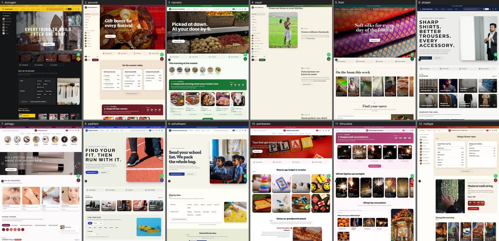
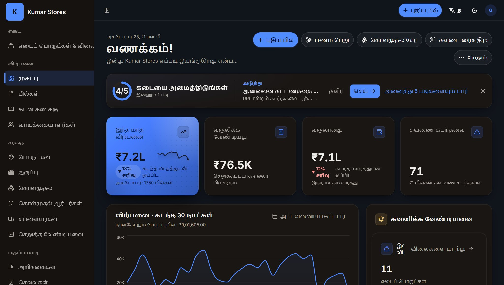
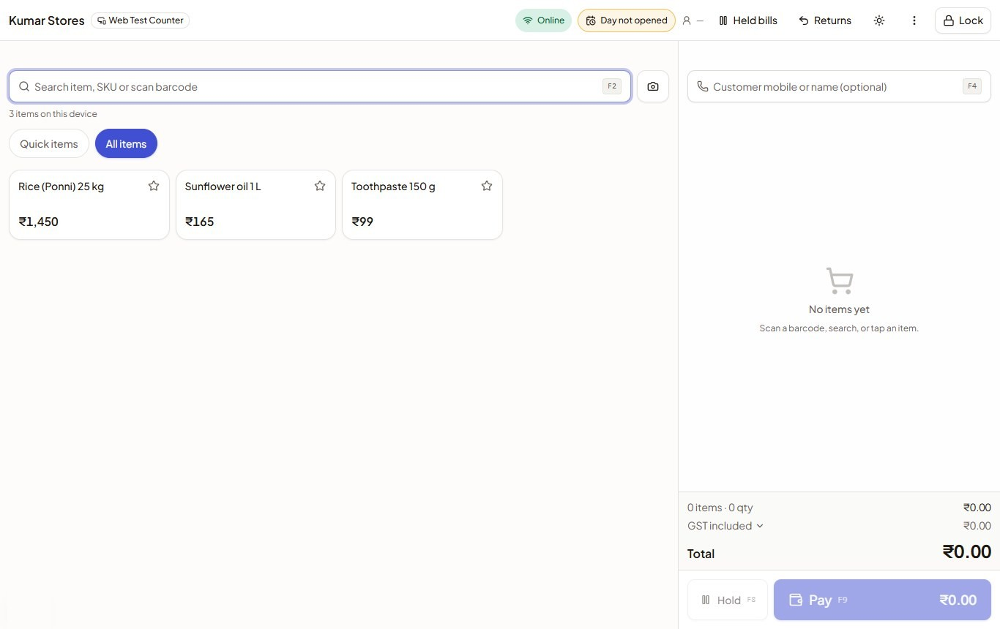
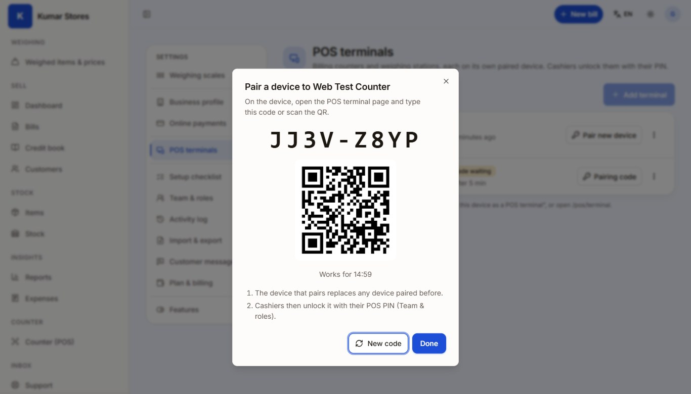
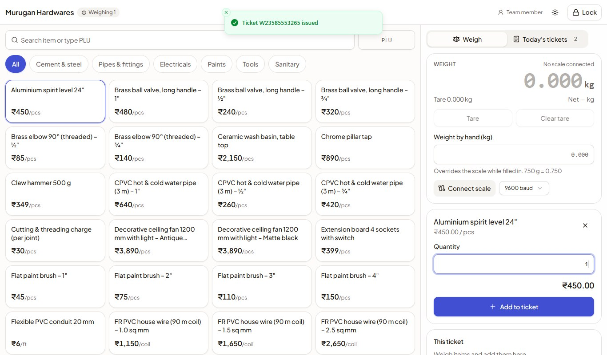
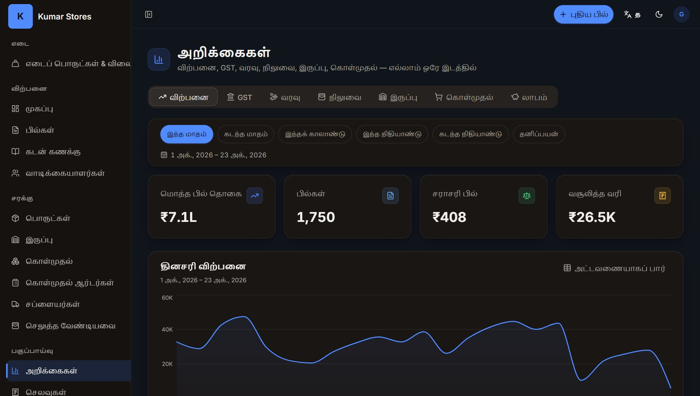
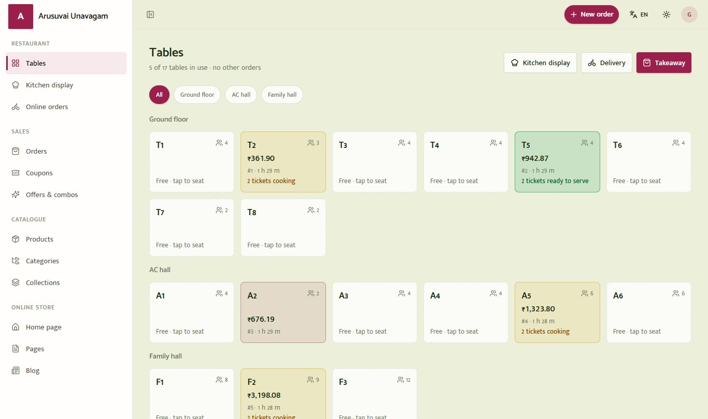
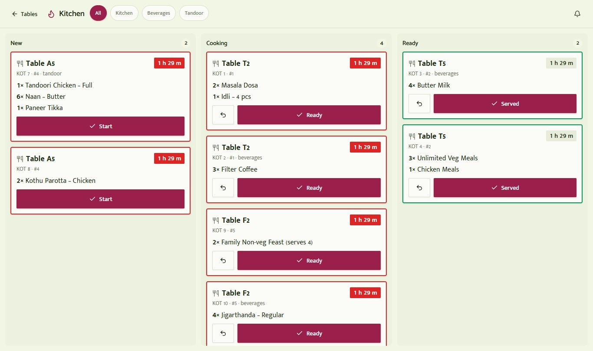
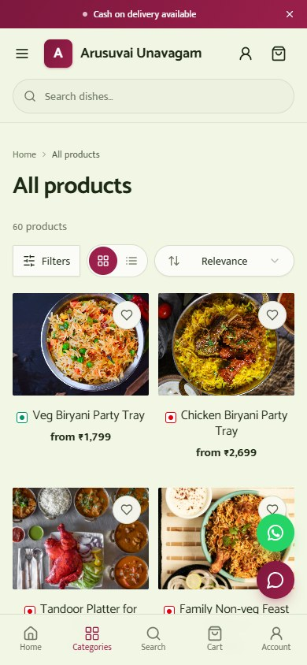

# ஒரு பார்வையில்

**சில்லறை மற்றும் வணிக மேலாண்மைத் தொகுப்பு (RBMS)** என்பது கடை நடத்துவதற்கான ஒரே இணைந்த அமைப்பு. கவுண்டரில் GST பில் போடலாம், இருப்பைக் கண்காணிக்கலாம், யார் உங்களுக்குப் பணம் தர வேண்டும் என்று பார்க்கலாம், சொந்த ஆன்லைன் கடையில் விற்கலாம், வியாபாரம் எப்படிப் போகிறது என்பதை உங்கள் போனிலேயே பார்க்கலாம். எல்லாப் பகுதிகளும் ஒரே தகவலைப் பகிர்ந்துகொள்வதால், ஒவ்வொன்றையும் ஒரே முறை பதிவு செய்தால் போதும்.

::: callout
**ஒரே வரியில்:** ஒரே கணக்கு, ஒரே இருப்புப் பட்டியல், ஒரே வாடிக்கையாளர் பட்டியல் — விற்க பல வழிகள்: கவுண்டரில், எடைத் தராசில், மேசையில் உள்ள QR குறியீட்டில், WhatsApp-இல், அல்லது உங்கள் சொந்த ஆன்லைன் கடையில்.
:::

## உங்களுக்குக் கிடைப்பவை

| உங்கள் கடைக்கு | என்ன செய்கிறது |
|---|---|
| **பில்லிங் செயலி (Billing app)** | GST பில்கள், இன்வாய்ஸ்கள், கடன் கணக்கு, இருப்பு, கொள்முதல், செலவுகள், அறிக்கைகள். எந்தக் கணினி அல்லது போன் பிரவுசரிலும் இயங்கும். |
| **POS முனையம் (POS terminal)** | பார்கோடு மற்றும் கேமரா ஸ்கேனிங், நிறுத்திவைத்த பில்கள், திருப்பங்கள், கல்லா அமர்வுகள், ஒவ்வொரு காசாளருக்கும் PIN திறப்பு ஆகியவற்றுடன் கூடிய வேகமான கவுண்டர் திரை. |
| **எடை நிலையம் (Weighing station)** | பிரித்து விற்கும் பொருட்களை எடை போட்டு, பார்கோடு உள்ள சீட்டை அச்சிடலாம்; காசாளர் அதை ஸ்கேன் செய்தால் போதும். மறுபடி டைப் செய்யவும் வேண்டாம், விலைத் தவறும் வராது. |
| **ஆன்லைன் கடை (Online Store)** | தமிழிலும் ஆங்கிலத்திலும் உங்கள் சொந்த இணையதளம். வாடிக்கையாளர் போனில் செயலி போல நிறுவிக்கொள்ளலாம்; டெலிவரி, கூப்பன், ஆன்லைன் பணம் செலுத்துதல் உண்டு. |
| **வணிக மொபைல் செயலி (Business mobile app)** | பில் போடுதல், இருப்பு, ஆர்டர்கள், வாடிக்கையாளர்கள், கடன் கணக்கு எல்லாவற்றையும் போனிலிருந்தே பார்க்கலாம் (முதலில் Android). |
| **மருந்தகம், உணவகம், சேவைகள் செயலிகள் (Pharmacy, Restaurant, Services apps)** | அதே அமைப்பு; கூடுதலாக மருந்து பேட்ச்கள், சமையலறை மற்றும் மேசைகள், அல்லது அப்பாயின்ட்மென்ட் மற்றும் வேலை அட்டைகளுக்கான கருவிகள். |
| **நிர்வாகக் கன்சோல் (Admin console)** | RBMS குழுவுக்கும் பார்ட்னர்களுக்கும்: செயலிகள், திட்டங்கள், கடைகளை அமைக்க. |

## கடை உரிமையாளர்கள் இதை ஏன் தேர்ந்தெடுக்கிறார்கள்

- **உங்கள் தொழிலுக்கு ஏற்றது.** கிராணா முதல் ஜவுளி, மருந்தகம், நகை, சலூன் வரை 29 தயார்நிலைத் தொழில் அமைப்புகள். பொருத்தமான வகைகள், சொற்கள், முகப்புப் பக்கம் ஆகியவை ஏற்கனவே தயாராக இருக்கும்.
- **GST-க்குத் தயார்.** HSN குறியீடுகளுடன் GST பில்கள், தாக்கல் செய்வதற்கான வரிச் சுருக்கங்கள், துணி மற்றும் காலணிகளுக்கான புதிய விலை அடிப்படையிலான GST விதி.
- **தமிழும் ஆங்கிலமும்.** உங்கள் கடையும், அமைப்பின் பெரும்பகுதியும் இரண்டு மொழிகளிலும் இயங்கும்.

# யாருக்கானது {pb}

RBMS, தமிழ்நாட்டு வணிகங்கள் உண்மையில் எப்படி வியாபாரம் செய்கின்றன என்பதை அடிப்படையாகக் கொண்டு வடிவமைக்கப்பட்டது. பதிவு செய்யும்போது உங்கள் தொழிலைத் தேர்ந்தெடுத்தால் போதும்; ஆரம்ப வகைகள், ஆன்லைன் கடையின் தோற்றம், தேவையான கருவிகள், தமிழ்-ஆங்கில முகப்புப் பக்கம் எல்லாவற்றையும் RBMS தயார் செய்துவிடும். இவை எல்லாவற்றையும் பிறகு மாற்றிக்கொள்ளலாம்.

## 29 தொழில்கள்

**உணவு மற்றும் அன்றாடத் தேவைகள்**

- மளிகை மற்றும் சூப்பர் மார்க்கெட் (கிராணா)
- பேக்கரி மற்றும் இனிப்பகம்
- பழம், காய்கறி, இறைச்சி மற்றும் மீன்
- இயற்கை உணவு மற்றும் சிறுதானியக் கடை
- உணவகம் மற்றும் கஃபே
- கிளவுட் கிச்சன்
- டீக்கடை மற்றும் ஜூஸ் பார்

**ஆடை, வீடு மற்றும் பரிசுப் பொருட்கள்**

- ஆடையகம் மற்றும் பொட்டிக் (ஜவுளி உட்பட)
- காலணிக் கடை
- நகைக்கடை
- அழகு சாதனங்கள்
- வீட்டு அலங்காரம் மற்றும் பரிசுப் பொருட்கள்
- மரச்சாமான் கடை
- பூக்கடை மற்றும் பூஜைப் பொருட்கள் கடை
- பட்டாசுக் கடை

**உடல்நலம் மற்றும் தனிப்பட்ட பராமரிப்பு**

- மருந்தகம்
- கண்ணாடிக் கடை
- சலூன்
- ஸ்பா மற்றும் நலவாழ்வு மையம்
- ஜிம் மற்றும் உடற்பயிற்சி மையம்

**கருவிகள், தொழில்நுட்பம் மற்றும் அன்றாட சில்லறை வணிகம்**

- ஹார்டுவேர் மற்றும் கட்டுமானப் பொருட்கள்
- எலக்ட்ரானிக்ஸ் மற்றும் மொபைல்கள்
- மொபைல் துணைப்பொருட்கள்
- மொபைல் மற்றும் எலக்ட்ரானிக்ஸ் பழுதுபார்ப்பு
- எழுதுபொருள் மற்றும் புத்தகங்கள்
- பொம்மைகள் மற்றும் விளையாட்டுப் பொருட்கள்
- விளையாட்டுப் பொருட்கள் கடை
- செல்லப்பிராணிக் கடை
- தையல் கடை

::: callout
**உங்கள் தொழில் பட்டியலில் இல்லையா?** பொதுவான அமைப்பு உள்ளது. நீங்கள் சொல்லும் தொழிலை RBMS பதிவு செய்துகொள்ளும்; அடுத்து எதை உருவாக்க வேண்டும் என்பதை நாங்கள் அறிந்துகொள்ள அது உதவும்.
:::

# செயலிகள் ஒன்றோடொன்று எப்படி இணைகின்றன {pb}

RBMS என்பது ஒரே கடைக் கணக்கைப் பகிர்ந்துகொள்ளும் செயலிகளின் குடும்பம். உங்கள் தொழில் மற்றும் திட்டத்தைப் பொறுத்து உங்களுக்குத் தெரியும் பகுதிகள் மாறும்.

<b>ஆன்லைன் கடை</b>வாடிக்கையாளர் போனிலிருந்தே ஆர்டர் செய்வார்

<b>POS முனையம்</b>கவுண்டர் பில், ஸ்கேனர், PIN திறப்பு

<b>எடை நிலையம்</b>பார்கோடு உள்ள எடைச் சீட்டு

<b>வணிக மொபைல் செயலி</b>உரிமையாளரும் ஊழியரும் போனில்

&#9660; &nbsp; &#9660; &nbsp; &#9660; &nbsp; &#9660;

<b>உங்கள் கடைக் கணக்கு</b>ஒரே பொருள் மற்றும் இருப்புப் பட்டியல் &middot; ஒரே வாடிக்கையாளர் பட்டியல் &middot; ஒரே பில், பணம், அறிக்கைத் தொகுப்பு &middot; பொறுப்புகளுடன் ஒரே குழு

&#9650; &nbsp; &#9650; &nbsp; &#9650; &nbsp; &#9650;

<b>பில்லிங் செயலி</b>பில்கள், கடன் கணக்கு, இருப்பு, கொள்முதல், அறிக்கைகள்

<b>மருந்தகச் செயலி</b>பேட்ச்கள், காலாவதி, H1 பதிவேடு

<b>உணவகச் செயலி</b>மேசைகள், KOT, சமையலறைத் திரை

<b>சேவைகள் செயலி</b>அப்பாயின்ட்மென்ட், வேலை அட்டைகள், உறுப்பினர் திட்டங்கள்

**பில்லிங் செயலி** இந்த அமைப்பின் இதயம். **மருந்தகம்**, **உணவகம்**, **சேவைகள்** செயலிகள் அதே அமைப்புதான்; அந்தத் தொழில்களுக்கான கூடுதல் திரைகள் மட்டும் இருக்கும். **ஆன்லைன் கடை** என்பது ஒவ்வொரு கடையின் பொது இணையதளம். **POS முனையம்** மற்றும் **எடை நிலையம்** ஆகியவை கணினி, டேப்லெட் அல்லது போனுடன் இணைத்துப் பயன்படுத்தும் கவுண்டர் திரைகள். **நிர்வாகக் கன்சோலை** RBMS குழுவே பயன்படுத்தும்; கடை உரிமையாளர்கள் அல்ல.

எல்லாமே ஒரே கணக்கில் இருப்பதால், ஆன்லைன் கடையில் ஒரு பொருள் விற்றால் கவுண்டர் பயன்படுத்தும் அதே இருப்பிலிருந்து அது குறையும். ஆன்லைனில் வாங்கிய வாடிக்கையாளர் உங்கள் வாடிக்கையாளர் பட்டியலிலும் கடன் கணக்கிலும் தானாகத் தெரிவார்.

# GST பில்லிங் மற்றும் இன்வாய்ஸ்கள்

பில்லிங் செயலியில் சில தொடுதல்களிலேயே சரியான GST பில் தயாராகிவிடும்.

- **GST பில்கள்:** உங்கள் கடை விவரம், GSTIN, HSN குறியீடுகள், வரிப் பிரிப்பு (CGST, SGST அல்லது IGST) ஆகியவற்றுடன். GST என்பது சரக்கு மற்றும் சேவை வரி; HSN என்பது வரி விகிதத்தைத் தீர்மானிக்கும் பொருள் குறியீடு.
- **எல்லா நிலைகளுக்கும் பில்:** வரைவு, வழங்கப்பட்டது, பகுதி செலுத்தப்பட்டது, செலுத்தப்பட்டது, தவணை கடந்தது, ரத்து செய்யப்பட்டது. பொருள் திருப்பத்திற்குக் கிரெடிட் நோட் உண்டு.
- **WhatsApp அல்லது SMS-இல் பகிரலாம்.** வாடிக்கையாளருக்குத் தெளிவான பில்லுக்கான இணைப்பு போய்ச் சேரும்; பணம் செலுத்தாத பில்களுக்குத் தானியங்கி நினைவூட்டல்களையும் இயக்கலாம்.
- **அச்சிடலாம் அல்லது PDF-ஆகப் பதிவிறக்கலாம்.**
- **இ-இன்வாய்ஸ் மற்றும் இ-வே பில்:** தேவைப்படும் வணிகங்களுக்கு, உயர் திட்டங்களில், உங்கள் GST கணக்கை இணைத்த பிறகு.

::: callout
**துணி மற்றும் காலணிகள்: விலை அடிப்படையிலான GST.** 2025 செப்டம்பர் முதல், ஆடைகள் மற்றும் காலணிகளுக்கு ஒரு பீஸ் ₹2,500 வரை 5%, அதற்கு மேல் 18% வரி. பில்லில் உள்ள தள்ளுபடியைக் கழித்த பிறகு, ஒவ்வொரு பீஸுக்கும் இந்த விதியை RBMS தானாகவே பயன்படுத்தும். வரி உட்பட (MRP) விலை வைக்கும்போது, ₹2,625 முதல் ₹2,950 வரையிலான விலை எந்த ஒரு வரி விகிதத்திலும் பொருந்தாத இடைப்பட்ட பகுதி என்பதால், அந்த விலை வந்தால் எச்சரிக்கும்; அப்போது விலையை மாற்றிக்கொள்ளலாம்.
:::

# கவுண்டர் (POS முனையம்)

POS முனையம் என்பது கூட்டமான கவுண்டருக்கான வேகமான திரை. கணினி அல்லது டேப்லெட்டில் பிரவுசரில் இயங்கும்; போனையும் இணைத்துக்கொள்ளலாம்.

## வேகமாக விற்க

- **ஸ்கேன் செய்யலாம் அல்லது தேடலாம்.** ஸ்கேனரால் பார்கோடை ஸ்கேன் செய்யலாம், போன் அல்லது லேப்டாப் கேமராவைப் பயன்படுத்தலாம், அல்லது பெயர்/குறியீட்டை டைப் செய்யலாம்.
- **அடிக்கடி விற்கும் பொருட்களுக்கு விரைவுப் பொத்தான்கள் மற்றும் பிடித்தவை.**
- **பில்களை நிறுத்தி வைத்து மீண்டும் தொடரலாம்** — வாடிக்கையாளர் பர்ஸைத் தேடும்போது அடுத்தவருக்கு பில் போடலாம்.
- **பொருள் திருப்பம் மற்றும் கிரெடிட் நோட்** கவுண்டரிலேயே.
- **புதிய பொருளை அங்கேயே சேர்க்கலாம்.** ஸ்கேன் செய்த குறியீடு உங்கள் பட்டியலில் இல்லாவிட்டால் உடனே சேர்க்கலாம்; குறியீடு இல்லாத பொருட்களையும் விற்கலாம்.
- **போன் எண் மூலம் வாடிக்கையாளர்:** கடனில் பில் போட, லாயல்டி புள்ளிகள் கொடுக்க, அல்லது WhatsApp-இல் பில் அனுப்ப.
- **விசைப்பலகை ஷார்ட்கட்கள்:** தேடல், வாடிக்கையாளர், நிறுத்தி வைத்தல், பணம் பெறுதல் ஆகியவற்றுக்கு.

## ஒன்றுக்கு மேற்பட்ட கவுண்டர், ஊழியர் PIN உடன்

ஒவ்வொரு கவுண்டரும் ஒரு **முனையம் (terminal)**; அதற்கு "கவுண்டர் 1" அல்லது "எடை 1" போல தனிப் பெயர் இருக்கும்.

1. உரிமையாளர் ஒரு முனையத்தைச் சேர்த்தால், 8 எழுத்துள்ள **இணைப்புக் குறியீடும்** ஒரு QR குறியீடும் கிடைக்கும். அது 15 நிமிடங்கள் வேலை செய்யும்.
2. கவுண்டரில் உள்ள சாதனத்தில் அந்தக் குறியீட்டை டைப் செய்யலாம் அல்லது QR-ஐ ஸ்கேன் செய்யலாம். அந்தச் சாதனம் அப்போதிலிருந்து அந்த முனையமாகிவிடும்.
3. ஒவ்வொரு காசாளருக்கும் **4 முதல் 6 இலக்க PIN** உண்டு. போன் OTP தேவையில்லாமல், PIN-ஐ உள்ளிட்டே கவுண்டரைத் திறக்கலாம்.
4. புதிய சாதனத்தை இணைத்தால் பழையது நீங்கிவிடும்; தொலைந்த சாதனத்தை உரிமையாளர் உடனே துண்டித்துவிடலாம்.

பாதுகாப்பு உள்ளமைந்தது: 1234 அல்லது 0000 போன்ற எளிதில் ஊகிக்கக்கூடிய PIN-கள் ஏற்கப்படாது; இரண்டு ஊழியர்கள் ஒரே PIN-ஐ வைத்திருக்க முடியாது; ஐந்து முறை தவறான PIN அடித்தால் கவுண்டர் ஐந்து நிமிடம் பூட்டிக்கொள்ளும். சில நிமிடம் பயன்படுத்தாமல் இருந்தாலும் கவுண்டர் தானாகப் பூட்டிக்கொள்ளும்.

முனையங்களின் எண்ணிக்கை உங்கள் திட்டத்தைப் பொறுத்தது. திட்டங்கள் பகுதியைப் பாருங்கள்.

## கல்லா அமர்வுகள்

ஒவ்வொரு முனையத்துக்கும் தனி **கல்லா அமர்வு (till session)** உண்டு. காலையில் கையிருப்புப் பணத்துடன் நாளைத் தொடங்குங்கள்; பகலில் ரொக்கமும் UPI-யும் வாங்குங்கள்; மாலையில் பணத்தை எண்ணி மூடுங்கள். கல்லாவில் எவ்வளவு இருக்க வேண்டும் என்பதை RBMS காட்டும்; அதனால் ஏதேனும் வித்தியாசம் இருந்தால் அன்றைக்கே தெரிந்துவிடும்.

## இணையம் மெதுவாக இருந்தாலும் சமாளிக்கும்

கவுண்டர், உங்கள் பொருட்பட்டியலின் ஒரு நகலைச் சாதனத்திலேயே வைத்திருக்கும்; அதனால் தேடலும் ஸ்கேனிங்கும் வேகமாகவே இருக்கும். விலைகள் அல்லது பொருட்கள் மாறினால், மாற்றங்கள் மட்டுமே எடுத்துக்கொள்ளப்படும்.

::: callout
**தெரிந்துகொள்ளுங்கள்:** பொருட்பட்டியல் சாதனத்தில் சேமிக்கப்படும்; ஆனால் பில் போடுவதற்கு இணைய இணைப்பு தேவை. இணையம் இல்லாமல் பில் போடும் வசதி இன்னும் RBMS-இல் இல்லை.
:::

# எடை நிலையம் (Weighing station)

எடை போட்டு விற்கும் கடைகளுக்கு (மளிகை, இனிப்பகம், இயற்கை உணவு, காய்கறி, பூக்கடை), **எடை நிலையம்** தராசு அருகே நிற்கும் வரிசையை இல்லாமல் செய்யும்.

1. உதவியாளர் பொருளைத் தராசில் வைக்கிறார். எடையை இணைக்கப்பட்ட USB தராசிலிருந்து எடுக்கலாம் அல்லது கையால் டைப் செய்யலாம்.
2. பொருளைத் தேர்ந்தெடுக்கிறார்; தேவைப்பட்டால் பாத்திரத்தின் எடையை (tare) கழிக்கிறார்.
3. உங்கள் ஒரு கிலோ விலையிலிருந்து RBMS தொகையைக் கணக்கிட்டு, பார்கோடுடன் கூடிய **எடைச் சீட்டை** அச்சிடும்.
4. கவுண்டரில் காசாளர் அந்தச் சீட்டை ஸ்கேன் செய்தால், எல்லா வரிகளும் உங்கள் விலையில் பில்லில் வந்துவிடும்.

ஒரு சீட்டை ஒருமுறை மட்டுமே பயன்படுத்த முடியும்; நாள் முடிந்ததும் அது காலாவதியாகிவிடும். திரையில் தெரியும் விலையை நிலையம் ஒருபோதும் எடுத்துக்கொள்ளாது, உங்கள் விலைப்பட்டியலிலிருந்து மட்டுமே எடுக்கும்; அதனால் தவறு நடக்க வாய்ப்பே இல்லை. கடை தராசுகள் அச்சிடும் லேபிள்களையும் கவுண்டரில் ஸ்கேன் செய்யலாம்; அவை எடையுள்ள வரியாக மாறிவிடும்.

# பணம் செலுத்துதல் மற்றும் கடன் கணக்கு

- **ரொக்கம், UPI, கார்டு, வங்கிப் பரிமாற்றம்** ஒவ்வொரு பில்லுக்கும் எதிராகப் பதிவாகும். பகுதியாகப் பணம் வாங்கவும் முடியும்.
- **ஆன்லைன் பணம் செலுத்துதல்** (Razorpay வழியாக): ஆன்லைன் கடைக்கும் பணம் செலுத்தும் இணைப்புகளுக்கும்.
- **கடன் கணக்கு:** பல கடைகளில் கடனில் விற்பனை நடக்கும். கடன் கணக்கு ஒவ்வொரு வாடிக்கையாளருக்கும் தனி நடப்புக் கணக்கு வைக்கும்; பணம் வரவு வைக்கலாம், கடன் வரம்பு வைக்கலாம், கணக்கு அறிக்கையின் இணைப்பை அனுப்பலாம், WhatsApp-இல் நினைவூட்டலும் அனுப்பலாம்.
- **நிலுவை ஒரே பார்வையில்:** வசூலிக்க வேண்டிய தொகையும் தவணை கடந்த தொகையும் முகப்புத் திரையிலேயே தெரியும்.

# இருப்பு மற்றும் கொள்முதல்

- **ஒவ்வொரு பொருளுக்கும் இருப்புக் கண்காணிப்பு,** குறைந்த இருப்புப் பட்டியல் மற்றும் மறு ஆர்டர் அளவுகளுடன்.
- **இருப்பு நகர்வுகள்** வரலாறாகப் பதிவாகும்: விற்பனை, கொள்முதல், திருத்தங்கள், திருப்பங்கள்.
- **பல கிளைகள் அல்லது இடங்கள்,** உங்கள் திட்டத்தில் இருந்தால், ஒவ்வொன்றுக்கும் தனி இருப்புடன்.
- **கொள்முதலும் சப்ளையர்களும்:** சப்ளையர் பில்களை உள்ளீட்டு வரிக் கடனுடன் (input tax credit) பதிவு செய்யலாம், கொள்முதல் ஆர்டர்கள் அனுப்பலாம், சரக்கைப் பகுதி பகுதியாகப் பெறலாம், டெபிட் நோட் மூலம் திருப்பி அனுப்பலாம்.
- **சப்ளையர் பணம்:** ஒரு பில்லில் ஒரு பகுதியைச் செலுத்தலாம், சப்ளையருக்கு ஒரே தடவையில் செலுத்தலாம், நீங்கள் எவ்வளவு கொடுக்க வேண்டும் என்பதைப் பழைய நிலுவை வாரியாகப் பார்க்கலாம்.
- **இறக்குமதி மற்றும் ஏற்றுமதி:** பொருட்களையும் வாடிக்கையாளர்களையும் Excel அல்லது CSV கோப்புகளிலிருந்து கொண்டுவரலாம்.

::: callout
**வேறு மென்பொருளிலிருந்து மாறுகிறீர்களா?** பொருள் மற்றும் வாடிக்கையாளர் பட்டியல்களை இன்றே ஸ்ப்ரெட்ஷீட்களிலிருந்து இறக்குமதி செய்யலாம். Tally அல்லது Vyapar-இலிருந்து நேரடி இறக்குமதி இன்னும் இல்லை.
:::

# வாடிக்கையாளர்களும் லாயல்டியும்

- பில்கள், கவுண்டர் விற்பனை, ஆன்லைன் ஆர்டர்களிலிருந்து தானாக உருவாகும் **வாடிக்கையாளர் பட்டியல்.**
- கவுண்டர் மற்றும் ஆன்லைன் வாங்குதலில் சேரும் **லாயல்டி புள்ளிகள்,** சில்வர், கோல்டு போன்ற நிலைகளுடன். வாடிக்கையாளர்கள் அடுத்த பில்லில் புள்ளிகளைப் பயன்படுத்தலாம்.
- சம்மதம் தந்த வாடிக்கையாளர்களுக்கு **WhatsApp பிரசாரங்கள்:** எல்லோருக்கும், நிலுவை உள்ளவர்களுக்கு, அல்லது சமீபத்தில் ஆர்டர் செய்தவர்களுக்கு மட்டும் அனுப்பலாம்.
- ஆன்லைன் கடையில் **மதிப்புரைகளும் அரட்டையும்,** உங்கள் குழுவுக்கு ஒரு உதவி இன்பாக்ஸும்.

# அறிக்கைகளும் GST சுருக்கங்களும்

அறிக்கைகள் பகுதி, உரிமையாளர்கள் ஒவ்வொரு நாளும் கேட்கும் கேள்விகளுக்குப் பதில் சொல்லும்.

- **விற்பனை:** நாள் வாரியாக, பொருள் வாரியாக, வாடிக்கையாளர் வாரியாக, பணம் செலுத்தும் முறை வாரியாக.
- **GST:** வரி விகித வாரியான மற்றும் HSN வாரியான சுருக்கங்கள், உங்கள் கணக்காளருக்குத் தேவையான GSTR-1 மற்றும் GSTR-3B வெளிப்புற விற்பனை எண்கள்.
- **பணவரவு, நிலுவை, இருப்பு, கொள்முதல்** அறிக்கைகள்.
- **லாபம்:** செலவுகளையும் சேர்த்துக் காட்டும் பார்வை.
- **செலவுகள்:** வாடகை, சம்பளம், மின்கட்டணம் போன்ற கடைச் செலவுகளைப் பதிவு செய்யலாம்.
- **விருப்பமான காலம்:** இந்த மாதம், கடந்த மாதம், காலாண்டு, நிதியாண்டு, அல்லது நீங்களே தேர்ந்தெடுக்கும் தேதிகள்.
- **பதிவிறக்கம்:** அறிக்கைகளை CSV அல்லது Excel கோப்பாகப் பதிவிறக்கலாம்; அல்லது குறிப்பிட்ட நேரங்களில் மின்னஞ்சலில் பெறலாம்.

# குழு, பொறுப்புகள் மற்றும் அனுமதிகள்

யார் என்ன செய்யலாம் என்பதை நீங்களே முடிவு செய்யலாம்.

- போன் எண் அல்லது மின்னஞ்சல் மூலம் **ஊழியர்களை அழைக்கலாம்.**
- மேலாளர், காசாளர், இருப்புப் பொறுப்பாளர் போன்ற **தயார்நிலைப் பொறுப்புகள்;** அல்லது உங்கள் சொந்தப் பொறுப்புகளை உருவாக்கலாம்.
- **நுணுக்கமான அனுமதிகள்:** எடுத்துக்காட்டாக, காசாளர் பில் போடலாம் ஆனால் தள்ளுபடி கொடுக்க முடியாது; இருப்புப் பொறுப்பாளர் இருப்பைத் திருத்தலாம் ஆனால் அறிக்கைகளைப் பார்க்க முடியாது.
- **செயல்பாட்டுப் பதிவு:** யார், எப்போது, என்ன செய்தார்கள் என்பதைக் காட்டும்.
- **POS PIN:** உரிமையாளரின் உள்நுழைவைப் பகிராமலேயே ஊழியர்கள் கவுண்டரை விரைவாகத் திறக்க உதவும்.

# ஆன்லைன் கடை (Online Store)

ஒவ்வொரு கடையும் தன் பெயர், லோகோ, வண்ணங்களுடன் தமிழிலும் ஆங்கிலத்திலும் தனக்கே உரிய ஆன்லைன் கடையை வைத்துக்கொள்ளலாம். வாடிக்கையாளர்கள் பார்த்து, கூடையில் சேர்த்து, பணம் செலுத்துவார்கள்; ஆர்டர்கள் உங்கள் கவுண்டர் பில்கள் வரும் அதே இடத்திலேயே வந்து சேரும்.

## உங்களுக்கே உரிய தோற்றம்

- **தீம்களும் தொழில் தோற்றங்களும்.** பத்து தயார்நிலை தீம்களும், ஒவ்வொரு தொழிலுக்கும் தனித் தோற்றமும் உண்டு. நேரடி முன்னோட்டத்துடன் வண்ணங்கள், எழுத்துருக்கள், பொத்தான் வடிவம், ஹெட்டர் பாணி, கார்டு பாணி என நிறைய மாற்றலாம்.
- **பக்க அமைப்புகள்.** வழக்கமான ஹெட்டர், பெரிய பட்டியலுக்கான வகைப் பக்கப்பட்டை, பொட்டிக்குகளுக்கான இடதுபுற மெனு, ஆடை மற்றும் நகைக்கான இதழ் பாணி அமைப்பு என்று தேர்ந்தெடுக்கலாம். போன்களில் செயலி போன்ற கீழ்ப்பட்டித் தாவல்களையும் இயக்கலாம்.
- **முகப்புப் பக்கப் பகுதிகள்.** தயார் பிளாக்குகளைக் கொண்டு முகப்புப் பக்கத்தை அமைக்கலாம்: பேனர்கள், ஸ்லைடர்கள், வகைகள், அதிகம் விற்பவை, நேரக் கணக்குடன் "இன்றைய சலுகை", ஃபிளாஷ் சேல், தங்க விலைப் பலகை, மெனு பலகை, வாடிக்கையாளர் கருத்துகள், புகைப்படத் தொகுப்பு, அடிக்கடி கேட்கப்படும் கேள்விகள், வரைபடம் மற்றும் முகவரி, செய்திமடல் மற்றும் பல. சில தொழில்களுக்குச் சிறப்புப் பிளாக்குகளும் உண்டு: காலணிக்கு "உங்கள் சைஸைக் கண்டுபிடியுங்கள்", அழகு சாதனங்களுக்கு "நிறம் வாரியாக வாங்குங்கள்", எழுதுபொருளுக்கு "வகுப்பு வாரியாக வாங்குங்கள்".
- **தமிழும் ஆங்கிலமும்,** வாடிக்கையாளர் மொழியை மாற்றிக்கொள்ளும் வசதியுடன்.

## விற்பனையும் டெலிவரியும்

- **டெலிவரி மண்டலங்களும் கட்டணமும்,** நீங்கள் வைக்கும் தொகைக்கு மேல் இலவச டெலிவரி, விருப்பக் கட்டணத்துடன் கேஷ் ஆன் டெலிவரி, நேரில் வந்து எடுத்துக்கொள்ளும் வசதி உட்பட.
- **கூப்பன்களும் சலுகைகளும்,** முதல் ஆர்டர் தள்ளுபடி உட்பட.
- UPI மற்றும் கார்டு மூலம் **ஆன்லைன் பணம் செலுத்துதல்.** ஒவ்வொரு கடையும் தன் சொந்த Razorpay கணக்கை இணைக்கும்; பணம் நேராக உரிமையாளருக்கே போகும்.
- ஒவ்வொரு ஆன்லைன் கடையிலும் **Google அல்லது போன் OTP மூலம் உள்நுழைவு.** வாங்குபவர்கள் ஒரு பாதுகாப்பான மைய உள்நுழைவுப் பக்கம் வழியாக உள்நுழைந்து, கூடை அப்படியே இருக்கக் கடைக்குத் திரும்புவார்கள்.
- **ஆர்டர்கள்:** புதியது முதல் டெலிவரி ஆனது வரை தெளிவான நிலைகள்; தேவைப்பட்டால் பணத் திருப்பம்.
- வாங்குபவர்களுக்கு **தேடல், வடிகட்டிகள், மதிப்புரைகள், விருப்பப் பட்டியல்.**
- **சொந்த இணைய முகவரி.** RBMS முகவரியைப் பயன்படுத்தலாம்; அந்த வசதி உள்ள திட்டங்களில் உங்கள் சொந்த டொமைனையும் இணைக்கலாம்.
- சலூன், ஸ்பா, பழுதுபார்ப்புக் கடைகளுக்கு **சேவைகளையும் முன்பதிவு செய்யக்கூடிய பொருட்களாக** வைக்கலாம்.

## செயலி போல நிறுவலாம்

**PWA** (progressive web app) என்பது போனின் முகப்புத் திரையில் சேர்த்து, செயலி போலவே திறக்கக்கூடிய இணையதளம். ஒவ்வொரு கடையும் தன் பெயர், ஐகான், வண்ணங்களுடன் நிறுவப்படும். Android-இல் வாங்குபவருக்கு "செயலியை நிறுவு" என்ற அறிவிப்பு வரும். iPhone-இல் "Share, பிறகு Add to Home Screen" என்று ஒரு சிறிய அட்டை வழிகாட்டும். மறுமுறை வரும்போது பொருள் படங்களும் கடைப் பக்கங்களும் வேகமாகத் திறக்கும்; போனில் சிக்னல் இல்லாவிட்டால் ஒரு நட்பான இணையமற்ற பக்கம் தெரியும். நீங்கள் விரும்பினால் நிறுவல் அறிவிப்பை அணைத்துவிடலாம்.

# தொழில் சார்ந்த கருவிகள்

பொதுவான அமைப்பு எல்லோருக்கும் ஒன்றுதான். பிறகு ஒவ்வொரு தொழிலுக்கும் தேவையான கூடுதல் கருவிகள் கிடைக்கும்.

## மருந்தகம்

- **மருந்து விவரங்கள்:** உப்பு (composition), தயாரிப்பாளர், அட்டவணை (OTC, G, H, H1, X), பேக் அளவு, அடுக்கு (rack).
- **பேட்ச்களும் காலாவதியும்:** காலாவதித் தேதி, MRP, கொள்முதல் விலையுடன் பேட்ச் வாரியாக இருப்பைப் பெறலாம். பில் போடும்போது முதலில் காலாவதியாகும் பேட்ச் முதலில் விற்கப்படும். காலாவதியான சரக்கு ஒருபோதும் விற்கப்படாது.
- **மாற்று மருந்துகள்:** அதே உப்புள்ள மருந்துகளைக் கண்டுபிடிக்கலாம்.
- **மருந்துச் சீட்டுகளும் H1 அட்டவணைப் பதிவேடும்:** ஒவ்வொரு H1 விற்பனைக்கும் நோயாளி, மருத்துவர், பேட்ச் விவரங்களுடன். மருந்துச் சீட்டு இன்னும் இல்லாத விற்பனைகளின் பட்டியலும் உண்டு.
- காலாவதியான அல்லது விரைவில் காலாவதியாகும் சரக்குக்கு முகப்புத் திரையில் **காலாவதிக் கண்காணிப்பு.**

## உணவகம் மற்றும் கிளவுட் கிச்சன்

- **தளத் திட்டம்:** பகுதிகளும் மேசைகளும்; ஒவ்வொரு மேசைக்கும் நடப்பில் உள்ள ஆர்டர்கள்.
- **KOT (சமையலறை ஆர்டர் சீட்டுகள்)** சமையலறை அல்லது பானங்கள் போன்ற சரியான இடத்துக்கு அனுப்பப்படும்.
- **சமையலறைத் திரை:** சமையல்காரர்களுக்கான திரை; புதியது, சமைக்கப்படுகிறது, தயார் என மூன்று பத்திகள், ஒவ்வொரு சீட்டிலும் டைமர்.
- **QR மேசை ஆர்டர்:** ஒவ்வொரு மேசையிலும் உள்ள QR குறியீடு, விருந்தினரின் போனில் மெனுவைத் திறக்கும். ஆர்டர் நேராகச் சமையலறைக்குப் போகும்; எப்போதும் உங்கள் மெனு விலையிலேயே.
- **பில் பிரித்தல், மேசை மாற்றுதல், இணைத்தல்,** காரணத்துடன் ரத்து செய்தல்.
- உங்கள் ஆன்லைன் கடையின் **ஆன்லைன் ஆர்டர்களும்** சமையலறையில் தெரியும்.
- உணவகங்களுக்கான 5% GST பில்லில் தானாகச் சேரும்.
- உணவகங்கள், கிளவுட் கிச்சன்கள், டீக்கடைகளுக்கு **ஆன்லைன் உணவு ஆர்டர்** (கீழே பார்க்க).

### ஆன்லைன் உணவு ஆர்டர்

உணவகங்கள், கிளவுட் கிச்சன்கள், டீக்கடைகள் தங்கள் ஆன்லைன் கடையில் உணவு ஆர்டர்களை எடுக்கலாம்.

- **அரை (Half), முழு (Full) அளவுகள்** போன்றவற்றை ஒரே தொடுதலில் கூடையில் சேர்க்கலாம்.
- ஒவ்வொரு உணவிலும் **சைவம், முட்டை, அசைவக் குறியீடுகள்;** விருந்தினர் நம்பிக்கையுடன் தேர்ந்தெடுக்கலாம்.
- பணம் செலுத்தும்போது **டெலிவரி அல்லது நேரில் எடுத்தல்.** உரிமையாளர் Settings, Online store, **Delivery & pickup** பகுதியில் வீட்டு டெலிவரி, நேரில் எடுத்தலை இயக்கவோ அணைக்கவோ, எடுக்கும் வழிமுறைகளை எழுதவோ முடியும்.
- **குறைந்தபட்ச ஆர்டர்** தொகை; ஒரு உணவை மெனுவிலிருந்து நீக்காமலே **இன்று தீர்ந்துவிட்டது** எனக் குறிக்கலாம்.
- **ஆர்டர்கள் உடனே சமையலறைத் திரைக்கு** வரும்; மேசை, கவுண்டர் சீட்டுகளுடன் சேர்ந்து தெரியும்.

## நகைக்கடை

- **தினசரி தங்கம், வெள்ளி விலை.** 24K விலையை உள்ளிட்டால் மற்ற தூய்மைகளுக்கான விலை தானாக வரும். விலையைச் சேமித்தால் இருப்பில் உள்ள ஒவ்வொரு நகைக்கும் விலை புதுப்பிக்கப்படும்.
- **நகை வாரியான இருப்பு:** மொத்த எடை, கல் எடை, சேதாரம், செய்கூலி (கிராமுக்கு, சதவீதம் அல்லது நிலையான தொகை), கற்கள், டேக் மற்றும் **HUID** (ஹால்மார்க் அடையாள எண்).
- **பழைய தங்கப் பரிமாற்றம்:** பழைய தங்கத்தை வாங்கும் விலையிலிருந்து கழிவு போக மதிப்பிட்டு, புதிய பில்லில் பணமாக ஈடு செய்யலாம்.
- உங்கள் ஆன்லைன் கடையில் **தங்க விலைப் பலகை.**

## சலூன், ஸ்பா, ஜிம், பழுதுபார்ப்பு, தையல் மற்றும் கண்ணாடிக் கடை

- **அப்பாயின்ட்மென்ட்கள்:** கால அளவுடன் சேவைகள், தனி வேலை நேரமும் இடைவேளையும் உள்ள ஊழியர்கள், ஒவ்வொரு ஊழியருக்கும் நாள் நாட்காட்டி, உங்கள் கடையிலிருந்தே ஆன்லைன் முன்பதிவு. வாடிக்கையாளர்கள் தங்கள் முன்பதிவைப் பார்க்கலாம் அல்லது இரண்டு மணி நேரத்துக்கு முன்புவரை ரத்து செய்யலாம்.
- **வேலை அட்டைகள் (Job cards):** ஒவ்வொரு பழுது, தையல் அல்லது கண்ணாடி வேலைக்கும் ஒரு சீட்டு. சாதனங்களுக்கு (பிராண்ட், மாடல், IMEI, பிரச்சனை), உடைகளுக்கு (அளவுகள், ட்ரயல் தேதி), கண்ணாடிக்கு (இரு கண்களுக்கான பவர்) தனித்தனி வார்ப்புருக்கள். உதிரிபாகங்கள், கூலி, முன்பணம், பில், வேலை நிலை வரலாறு எல்லாம் ஒரே இடத்தில். வாடிக்கையாளர்கள் உங்கள் கடையில் உள்ள இணைப்பு மூலம் வேலையின் நிலையைப் பின்தொடரலாம்.
- **உறுப்பினர் திட்டங்கள்:** நாட்கள், அமர்வுகள் அல்லது வரம்பற்றது என்ற அடிப்படையிலான திட்டங்கள்; முடக்க நாட்கள் (freeze), புதுப்பித்தல், முன்பலகை செக்-இன் திரை, விரைவில் முடியவிருக்கும் உறுப்பினர் பட்டியல்கள்.

## எடைத் தராசுகள்

பிரித்து விற்கும் பொருட்களுக்கு PLU குறியீடுகள், தினசரி விலைப்பட்டியல், உங்கள் தராசுக்கு அனுப்பக்கூடிய கோப்பு, லேபிள் முன்னோட்டம், கவுண்டரில் தராசு லேபிள்களை ஸ்கேன் செய்யும் வசதி. மளிகை, பேக்கரி, காய்கறி, இயற்கை உணவு, பூக்கடைகளில் பயன்படுகிறது.

## வரிசை எண், IMEI மற்றும் வாரண்டி

எலக்ட்ரானிக்ஸ் மற்றும் பழுதுபார்ப்புக் கடைகளுக்கு: பொருட்களை வரிசை எண் அல்லது இரண்டு IMEI மூலம் கண்காணிக்கலாம்; கவுண்டரில் IMEI-ஐ ஸ்கேன் செய்து அந்தக் குறிப்பிட்ட பொருளையே பில்லில் சேர்க்கலாம்; அதை பில்லில் அச்சிடலாம்; பில் தேதியிலிருந்தே வாரண்டியைத் தொடங்கலாம். எந்த நேரத்திலும் வாரண்டியைச் சரிபார்க்கலாம், கிளெய்ம் பதிவு செய்யலாம்.

# வணிக மொபைல் செயலி (Business mobile app)

**வணிக மொபைல் செயலி** உரிமையாளர்களுக்கும் ஊழியர்களுக்கும். உங்கள் போன் எண்ணில் உள்நுழைந்து, கடையைத் தேர்ந்தெடுத்தால், செயலி உங்கள் கடையின் தோற்றத்தை எடுத்துக்கொள்ளும்.

- **முகப்புத் திரையில்** இன்றைய விற்பனையும் நிலுவையும்.
- கேமரா பார்கோடு ஸ்கேனிங் மற்றும் கல்லா கையாளுதலுடன் **கவுண்டர் பில்லிங்.**
- ஆன்லைன் கடையிலிருந்து வரும் **ஆர்டர்கள்.**
- இருப்புத் திருத்தம் உட்பட **பொருட்களும் இருப்பும்.**
- **வாடிக்கையாளர்கள், கடன் கணக்கு, செலவுகள்.**
- **ஆங்கிலமும் தமிழும்.**

இந்தச் செயலி முதலில் Android-க்காக உருவாக்கப்படுகிறது; அதே செயலி iPhone-க்கும் வரத் திட்டமிடப்பட்டுள்ளது. திரைகள் இணையத்தில் உள்ள அதே அனுமதிகளைப் பின்பற்றும்; அதனால் காசாளருக்கு ஒரு காசாளர் செய்யக்கூடியவை மட்டுமே தெரியும்.

# WhatsApp மற்றும் செய்திகள்

- பில்லிங் செயலி, POS முனையம் அல்லது மொபைல் செயலியிலிருந்தே **வாடிக்கையாளருக்கு WhatsApp-இல் பில் அனுப்பலாம்.**
- பணம் செலுத்தாத பில்களுக்கு **பணம் செலுத்தும் நினைவூட்டல்கள்;** விரும்பினால் இயக்கலாம், அணைக்கலாம்.
- கடன் கணக்கிலிருந்து இணைப்பாக **வாடிக்கையாளர் கணக்கு அறிக்கைகள்.**
- சம்மதம் தந்த வாடிக்கையாளர்களுக்கு **பிரசாரங்கள்,** பதில்களுக்கு ஒரு WhatsApp இன்பாக்ஸ்.

# திட்டங்கள் {pb}

RBMS-இல் நான்கு திட்ட நிலைகள் உள்ளன. ஒவ்வொரு செயலிக்கும் தனித் திட்டங்கள் உண்டு; அதனால் பில்லிங், மருந்தகம், உணவகம், சேவைகள் செயலிகளுக்கு இடையே சேர்க்கப்பட்டுள்ளவை சற்று வேறுபடலாம்.

| நிலை | யாருக்குப் பொருந்தும் | பொதுவாகச் சேர்க்கப்படுபவை |
|---|---|---|
| **Free (இலவசம்)** | RBMS-ஐச் சோதித்துப் பார்க்கும் ஒரு கடை | GST பில்கள், WhatsApp-இல் பகிர்தல், அடிப்படை அறிக்கைகள், அடிப்படை ஆன்லைன் கடை, **1 POS முனையம்** |
| **Starter (தொடக்கம்)** | ஒன்று அல்லது இரண்டு கவுண்டர் உள்ள கடை | Free-இல் உள்ள அனைத்தும்; கூடுதலாக கடன் கணக்கு, GST அறிக்கைகள், இருப்புக் கண்காணிப்பு, ஆன்லைன் பணம் செலுத்துதல், குழுப் பொறுப்புகள், கூப்பன்கள், லாயல்டி, இறக்குமதி-ஏற்றுமதி, மதிப்புரைகள், கடை பகுப்பாய்வு, செலவுகள், இணைப்பு மற்றும் PIN கவுண்டர்கள், எடை நிலையம், **2 POS முனையங்கள் வரை** |
| **Pro (புரோ)** | பரபரப்பான அல்லது வளர்ந்துவரும் கடை | Starter-இல் உள்ள அனைத்தும்; கூடுதலாக கொள்முதலும் சப்ளையர்களும், மேம்பட்ட அறிக்கைகள், WhatsApp பிரசாரங்கள், இ-இன்வாய்ஸ் மற்றும் இ-வே பில், சொந்த டொமைன், பல கிளைகள் மற்றும் பல, **5 POS முனையங்கள் வரை** |
| **Enterprise (நிறுவனம்)** | சங்கிலிக் கடைகளும் பெரிய கடைகளும் | Pro-வில் உள்ள அனைத்தும்; **வரம்பற்ற POS முனையங்கள்** |

தொழில் கருவிகளும் இதே அடிப்படையில்தான். எடுத்துக்காட்டாக, மருந்து பேட்ச்களும் காலாவதியும் எல்லாத் திட்டங்களிலும் வேலை செய்யும்; மருந்துச் சீட்டுகளும் H1 பதிவேடும் Starter-இலிருந்து கிடைக்கும். உணவக மேசைகளும் KOT-களும் எல்லாத் திட்டங்களிலும் உண்டு; சமையலறைத் திரையும் QR மேசை ஆர்டரும் Starter-இலிருந்து கிடைக்கும்.

கூடுதல் ஊழியர்கள், ஒரு கூடுதல் கிளை, கூடுதல் WhatsApp செய்திகள், கூடுதல் சேமிப்பு அல்லது SMS பேக்குகள் போன்ற **கூடுதல் வசதிகளை (add-ons)** தேவைப்படும்போது உங்கள் திட்டத்துடன் சேர்த்துக்கொள்ளலாம்.

::: callout
**விலை:** தற்போதைய விலைகளை நீங்கள் பதிவு செய்யும்போது உங்கள் RBMS பார்ட்னர் தெரிவிப்பார். மேலே உள்ள திட்ட விவரங்கள் ஒரு வழிகாட்டி மட்டுமே; செயலிக்குச் செயலி மாறலாம்.
:::

# தொடங்குவது எப்படி {pb}

## முதல் பில்லுக்கு மூன்று படிகள்

1. **பதிவு செய்யுங்கள்.** உங்கள் போன் எண்ணை உள்ளிட்டு, வரும் குறியீட்டைக் கொடுங்கள். கடையின் பெயரையும், இருந்தால் GSTIN-ஐயும் தாருங்கள்.
2. **உங்கள் தொழிலைத் தேர்ந்தெடுங்கள்.** உங்கள் தொழிலுக்கு மிக நெருக்கமானதைத் தேர்ந்தெடுங்கள். ஆரம்ப வகைகள், கடையின் தோற்றம், தேவையான கருவிகள் ஆகியவற்றை RBMS தயார் செய்துவிடும்.
3. **முதல் பில்லைப் போடுங்கள்.** ஒன்றிரண்டு பொருட்களைச் சேர்த்து, **புதிய பில்** தொட்டு, வாடிக்கையாளரைச் சேர்த்து, பணம் வாங்கி, WhatsApp-இல் பில்லை அனுப்புங்கள்.

மீதமுள்ளவற்றுக்கு முகப்புத் திரையில் உள்ள ஒரு சிறிய **அமைப்புப் பட்டியல்** வழிகாட்டும்: கடை விவரம், பொருட்கள், முதல் பில் அல்லது ஆர்டர், உங்கள் ஆன்லைன் கடை.

## நல்லதொரு முதல் வாரம்

- **நாள் 1:** அதிகம் விற்கும் 20 பொருட்களைச் சேர்க்கவும், அல்லது உங்கள் பட்டியலை ஸ்ப்ரெட்ஷீட்டிலிருந்து இறக்குமதி செய்யவும்.
- **நாள் 2:** சிறிய விற்பனையாக இருந்தாலும் ஒவ்வொன்றுக்கும் பில் போடுங்கள்.
- **நாள் 3:** வழக்கமான கடன் வாடிக்கையாளர்களையும் அவர்களின் தொடக்க நிலுவையையும் சேர்க்கவும்.
- **நாள் 4:** ஊழியர்களை அழைத்து, அவர்களின் பொறுப்புகளையும் PIN-களையும் அமைக்கவும்.
- **நாள் 5:** உங்கள் ஆன்லைன் கடையின் முகப்புப் பக்கத்தை வெளியிட்டு, இணைப்பை WhatsApp ஸ்டேடஸில் பகிருங்கள்.
- **வார இறுதி:** அறிக்கைகளைத் திறந்து விற்பனை, நிலுவை, குறைந்த இருப்பைப் பாருங்கள்.

## அடிக்கடி கேட்கப்படும் கேள்விகள்

**சிறப்பு ஹார்டுவேர் தேவையா?** இல்லை. பிரவுசர் உள்ள கணினி, டேப்லெட் அல்லது போன் போதும். பார்கோடு ஸ்கேனர், ரசீது பிரிண்டர், USB தராசு ஆகியவை விருப்பத்துக்குரியவை.

**என் ஊழியர்கள் தங்கள் சொந்த போனில் பயன்படுத்தலாமா?** பயன்படுத்தலாம்; தங்கள் சொந்த உள்நுழைவு அல்லது கவுண்டர் PIN மூலம், நீங்கள் கொடுத்த அனுமதிகளுடன் மட்டும்.

**என் தகவல் பாதுகாப்பாக உள்ளதா?** ஒவ்வொரு கடையின் தகவலும் தனித்தனியாக வைக்கப்படும்; ஊழியர்களின் செயல்கள் பதிவாகும்; PIN-கள் பாதுகாக்கப்பட்ட வடிவத்தில் சேமிக்கப்படும், வெறும் எண்களாக அல்ல.

**எந்த மொழிகள் உள்ளன?** இன்று ஆங்கிலமும் தமிழும்.

## எங்களைத் தொடர்புகொள்ள

- **போன் / WhatsApp:** [சேர்க்கப்படும்]
- **மின்னஞ்சல்:** [சேர்க்கப்படும்]
- **இணையதளம்:** [சேர்க்கப்படும்]
- **பார்ட்னர் விசாரணைகள்:** [சேர்க்கப்படும்]
