# About this manual

This manual shows you how to run your shop with **Retail & Business Management Suite (RBMS)**: how to sign in, set up your shop, make bills, take payments, look after stock, collect what customers owe you, sell online, and see how the business is doing.

It is written as short tasks. Each task says what to tap or click, in order, and what you should see on the screen. At the end of every chapter you will find the problems people meet most often, with the fix.

## Who should read what

| If you are... | Start with |
|---|---|
| **A shop owner** setting up for the first time | Chapters 1 and 2, then 3 and 4 |
| **A manager** who looks after stock, staff and reports | Chapters 3, 6, 7 and 8 |
| **A cashier** who bills at the counter | Chapters 1, 4 and 5 |
| **Running an online store** | Chapter 9 |
| **In pharmacy, restaurant, jewellery, services or electronics** | Chapter 10 |
| **Using the phone app** | Chapter 11 |

## The parts of RBMS

These are the names used in this manual.

| Part | What it is for |
|---|---|
| **Billing app** | GST bills, customers, credit book, stock, purchases, expenses and reports. Opens in the browser of any computer, tablet or phone. |
| **POS terminal** | The fast counter screen: scan or search items, hold bills, take payment, print a receipt. Cashiers unlock it with a PIN. |
| **Weighing station** | A counter screen for loose goods. It weighs an item and prints a ticket with a barcode that the cashier scans. |
| **Online Store** | Your own shop website for customers, in English and Tamil. You run it from the **Online store** section of your menu. |
| **Business mobile app** | An Android app for owners and staff: billing with the camera, stock, orders, credit book and expenses. |
| **Pharmacy app, Restaurant app, Services app** | The same system with extra screens for medicine batches, tables and kitchen, or appointments and job cards. |
| **Admin console** | Used by the RBMS team and partners to set up shops and plans. Shop owners do not need it. |

::: callout
**What you see depends on your trade and your plan.** If a screen in this manual is missing from your menu, either your plan does not include it, the owner has switched it off (Settings, then Features), or your role does not allow it. See "What a cashier sees" in chapter 8.
:::

## Words used in this manual

- **Bill** is an invoice you give a customer. A GST bill shows the tax on each item.
- **GSTIN** is the 15-character GST number of a business. **HSN** is the product code that decides the tax rate.
- **Credit book** is the list of customers who owe you money, or who have paid you in advance.
- **Walk-in customer** is a customer you do not save, for example a cash sale.
- **Till** is the cash drawer at a counter. Opening and closing the day tells you how much cash should be in it.

# 1. Getting started

## Open your shop

Every shop has its own address, for example your-shop.example. Open that address in your browser. You can also pin it to your phone's home screen.

If an app asks for a **Shop address** instead, type the short name of your shop (for example *raja*) and tap **Open shop**. To work in another shop later, open the account menu (your round letter at the top right) and choose **Switch shop**.

## Sign in

You do not need a password. RBMS sends you a one-time code.

To sign in:

1. Open your shop's address. You see **Sign in to** and your shop's name.
2. Type your **mobile number** (no +91 needed) or your **email address**.
3. If you used a mobile number, choose how to receive the code, **SMS** or **WhatsApp**. Email codes always arrive by email.
4. Tap **Send code**.
5. Type the 6-digit code you received and tap **Verify and sign in**.

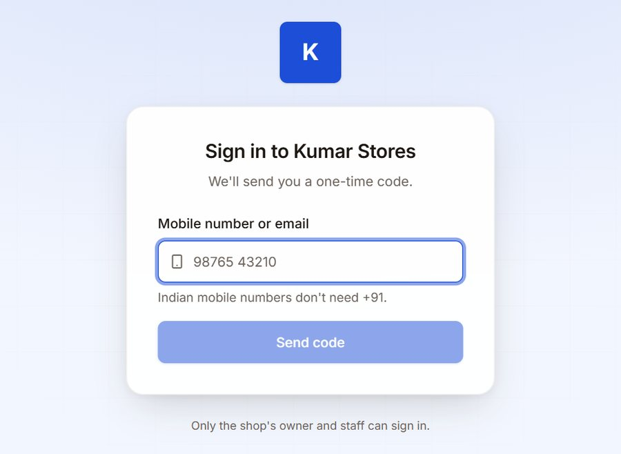

The code works for a few minutes. If it has not arrived, wait for the countdown on **Resend code** to finish, then tap it. Tap **Change** to correct the number.

::: callout
**Only the owner and the staff the owner has added can sign in.** If you see "No access to" your shop's name, you are signed in but the owner has not added you yet. Ask the owner to invite you (chapter 8).
:::

To sign out, open the account menu at the top right and choose **Sign out**.

## Find your way around

When you sign in you land on the **Dashboard**. On a computer the menu is on the left. On a phone, open it with the menu button at the top left.

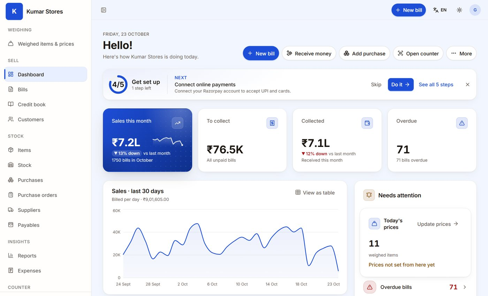

The menu in the Billing app has these groups.

| Group | Pages |
|---|---|
| **Sell** | Dashboard, Bills, Credit book, Customers |
| **Stock** | Items, Stock, Purchases, Purchase orders, Suppliers, Payables |
| **Insights** | Reports, Expenses |
| **Counter** | Counter (POS) |
| **Weighing** | Weighed items & prices (when weighing is on) |

Other apps add their own group, such as **Online store**, **Pharmacy**, **Tables** or **Appointments**.

- The big **New bill** button at the top right is always one tap away.
- The round buttons on the dashboard (**New bill**, **Receive money**, **Add purchase**, **Open counter**) are quick actions. **More** shows the rest.
- **Settings** is in the account menu (the round letter at the top right). Settings has its own list down the left: Business profile, Online payments, Reminders, POS terminals, Setup checklist, Team & roles, Activity log, Import & export, Customer messages, Plan & billing and Features. You see only the pages your role and plan allow.
- The **Get set up** card on the dashboard lists the first steps for a new shop. Tap **Do it** to do the next step, **Skip** to leave one for later, or the cross to hide the card. You can reopen the list any time from Settings, **Setup checklist**.

## Language: English or தமிழ்

Tap the **EN** button with the language icon at the top right to change the language. The screens and messages change straight away. Your choice is remembered on that device.

## Light or dark

Tap the sun or moon button at the top right. You can choose **Light**, **Dark** or **System**, which follows your phone or computer. Dark is easier on the eyes in a dim shop.

## Common problems

| What you see | What to do |
|---|---|
| "That code didn't work" | Check all 6 digits. Codes expire, so tap **Resend code** and use the newest one. |
| No SMS arrives | Go back and choose **WhatsApp**, or sign in with your email. |
| "No access to (shop)" | The owner must add your number or email in Team & roles. |
| "Not available on your plan" | The page is not in your plan. The owner can upgrade in Settings, **Plan & billing**. |
| "Turned off" | The owner switched the feature off. The owner can turn it on in Settings, **Features**. |

# 2. First-time setup

Do these once, in this order. The **Setup checklist** (in Settings) ticks them off as you go. Plan on about 20 minutes.

## Step 1. Business profile and GST

The details here are printed on every bill, so fill them in before you make your first one.

To fill in your business profile:

1. Open the account menu, choose **Settings**, then **Business profile**.
2. Type your **Legal business name** exactly as registered.
3. If you are GST-registered, type your **GSTIN**. A tick appears when it is valid. If you are not registered, leave it empty.
4. Choose your **State**. This matters: it decides whether a bill shows CGST + SGST (customer in your state) or IGST (customer in another state).
5. Fill in the address, city, PIN code, phone and email.
6. Scroll down and tap **Save profile**.

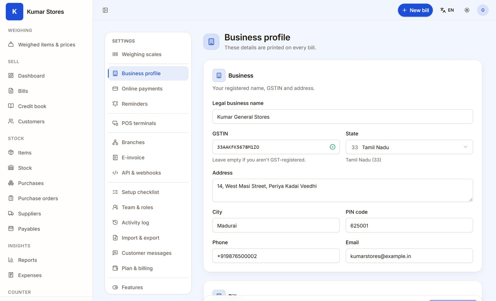

::: callout
Only the owner or an admin can change the business profile. If a cashier sees "Your business profile is incomplete" when billing, the owner needs to add the legal name and state.
:::

## Step 2. Bill settings

Further down the same page, in **Bills**:

- **Bill number prefix** is 1 to 6 capital letters, digits or hyphens. The page shows how your next bill will look.
- **Terms & conditions** are printed at the bottom of each bill.

## Step 3. Payment details and UPI

Still on **Business profile**, under **Getting paid**:

1. Type your **UPI ID** (it looks like yourshop@bank). Bills then show a scan-to-pay QR code, and the counter can show a QR with the exact amount.
2. If you like, add your **bank name, account number and IFSC**. They print on the bill.
3. Tap **Save profile**.

To let customers pay online by UPI, card or net banking from the bill link, open Settings, **Online payments** and connect your own Razorpay account. The page shows a six-step guide. You can start in test mode, where no real money moves.

## Step 4. Brand: logo and colour

Open Settings, **Branding** (shown in the apps that include the online store). Upload a wide **Logo** (about 3 to 1; PNG or SVG with a clear background works best) and pick your colours and fonts. They appear on your bills, your online store and the apps. With no logo, your shop name is shown.

## Step 5. Tax on your items

Every item carries a GST rate and an HSN code, so bills work out the tax for you. You set them when you add the item (chapter 3). Check these three things for each item:

- **GST rate**, for example 0%, 5%, 12% or 18%.
- **HSN code**, 2 to 8 digits.
- **Price includes GST** is on for MRP-style prices, and off when GST is added on top.

## Step 6. Store settings (if you sell online)

Open the **Online store** section of the menu, then Settings, **Online store**. Here you open or close the store, set cash on delivery, a minimum order value, contact details, and the shipping, returns, privacy and terms pages. Chapter 9 covers this in full.

## Step 7. Add your team

Invite your cashiers and managers and set a POS PIN for each (chapter 8).

## Step 8. Check which features are on

Open Settings, **Features**. This page has a switch for each part of the app, grouped under headings such as Billing. Only the owner can change them. A feature that is greyed out says why: not in your plan, not part of this app, or it needs another feature turned on first.

## Common problems

| What you see | What to do |
|---|---|
| "Enter a valid 15-character GSTIN" | Copy it from your GST certificate. It is 15 letters and digits, for example 33ABCDE1234F1Z5. |
| Bills show IGST when the customer is in your state | Check your **State** in the business profile and the **Place of supply** on the bill. |
| UPI QR does not appear | The UPI ID is missing or wrong. It looks like name@bank. |

# 3. Products and stock

Your items are the heart of the system. The same list is used for bills, the counter, stock and the online store, so you type each item once.

There are two ways to keep your list, depending on your app:

- **Items** (Billing app, in the Stock group): a simple list of what you sell, with its rate, GST and stock.
- **Products** (apps that include the online store, in the Catalogue group): the full editor with photos, sizes and colours, categories and web details. Everything you save in Products also appears at the counter and on bills.

## Add an item (Billing app)

To add an item:

1. Open **Items** and tap **Add item**.
2. Type the **Name**.
3. Type the **Rate** (the price per unit before GST), choose the **GST rate**, and type the **HSN/SAC code** (2 to 8 digits).
4. Choose the **Unit**, for example pcs or kg.
5. If you keep stock of it, type the **Quantity in hand** and **Cost per unit** under Opening stock. Leave them empty if you do not count this item (for example a service).
6. Tap **Save**.

Saved items appear as you type a bill, with their rate and GST already filled in.

## Add a product (Catalogue)

To add a product:

1. Open **Products** and tap **Add product**.
2. Under **Basics**, type the **Product name**, a **Description** and choose a **Category**. You can create a new category on the spot with **Create category**.
3. Under **Photos**, upload JPG, PNG or WebP pictures (up to 10 MB each). The first photo is the main one. Drag to reorder.
4. Under **Pricing & tax**, type the **Price** and, if you like, the **MRP** and your **Cost** (only your team sees cost). Choose the **GST rate**, **HSN code** and **Unit**. Tick **Price includes GST** for MRP-style prices.
5. Type the **SKU** and **Barcode** if you have them (see below).
6. Under **Inventory**, type the opening stock.
7. Under **Sold on**, choose where it can be sold: **Online store**, **Billing** (the counter), or both.
8. Set **Status** to **Active** to make it visible, or leave it as **Draft** to finish later. Tap **Create product**.

The page shows a price breakdown (what the customer pays, the taxable value, GST and your margin) so you can check the numbers before saving.

::: callout
**Status matters.** *Draft* hides the product everywhere. *Archived* hides it from the store and the counter but keeps it on old bills and orders. You can make an archived product active again.
:::

## Sizes and colours (variants)

If a product comes in sizes or colours, add options and RBMS makes one variant for every combination.

1. Open the product and go to **Variants**.
2. Tap **Add options**. Type an option name, for example *Size*, and its values, for example *Small, Medium, Large*, pressing Enter after each. You can add up to 3 options, such as Size, Colour and Fabric.
3. Tap **Generate variants**.
4. In the table, give each variant its own **SKU**, **barcode**, **price**, **MRP**, **cost** and **weight**. Use **Apply all** to set one price for every variant.
5. Tap **Save**.

Each variant has its own stock. If you do not see the **Variants** section, the owner needs to turn on **Variants and options** in Settings, **Features**.

## Barcodes

- Type the barcode on the product (or on each variant). At the counter, scanning that code adds the item.
- If a scanned code is not found, the counter offers to add the item on the spot (chapter 5).
- A USB or Bluetooth scanner works on the counter screen without clicking anywhere first. On a phone, use the camera button.

## GST by price band (clothes and footwear)

Clothing (HSN 61, 62, 63) and footwear (HSN 6401 to 6405) are taxed at **5% when a piece or pair sells for ₹2,500 or less before GST, and 18% above that**. RBMS works it out for each piece after any discount.

To use it, tick **GST by price band (apparel / footwear)** in Pricing & tax. On a bill, the line then shows "5% by price" or "18% by price". Each size or variant is taxed at its own price. If you use tax-inclusive prices, the page warns you when a price lands in the small zone where neither rate fits (the bill then uses 18%), so you can re-price.

## Categories and collections

- **Categories** group your products. Open **Categories**, tap **New category**, and drag rows to change the order. Use the row menu to put a category inside another. A category can be deleted only when it is empty.
- **Collections** are lists for your store, such as "Bestsellers" or "Under ₹999". Choose **Hand-picked** (you add products and drag them into order) or **Automatic** (a rule such as category, tag, maximum price or "on sale" fills it for you).

## Import from a spreadsheet

You can load many products, customers, suppliers or stock counts at once from a CSV or Excel file.

1. Open Settings, **Import & export** (or tap **Import** on the Products page).
2. Choose what to import: **Products**, **Customers**, **Suppliers** or **Stock levels**. The card tells you how many columns it uses and which are required (for example Products needs Name, GST % and Price).
3. Tap **Download template** and fill it in. The template has the right columns, an example row and a Help sheet.
4. Drop your file on the page. It can be .csv or .xlsx, up to 10 MB and 20,000 rows.
5. RBMS matches your column headings automatically. Check the matching and change any that are wrong.
6. Look at the **Preview**. Rows with problems are highlighted, and you can show only those.
7. Tap **Import** (it shows how many rows). Rows with problems are skipped.
8. When it finishes you see how many were **Added**, **Updated**, **Skipped** or **Failed**. Download the error list as a CSV, fix the rows and import that file again.

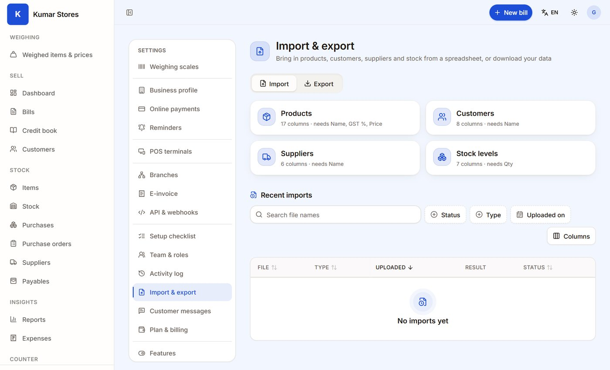

The **Export** tab downloads a full copy of your data as Excel or CSV, for your accountant or as a backup.

## Check stock and adjust it

Open **Stock** (Billing app) to see what you have.

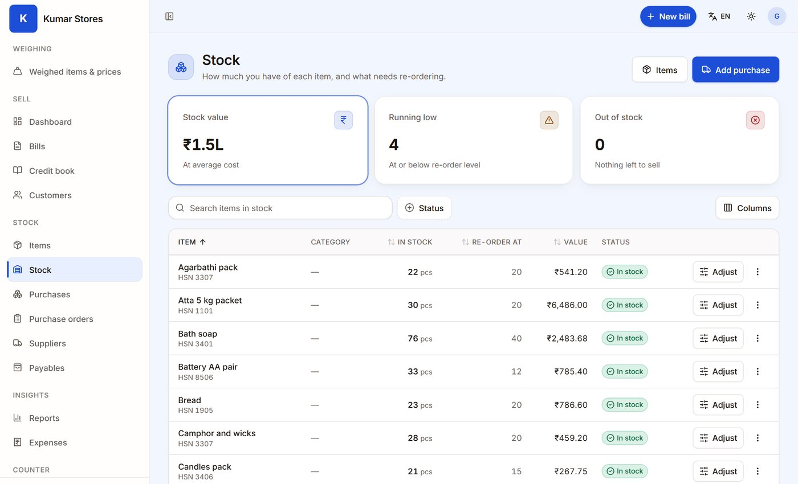

- The three tiles show **Stock value**, **Running low** and **Out of stock**. Tap a tile to filter the list.
- Use the **Status** filter: **All**, **Low**, **Out of stock** or **Not tracked**.
- Tap an item's menu, **Stock history**, to see every sale, purchase and adjustment.

To adjust stock after a count or a breakage:

1. Next to the item, tap **Adjust**.
2. Choose **Add**, **Remove** or **Set count**. Use **Set count** after counting the shelf.
3. Type the quantity. When you add stock you can also type the **Cost per unit**, which updates the average cost.
4. Type a **Reason**, for example "damaged" or "stock count".
5. Tap **Save change**. The dialog shows the stock before and after.

## Low-stock alerts

Tell RBMS when to warn you. In the item's menu choose **Stock settings**, then type a **Re-order level**. The item is marked **Low** when stock falls to that number. Zero means no alert. Turn off **Track stock** for services or items you do not count.

## Purchases and suppliers

Record what you buy so stock goes up, and so you can claim input tax credit (ITC).

To save a supplier:

1. Open **Suppliers** and tap **Add supplier**.
2. Type the name. Add the **GSTIN** (to claim ITC) and the **State**, which decides CGST + SGST or IGST on their bills.
3. Tap **Save**.

To record a purchase:

1. Open **Purchases** and tap **Add purchase**.
2. Choose the **Supplier**, or use a one-off supplier you do not want to save.
3. Type the **Supplier bill no.** and the **Bill date**.
4. Add the items. Search for a saved item, and the line says "Saved item: stock will go up". An item you type by name only does not change stock.
5. Type the **Cost price** for each, and say whether the bill is **Paid** or unpaid. Unpaid bills add to what you owe the supplier.
6. Tap **Save purchase**.

To pay a supplier later, open **Payables**. It shows what you owe each supplier by age (0 to 30, 31 to 60, 61 to 90 and over 90 days). Tap **Pay**, choose **Oldest first** or pick the bills, enter the amount and how you paid, and tap **Record payment**. If you pay by mistake, **Reverse** the payment.

To send goods back, open the purchase and choose **Return goods**. A **debit note** is issued, stock goes down and the bill's balance drops. A purchase can be cancelled, which takes its stock back out.

### Scan a supplier bill instead of typing it

On **New purchase**, press **Scan supplier bill**, take a photo of the bill (or choose a photo or a PDF) and wait a few seconds. The form is filled in for you: supplier, bill number, date and every item line. Anything the AI was unsure about, or that does not add up, is tinted and listed above the form; fix those, and compare the "bill total as printed" in the summary with the total on your paper. Medicine shops must have a batch and expiry on every line. Nothing is saved until you press **Save purchase**. A scan uses about 40 AI credits; the owner can switch it off in Settings > AI.

## AI helpers for items and imports (optional)

These need **AI** to be switched on in **Settings > AI** (the owner does this; each helper has its own switch) and the **Use AI helpers** permission. Every answer is a draft: nothing is saved until you press the normal **Save**. Each use costs a few AI credits (see Settings > AI for what is left this month).

- **Suggest HSN & GST.** In **Add item** (Billing), in the product page of the catalogue and in the counter's "not found: add it" box, type the item name and press **Suggest HSN & GST**. You see up to three HSN codes with the official description. Press **Use this** to fill in the HSN and the usual GST rate, then check the rate yourself; it is only the usual rate. For clothes and footwear the price-band rule (5% up to Rs 2,500 a piece, 18% above) is shown. If it says "Not sure", look the code up on the GST portal. The owner can also switch on "Suggest HSN and GST when I leave the item name box" in Settings > AI.
- **Write description.** On a product page press **Write description**. AI writes an English and a Tamil description, a search title and description and key points, using only the facts on the product and your store settings. It never adds delivery, refund, warranty or health promises that you did not state; anything it left out for that reason is listed. Press **Use English** to put the English text and search texts in the form, or **Save Tamil text** to keep the Tamil text with the product.
- **Translate to Tamil (many products).** In **Products**, tick the products and press **Translate to Tamil**. You see about how many credits it will use, then it drafts the Tamil names and descriptions in the background. Press **Review Tamil drafts**, read each one, correct it if needed and **Approve** (or **Reject**). Nothing is final until you approve it.
- **Suggest mapping with AI.** In **Settings > Import & export**, after you choose your file, press **Suggest mapping with AI** above the column list. Only the heading row and five sample rows are sent (phone numbers, e-mails and GSTINs are hidden). Check the matched columns and change any that are wrong before you start the import.
- **Help.** The **Help** button at the top of every screen answers "how do I..." questions in Tamil or English from this manual and links to the screen it talks about. It does not look at your sales or customers. If the manual does not cover the question it says so and asks you to contact support.
- **Ask your shop.** The **Ask** button at the top of every screen (for owners and staff who may view reports) answers questions about your own numbers in Tamil, Tanglish or English: today's, this week's or this month's sales, cash against UPI, best and slowest items, who owes you money (for example "more than 5000 for over 30 days"), low stock, expiry, purchases, expenses, GST figures and staff-wise or branch-wise sales. Press the microphone to speak the question where your browser supports it. Follow-ups such as "and last month?" work. The answer is read from your reports and every number in it is checked against them; press **Show figures** to see the table behind it. If a number cannot be matched, you get the figures themselves instead of a written answer. It only reads: it cannot change anything, and customers' phone numbers stay hidden. A question uses about 15 to 40 AI credits.
- **Explain this month (GST).** In **Reports > GST**, on the GSTR-1 card, press **Explain this month** for a short note on what changed since last month, anything unusual and what to check in your bills before filing. It is written from the computed figures only (about 2 AI credits) and never says your return is correct or tells you when to file: check with your accountant.
- **Daily summary.** In **Settings > AI > Daily summary** switch it on, choose the time (default 9 pm) and language (English or Tamil), and add staff phones if they should get it too. Every day at that time you get a short note on today's sales against the same day last week, cash / UPI / card, top items, low stock, items not sold for 30 days, money to collect (with the most overdue customers) and, for pharmacies, batches about to expire, plus one or two things to do tomorrow. The latest one also shows on your dashboard. All numbers are worked out by the software from your bills; AI only writes the words, and if a number in its text does not match, you get a plain standard text instead. It goes on WhatsApp and e-mail where those are set up for the platform; otherwise it shows in the app only. **Preview** shows it without sending, **Send now** makes today's. About 1 AI credit a day. A time before 12 noon sends yesterday's summary.
- **Reorder suggestions.** In **Stock**, press **Reorder suggestions** to see what to buy and how much, in groups (festival stock-up, out of stock, running low, selling faster lately). The quantities come from your last 28 and 90 days of sales, current stock, items already on order and, when your shop has sales from the same festival last year (Pongal, Tamil New Year, Aadi, Vinayagar Chathurthi, Navaratri / Ayudha Pooja, Deepavali, Karthigai Deepam, Christmas, Ramzan, Bakrid), the extra rush then. AI writes one line of reason per group (about 2 credits). Tick the items, change quantities, choose the supplier and press **Create purchase order**: it makes a **draft** purchase order for you to check and send. Nothing is ordered automatically.
- **Write a campaign with AI.** On **Inbox > Campaigns > New**, type your goal (for example "Pongal offer 10% on sarees for regular customers") and press **Write the message**. You get a WhatsApp message in English and Tamil (and short SMS versions) using only what you wrote: it never adds an offer, price, date or delivery promise you did not type. It also suggests the customers (for example regulars who bought sarees in the last 6 months and were not messaged in the last 14 days, leaving out anyone who opted out) and a good time. **Use this audience and time** fills in the campaign; you still choose an approved WhatsApp template and press Start yourself. About 10 credits.
- **Review replies and themes.** In **Store > Reviews**, open a review, press **Reply**, then **Draft reply with AI** for a polite reply in the reviewer's language. It promises nothing (no refund, replacement or discount) unless you write it in the box for your own decisions. Edit it and post. **Review themes** counts what customers praised and complained about in the last 90 days and sums it up in a few lines.

## Common problems

| What you see | What to do |
|---|---|
| A product does not show at the counter | Check **Status** is Active and **Billing** is ticked under Sold on. |
| Stock went below zero | A sale was made without stock. Use **Adjust**, **Set count** to correct it. |
| Import says a column is missing | Match the required column to a heading in your file, or use the template. |
| "Two variants have this SKU" | Each variant needs a different SKU. |
| A purchase did not add stock | The line was typed by name. Pick a saved item instead. |

# 4. Billing

## Make a bill

To make a bill:

1. Tap **New bill** (top right of any page).
2. Under **Bill to**, search for a customer by name or phone, or choose **Walk-in / cash sale**. See "Customers" below.
3. Check the **Bill date**. Choose a **Due date** if the customer will pay later (**7 days**, **15 days**, **30 days**, or **No due date**).
4. Check the **Place of supply**. It starts as your state. Change it if you are selling to another state, and the tax changes from CGST + SGST to IGST.
5. Under **Items**, start typing an item name. Pick it from the list, and the rate, GST and HSN fill in. Change the **Qty**, **Rate** or **Discount** if needed. Tap **Add item** for more lines.
6. Watch the **Bill summary** on the right: subtotal, discount, taxable value, tax, round off and **Total**.
7. Tap **Save & issue bill**. The bill gets the next number and can no longer be edited. Or tap **Save draft** to finish it later.

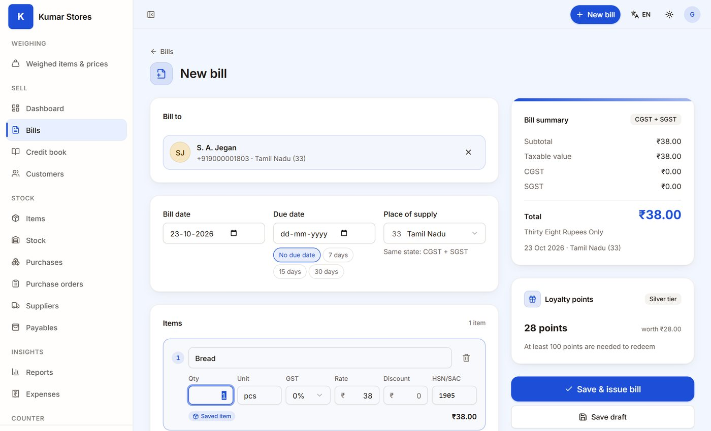

::: callout
**Draft or issued?** A *draft* has no bill number and can be edited or deleted. An *issued* bill has its number, can be shared, and can only be cancelled or credited. Issue a bill only when you are ready to give it to the customer.
:::

After you issue a bill, you can send it to the customer straight away or start the next bill.

## Customers

- **Walk-in customer.** Choose **Walk-in / cash sale**, or type a name and choose **Bill "name" without saving**. Nothing is stored for them.
- **Saved customer.** Type a name or phone in **Bill to**. If there is no match, choose **Add "name" as a new customer**. Saved customers can buy on credit, get statements and collect loyalty points.
- A customer who still owes you shows "unpaid from earlier bills" in the picker.

To add a customer from the **Customers** page, tap **Add customer**. Only the name is required. Add a **GSTIN** for business buyers (RBMS shows "Valid GSTIN" with the state). You can also type an **Opening balance** (money they already owe you, or have paid ahead) and a **Credit limit** in the Credit book section.

## Discounts

Type a discount on any line as rupees or percent. Discounts need the **Give discounts** permission. A cashier without it sees the field locked ("Discounts need the Give discounts permission") and must ask a manager or the owner.

## Take payment

You can record payment when you issue the bill or later.

To record a payment on a bill:

1. Open the bill (Bills, then tap it) and tap **Record payment**.
2. Type the **Amount received**. You cannot enter more than the balance.
3. Choose **Paid by**: **Cash**, **UPI**, **Card**, **Bank**, **Cheque** or **Other**.
4. Add a **Reference** (UPI reference or card approval code) if you have one, and the date.
5. Tap **Save payment**.

A bill moves from **Unpaid** to **Part paid** to **Paid** as payments are added. A bill past its due date shows **Overdue**. To undo a wrong payment, use **Remove payment** next to it; the balance goes back up.

At the counter (chapter 5) you can split one bill across cash, UPI, card and credit.

## Share on WhatsApp, print, download

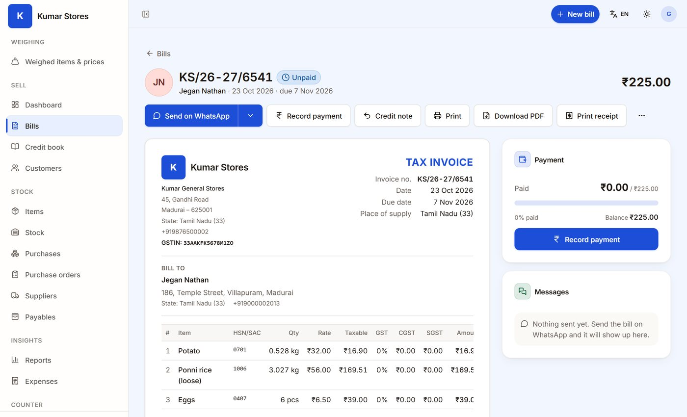

On an issued bill:

- **Send on WhatsApp** sends the customer a message with a link to the bill. If the customer has no phone number saved, RBMS asks for one. The arrow next to the button has more ways to send, such as SMS. The **Messages** box on the right lists what has been sent.
- **Share link / QR** (in the menu) shows the link and a QR code. Anyone with the link can view the bill and pay by UPI. Online card or net-banking payment appears if you connected Razorpay.
- **Print** and **Download PDF** make the paper or PDF bill. **Print receipt** makes a narrow receipt.

## Returns and credit notes

When a customer returns goods or you correct a price, issue a **credit note**. Do not edit the original bill.

To issue a credit note:

1. Open the original bill and tap **Credit note**.
2. Tick what is coming back. Use **Select everything left**, or set a quantity for each line. Choose **Amount** instead of Quantity for a price correction.
3. Choose the **Reason**: **Goods returned**, **Price correction** or **Other**.
4. Under **Money back**, choose **Cash**, **UPI**, **Card**, **Credit book** or **No refund**. If the bill was already paid, you must choose how the money goes back. For a walk-in customer, refund the money (credit book needs a saved customer).
5. Leave **Put returned items back in stock** on, or turn it off for damaged goods.
6. Tap **Issue credit note**.

The credit note has its own number, GST is worked out from the original bill, and your reports and GST figures take it into account. See all of them under **Credit notes** (button on the Bills page). A credit note can be cancelled only on the same day, and only if no money was refunded.

## Quotations (estimates)

Give a customer a price before they order. A quotation has its own number (for example QT/26-27/0001), a valid-until date and your terms. It never changes stock, sales, GST returns or the credit book. Only the bill or order you make from it does.

1. Open **Quotations** and tap **New quotation**. Pick the customer, add the items, and set the delivery time and any advance you want (for example 50%).
2. Tap **Save & send**. Send it on WhatsApp, SMS or email, or copy the link. The customer opens the link on their phone, reads the quotation in English or Tamil, and taps **Accept** or **Decline**. You see who answered and when.
3. When the customer accepts, tap **Make bill** (or **Make order**, if your shop takes orders). The bill is a draft you can still edit. Choose **Issue the bill now** and tick the advance to record the advance as a payment at the same time.

If the price changes, tap **Revise**. The number stays the same and becomes revision 2. The customer's old link points to the new one. A quotation that is not answered by its valid-until date shows as **Expired**: revise it to give new dates.

Make order needs every line to be a saved item. For free-text lines, make a bill.

## Cancel a bill

Cancel a bill only when it was made by mistake. Needs the **Cancel bills** permission.

1. Open the bill, open the **More actions** menu and choose **Cancel bill**.
2. Type a reason if you like and confirm with **Cancel bill**.

The stock goes back. The cancelled bill stays in your records, as GST rules require, but is no longer due. A draft can simply be deleted with **Delete draft**.

## Find a bill

Open **Bills**. Search by number or customer, and filter by **Status**, **Date** or **Paid by**. Tabs show **All**, **Draft**, **Unpaid**, **Part paid**, **Overdue**, **Paid** and **Cancelled**, each with a count.

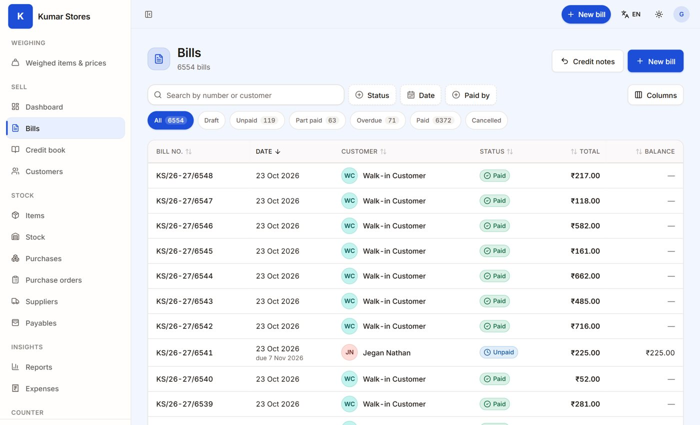

## Common problems

| What you see | What to do |
|---|---|
| "Choose a customer or bill a walk-in customer" | Pick a customer first, or **Walk-in / cash sale**. |
| "Your business profile is incomplete" | The owner must add the legal name and state (chapter 2). |
| "This bill can't be edited" | Only drafts can be edited. Cancel the bill or issue a credit note. |
| Cannot give a discount | Ask for the **Give discounts** permission. |
| "More than the balance" | You tried to record more than is due. Enter the balance or less. |
| Plan limit message when issuing | Your plan has a monthly bill limit. Save as draft and issue next month, or upgrade. |

# 5. The POS counter

The POS counter is a full-screen billing page made for speed. It has big buttons, works with a barcode scanner or the camera, lets you hold bills, and splits payment across cash, UPI, card and credit.

To open it, tap **Open counter** on the dashboard, or choose **Counter (POS)** in the menu.

## Open the day (till)

Opening the day tells RBMS how much cash is in the drawer, so that at closing it can tell you what should be there.

To open the day:

1. Tap **Day not opened** in the top bar (or the **Day open / close** button).
2. Check the **Register** name. Each counter keeps its own till, for example *Counter 1*.
3. Type the **Opening cash**, the cash in the drawer before the first sale. Choose **Count notes** to count by note and coin.
4. Tap **Open day**.

The top bar then shows **Day open** with the time. You can bill without opening the day, but those bills will not count in the till. Opening and closing need the **Open and close the till** permission.

## Make a sale

To make a sale:

1. **Add items.** Scan a barcode (a scanner works without clicking first), or press **F2** and type a name, SKU or code, or tap an item tile. **Quick items**, **Favourites** and **Recent** are tabs at the top. Tap the star on an item to keep it on top.
2. For a product with sizes or colours, pick the option in the dialog that opens.
3. For an item sold by weight, type the weight from the scale (for example 0.750) and tap **Add to bill**.
4. Tap a line to change its **quantity**, **price** or **discount**. Changing price or discount needs the **Give discounts** permission. Use the small buttons to add or take away one.
5. Add the **customer** (press **F4**): type a mobile number or name. This is optional for a cash sale, but needed for credit and loyalty points. Choose **Bill with this number only** to avoid saving, or **Add new customer**.
6. Tap **Pay** (or press **F9**).

### Take payment

In the **Payment** window you can split one bill across several ways.

- **Cash.** Type what the customer handed over, or tap a note such as 500. The **Change to return** shows. Tap **Exact** if they paid the exact amount.
- **UPI.** The window shows a QR with the exact amount (if the shop's UPI ID is set in the business profile). When the money arrives, tap **Mark as received**. You can add the UTR reference.
- **Card.** Type the amount and the approval code from the card machine slip.
- **Credit.** Put the rest on the customer's account. This needs a saved customer, and the window warns you if it goes over their credit limit.
- **Points.** If the customer has loyalty points, you can apply some (chapter 6).

When "Still due" reaches zero, tap **Complete sale** (or press **F10**).

On **Sale complete** you can **Print receipt**, send the bill on WhatsApp to a 10-digit mobile number, or tap **New sale**. Switch on **Print automatically after every sale** to skip the button.

## Hold a bill and come back

Serving two customers at once? Tap **Hold** (or press **F8**), give the bill a name, and serve the next customer. To bring it back, tap **Held bills** (or press **F7**) and **Recall**. Recalling a bill holds the current one first, so nothing is lost. Held bills stay on that device.

## Scan an item that is not in the list

If a scanned code is not found, a window offers **Add to catalogue**: type the item name, price, GST rate and, if you wish, MRP, cost, opening stock, unit and category, then tap **Save and add to bill**. Or choose **Open item (this bill only)** to bill it once without saving. If you do not have permission to add items, the counter tells you to ask a manager.

## Returns at the counter

1. Tap **Returns** in the top bar.
2. Type the **Bill number** and tap **Find**.
3. Tick what is coming back. Choose how the money goes back (**Cash**, **UPI**, **Card**, **Credit book** or **No refund**).
4. Tap **Issue credit note**. The items go back in stock, and the refund shows in this till's report. You can **Print slip**.

You can also cancel the whole bill instead. Returns need the **Credit notes and returns** permission.

## Cash in and cash out

During the day, record cash that goes into or out of the drawer (tea, courier, change from the bank).

1. Open **Day open / close** and choose the **Cash in / out** tab.
2. Choose **Cash out** or **Cash in**, type the **Amount** and a **Note**.
3. Tap **Record**.

## Close the day

1. Open **Day open / close**. The **Today (X report)** tab shows bills, sales, each payment method and the cash expected. You can print the X report.
2. Choose the **Close day** tab and count the drawer (type the total or count notes).
3. RBMS shows **Matches**, **Extra** or **Short** with the difference. Add a note if needed.
4. Tap **Close day**. You can print the Z report.

The first tab can also show the whole shop's day, across all counters.

## Keyboard shortcuts

| Key | Does |
|---|---|
| F2 | Search or scan box |
| F4 | Customer |
| F7 | Held bills |
| F8 | Hold the bill |
| F9 | Pay |
| F10 | Complete the sale (exact cash if nothing was typed) |
| ? or F1 | Show this help |

## If the internet goes down

The counter keeps the items it has saved on the device, so you can still search them. But a bill is saved on the server, so **a sale cannot be completed while you are offline**. The cart is kept on the device. When the connection returns, tap **Pay** again. The top bar shows **Online** or **Offline**.

## POS terminals: a counter on its own device

A **POS terminal** is a counter or weighing station paired to one device, such as a counter PC, tablet or phone. Each cashier unlocks it with a personal PIN, so the owner never has to sign in on the shop floor, and each terminal keeps its own till.

### Add a terminal and pair a device

The owner (or a manager with the **POS devices** permission) does this once per counter.

1. Open Settings, **POS terminals**, and tap **Add terminal**.
2. Type a **Name**, for example *Counter 1*. Use a different name for each terminal. The name is also the till name.
3. Under **Used for**, choose **Billing counter** or **Weighing station**.
4. Choose the **Receipt printer** width (58 or 80 mm), how many minutes of idle time before it **locks**, and whether to **Print automatically**.
5. Tap **Create and pair**. A window shows an 8-character **pairing code** and a QR code. It works for 15 minutes.
6. On the counter device, open the counter and choose **Use this device as a POS terminal**. Type the code, or scan the QR, and tap **Pair device**.

The page shows **Paired** with the device and when it was last seen. Use **Pair new device** on a terminal to replace the device (the old one stops working), and **New code** if a code expired. Your plan limits how many terminals you can have; the page shows "1 of 2 terminals on your plan".

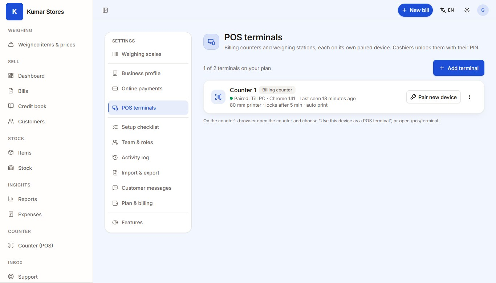

### Unpair or delete

- **Unpair device** (in the terminal's menu) stops the device at once and signs out its cashier. The terminal stays and you can pair another device.
- On the device itself, open the **Device** menu on the lock screen and choose **Unpair this device**.
- **Delete terminal** removes the terminal. Bills and till sessions made on it stay.

### Staff PINs

Each cashier needs a PIN of 4 to 6 digits. It cannot be 1234 or one digit repeated, and no two people in the shop can share one.

- A cashier sets their own: open Settings, **Team & roles**, tap **My POS PIN**, type it twice and save.
- The owner or a manager can set, reset or remove anyone's PIN from the team list (the key button on their row).

### Unlock, lock and switch cashier

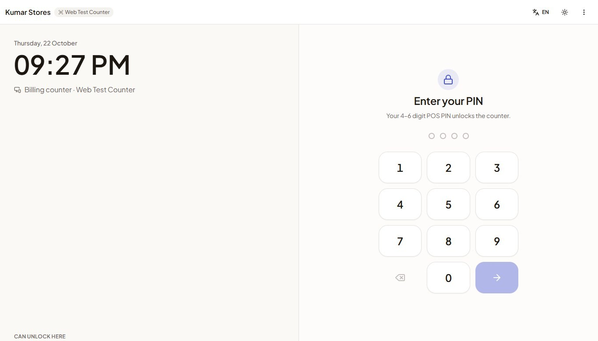

- To start, type your PIN on the pad and tap **Unlock**.
- Tap **Lock** to lock the terminal when you step away. It also locks by itself after the idle time.
- To change cashier, tap **Switch cashier** (or **Lock**), and the next person enters their PIN.
- After 5 wrong PINs in a row the terminal locks for 5 minutes.
- A person with no counter access is told "Your role can't use this terminal".

## Weighing station and weigh tickets

A **weighing station** is a terminal for loose goods such as rice, vegetables or nails. The weigher weighs and prints a ticket; the cashier scans the ticket and the items go into the bill at the right price. No re-typing, no price mistakes.

To issue a weigh ticket (weigher):

1. Unlock the weighing station with your PIN.
2. Pick the item from the list, or type its **PLU** code, or scan it.
3. Put the goods on the scale. If you use a computer with Chrome or Edge, tap **Connect scale** to read a weighing scale directly. Otherwise type the weight by hand in kg (750 g is 0.750).
4. If a container is on the scale, tap **Tare**. The screen shows the net weight.
5. Tap **Add to ticket**. Add more items the same way.
6. Tap **Issue and print ticket**. A ticket with a barcode prints. Give it to the customer.

To bill a ticket (cashier): scan the ticket's barcode at the POS counter, or type the code. Its lines come into the bill at the shop's prices and cannot be changed. To take a ticket off the bill, remove it. A ticket can be used once and is valid for the day.

The **Today's tickets** tab lists tickets with their status (**Open**, **Billed**, **Cancelled**). **Cancel** a ticket if the customer changes their mind, and weigh again.

### Weighed items, prices and the scale barcode

Open **Weighed items & prices** (Weighing group) to list items sold by weight, each with a **PLU** code, today's price per kg and a tare. Type the day's prices and tap **Save prices**. **Download PLU file** gives you the list to load into the scale. In Settings, **Weighing scales**, set the barcode format your scale prints (prefix, PLU digits and value digits), and use **Try a label** to check it. With the right format, the counter can also scan the labels printed by a separate price-computing scale.

## Common problems

| What you see | What to do |
|---|---|
| "Wrong or expired code" when pairing | Codes last 15 minutes. Tap **New code** in Settings, POS terminals. |
| "Too many tries" when pairing | Wait 10 minutes. |
| "This code belongs to another shop" | You are on a different shop's page. Open your own shop's address. |
| "Wrong PIN" | Try again. After 5 wrong tries the terminal locks for 5 minutes. |
| "That PIN is too easy to guess" or "already uses that PIN" | Choose another. |
| "Ticket is already billed" | A weigh ticket works once. Weigh again. |
| "Ticket has expired" | Tickets last for the day. Weigh again. |
| The counter says "Needs a connection" for the till | Opening, closing and cash in or out are saved on the server. Bill on, and do it when you are back online. |
| "POS terminals are off" | The owner must switch it on in Settings, **Features**, or upgrade the plan. |
| "The scale was disconnected" | Check the cable and the speed (baud), or type the weight by hand. |

# 6. Customers and the credit book

## Customers

Open **Customers** to see everyone you saved. Search by name, phone or GSTIN. Tap a customer to see their details, their bills and what they owe, and to make a new bill for them. To change a customer, use **Edit customer**. Deleting a customer does not affect their old bills.

## The credit book

The **credit book** keeps the account of each customer who buys on credit. Open **Credit book**.

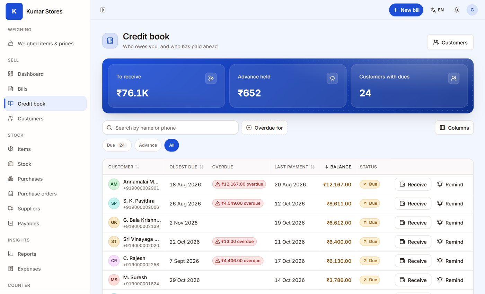

The tiles show **To receive**, **Advance held** (money customers paid ahead) and **Customers with dues**. Switch between **Due**, **Advance** and **All**, and click a column heading to sort, for example by balance. Each row shows the balance, the oldest due date, how long it is overdue and the last payment.

### Give credit

Put a bill on credit by saving the customer on the bill and leaving it unpaid or part paid (or choosing **Credit** at the counter). If you set a **credit limit** on the customer, you see a warning when a bill crosses it.

### Receive a payment

1. In the credit book, tap **Receive** on the customer's row (or open the customer and tap **Receive payment**).
2. Type the **Amount received**. It starts at the full balance.
3. Choose **Paid by**, the date and an optional note or reference.
4. Tap **Save receipt**.

The payment settles the **oldest bills first**. Anything extra is kept as **advance** and used on their next bills. The result window lists which bills were settled.

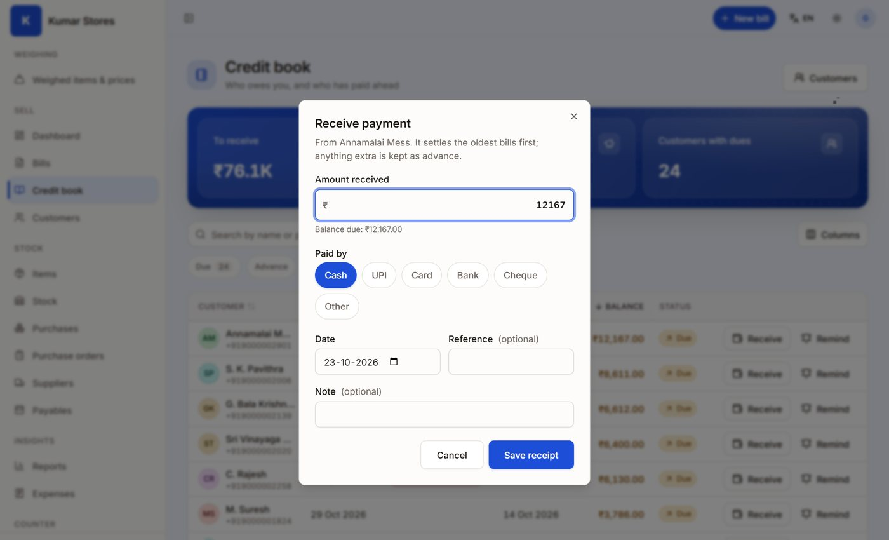

### Statements

Open a customer's ledger to see every bill, payment, credit note and refund with a running balance. Pick a date range, and use **Download CSV** or **Statement PDF**.

To share a statement, tap **Share statement**. The customer gets a link that shows their balance and the last 90 days of entries, and they can print it. You can send it on WhatsApp or copy the link or QR.

### Reminders

- **One customer.** Tap **Remind** on their row. RBMS sends a payment reminder. If it cannot, it offers **Use WhatsApp** so you can send it yourself.
- **Automatic.** Open Settings, **Reminders**, switch on **Send reminders automatically**, and pick the days after the due date (up to a set number). Reminders go out by WhatsApp at 10 AM and include the amount and a link to pay. You can also turn on payment receipts, so a customer who pays online gets a thank-you message. The page shows a preview of the message.

### Ageing: who has not paid for how long

Open **Reports**, **Dues**. It groups what is owed into **Not yet due**, **1 to 30**, **31 to 60**, **61 to 90** and **over 90 days**, and lists each customer. Chase the oldest first.

## Loyalty points

If your plan includes loyalty, customers earn points on every bill, by mobile number, and use them as a discount.

To set the rules: open the **Grow** group, **Loyalty**, then **Points rules**. You set the points earned for every ₹100, the value of one point, the fewest points that can be used, the largest share of a bill points can pay, when points expire, and **tiers** (such as Silver and Gold) that earn faster as lifetime spend grows. A box shows an example so you can check your numbers.

- **Earning.** A customer joins automatically when a bill with their mobile number is paid. Always ask for the number.
- **Using.** On the bill form you see a **Loyalty points** card with the balance, what it is worth and "Use points". At the counter, the same appears in the payment window. Points apply when the bill is issued, not on a draft.
- **Members.** The **Members** tab lists points balance, tier and last activity. Open a member to see their points history and to **Adjust points** by hand (a reason is required and is saved in the activity log).

## Common problems

| What you see | What to do |
|---|---|
| Cannot choose Credit at the counter | Credit needs a saved customer. Add or pick one first (F4). |
| "Over the credit limit" | Warning only. Collect payment, or raise the customer's limit. |
| Reminder not sent | Use **Use WhatsApp**, or check the customer has a phone number. |
| "Add the customer's phone number to use loyalty points" | Points work by mobile number. Save the number on the customer. |
| "At least N points are needed to redeem" | The customer has not reached the minimum yet. |

# 7. Reports and GST

## The dashboard

The **Dashboard** is your quick look at today. It shows **Sales this month** (with the change from last month), **To collect** (all unpaid bills), **Collected** and **Overdue** bills, a chart of the last 30 days, and a **Needs attention** box. Tap a card to open the page behind it. In apps with an online store you also see orders and store visitors.

## Open the reports

Open **Reports** from the **Insights** group. Pick a report tab, then a date range: **This month**, **Last month**, **This quarter**, **This FY**, **Last FY** or **Custom**. A financial year runs from April to March.

| Tab | What it tells you |
|---|---|
| **Sales** | Total billed, number of bills, average bill and tax collected. A daily sales chart, your **Top items** and **Top customers**, and the full sales register. |
| **GST** | Taxable value, output tax, input tax credit and net GST payable, with the sections you file. See below. |
| **Payments** | Money received, split into cash and online and UPI, by method and by source (on the bill, a receipt or online). |
| **Dues** | What customers owe, by age. See chapter 6. |
| **Stock** | Stock value, items low and out, the top items by stock value and a full valuation. |
| **Purchases** | What you bought, the ITC you earned, and what is unpaid to suppliers. |
| **Profit** | Sales less purchases and expenses. Shows when expenses are on. |

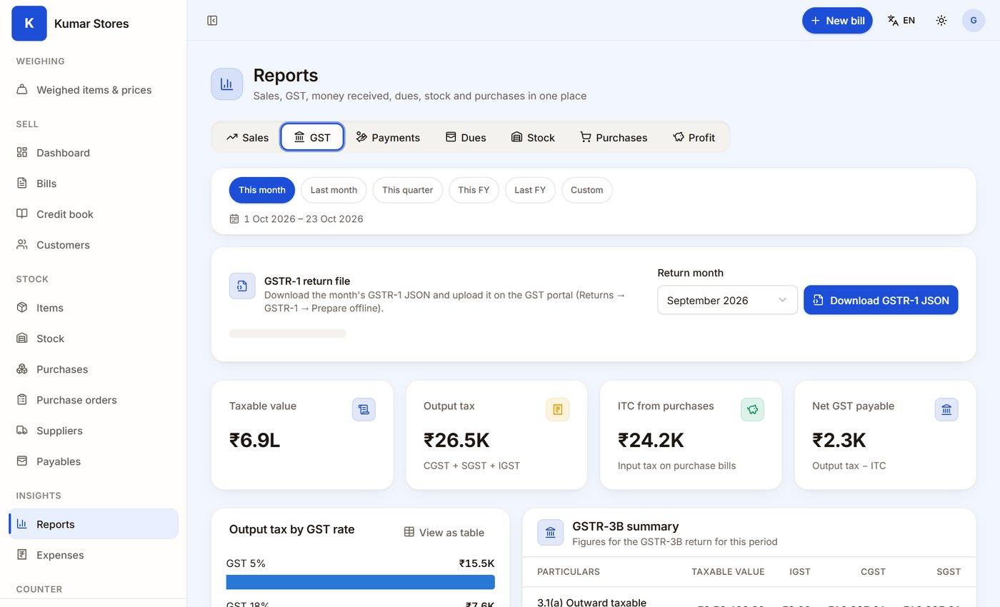

Charts have a **View as table** button if you prefer numbers.

## GST summary for filing

Open **Reports**, **GST**, choose the period, and read:

- **Taxable value**, **Output tax** (CGST + SGST + IGST on your sales), **ITC from purchases** (input tax on purchase bills) and **Net GST payable** (output tax minus ITC). If ITC is more, it shows **Credit carried forward**.
- **GSTR-1 sections**, the outward supplies you report:
  - **B2B**: bills to customers with a GSTIN.
  - **B2CL**: large inter-state bills (over ₹1,00,000) to buyers without a GSTIN.
  - **B2CS**: all other bills to buyers without a GSTIN, by state and rate.
  - **HSN summary**: quantity and tax for each HSN code.
  - **Credit notes** to registered and unregistered buyers.
- **GSTR-3B summary**, the figures for that return for the period.

B2CS and HSN figures are already net of credit notes.

::: callout
**Check your numbers with your accountant.** The GSTR-3B summary is a simple head-wise difference. It does not set off IGST credit against CGST and SGST. Treat it as a working figure, and file from your accountant's final numbers.
:::

## Export

- **Download CSV** on a report table saves it as a file you can open in Excel.
- **GSTR-1 return file**: at the top of the GST tab, choose the **Return month** and tap **Download GSTR-1 JSON**. It is prepared offline for you to upload on the GST portal.
- **Settings, Import & export, Export** downloads a full copy of your items, customers and more.
- On any bill, **Download PDF** saves it; on a customer's ledger, **Statement PDF**.

## Expenses and profit

Open **Expenses** (needs the **Manage expenses** permission) to record rent, salaries, electricity and other spending.

1. Tap **Add expense**.
2. Type the **Amount** you paid, including GST, and the date.
3. Choose a **Category**, such as Rent, Salaries, Electricity, Transport, Packaging, Marketing, Repairs or Other. **Categories** lets you add your own.
4. Choose the **GST rate**. Add the vendor's **GSTIN** to claim the GST back (input credit). Without a valid GSTIN, no credit is shown.
5. Choose **Paid by**, add a reference or note, and attach a **receipt** photo or PDF (up to 10 MB).
6. Tap save.

The page totals **Spent**, **GST paid** and **ITC you can claim**, with spending by category and month. A cancelled expense stays on record but is left out of totals. The **Profit** report then shows gross profit (sales less purchases) and net profit (less expenses after ITC), and the GST you will have to pay for the period.

### Scan a receipt for an expense

In **Add expense**, press **Scan receipt**, photograph the receipt and check the amount, date, category and payment method it fills in. Use **Attach this photo as the receipt** to keep the photo with the expense. A scan uses about 15 AI credits.

## Common problems

| What you see | What to do |
|---|---|
| A report is empty | Widen the date range, for example **This FY**. |
| Stock report shows today's stock, not the range | Correct: stock is always as it is right now. |
| Cannot open Reports or Expenses | You need the **View reports** or **Manage expenses** permission. |
| GST report missing purchases | Record your supplier bills in **Purchases** so ITC counts. |

# 8. Team and roles

## Invite a team member

Open Settings, **Team & roles**. The **Members** tab lists everyone with access. Only the owner, an admin, or a person with the **Manage team and roles** permission can change it.

To invite someone:

1. Tap **Invite member**.
2. Type their **mobile number or email**. Indian numbers can be typed without +91.
3. Choose the **Access level**:
   - **Admin** can do everything, like the owner.
   - **Staff** can do what their roles allow.
4. Under **Roles**, tick one or more roles (see below). With no role ticked, a staff member gets the **Staff (default)** access.
5. Tap **Send invite**.

They can sign in straight away with a one-time code sent to that number or email. No password is needed.

To change someone's access, open their row menu and choose **Change access**. To stop someone signing in without losing their history, turn their switch off (their record stays and you can turn it back on). **Remove** takes them off the team for good; bills and records they made stay. Your plan limits the number of team members, and the page tells you if you have reached it.

## The built-in roles

| Role | What it is for |
|---|---|
| **Owner** | The shop's owner. Can always do everything. |
| **Admin** | Can do everything, like the owner (only owners can change owners). |
| **Manager** | Runs the shop day to day: everything except settings and team management. |
| **Cashier** | Creates bills, receives payments and adds customers. |
| **Accountant** | Reports, credit book, purchases and expenses. |
| **Stock keeper** | Adds and edits products, adjusts and transfers stock, and records purchases. |
| **Delivery** | Sees orders and marks them shipped or delivered. |
| **Staff (default)** | For staff with no role: view everything, create bills with discounts, receive payments, add customers and use the credit book. |

A member with several roles gets all of their permissions together.

## Custom roles and permissions

If a built-in role is not right, make your own.

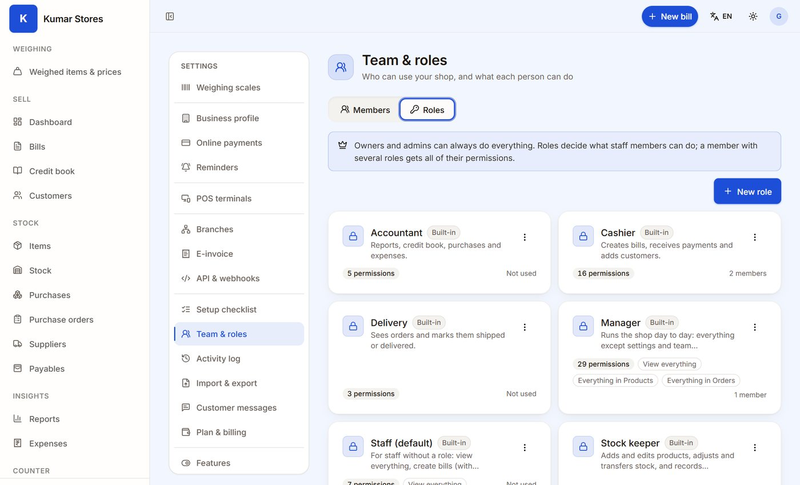

To make a role:

1. Open **Team & roles**, the **Roles** tab, and tap **New role**. Or open a built-in role's menu and choose **Duplicate**, to start from it.
2. Type a **Role name** and a description.
3. Tick what people with this role can do. You can tick everything in a group at once.
4. Tap **Create role**.
5. Go to **Members** and give the role to people.

Changes to a role apply to everyone who has it, within a minute. A role that people hold can be deleted, and they lose its permissions. Built-in roles cannot be deleted.

### Key permissions

| Permission | What it allows |
|---|---|
| Create bills | Create, edit, issue and share bills |
| Cancel bills | Cancel issued bills (stock goes back) |
| Give discounts | Add discounts to bill lines and change prices at the counter |
| Credit book | Customer ledgers and dues, receipts on account, statements and reminders |
| Receive payments | Record payments against bills |
| Add customers | Add and edit customers |
| View reports | Sales, payments, GST, stock and purchase reports |
| Manage products | Add and edit products, prices and categories |
| Adjust stock | Correct stock counts |
| Purchases and suppliers | Record purchase bills and orders, debit notes, and manage suppliers |
| Pay suppliers | Pay suppliers, reverse payments, mark purchases paid |
| Manage expenses | Record expenses and see the profit report |
| Manage orders | Work with online and manual orders (with separate permissions to cancel, record refunds, mark shipped and delivered) |
| Manage coupons | Create and change coupons |
| Manage store content | Edit home page, pages, blog and menus |
| Moderate reviews | Approve or reject reviews |
| Import and export data | Upload spreadsheets and download data |
| View activity log | Read and download the activity log |
| Manage team and roles | Invite members, assign and edit roles |
| Manage settings | Shop settings such as the payment account |
| Open and close the till | Day open, close and cash in or out at the counter |
| Credit notes and returns | Issue returns and credit notes |
| POS devices | Add terminals, create pairing codes and reset staff PINs |
| Weighing | Use a weighing station |

## POS PINs

On **Team & roles**, **My POS PIN** sets your own PIN. The key button on a member's row lets a person with the **POS devices** permission set, reset or remove theirs. A member with a PIN shows a green **POS PIN** tag. Tell a new PIN to the person face to face.

## What a cashier sees

A signed-in cashier sees only what their roles allow. For the built-in **Cashier** role that means:

- Making bills, receiving payments and adding customers.
- The counter, if they have a PIN on a paired terminal.
- Not: settings, team, reports, purchases or expenses. Menu items they cannot use are hidden, and a page they open by link says "You don't have access to this" and names the permission to ask for.
- A discount or price change shows as locked unless they have **Give discounts**.

If a cashier needs one more thing, do not make them an admin. Make a custom role and tick just that permission.

## The activity log

Open Settings, **Activity log** (needs the **View activity log** permission). It records every change in your shop: who did it, what, and when. Filter by period (**Today**, **7 days**, **30 days**, **90 days** or **Custom**), by person, or by area, and open a row to see the **before and after** values.

## Plan and billing

Open Settings, **Plan & billing** to see your plan, usage against your limits, add-ons, payments and invoices, and to cancel or resume. Only people with the **Manage plan & billing** permission see it.

## Common problems

| What you see | What to do |
|---|---|
| "Team limit reached" | Upgrade the plan, or turn off someone who has left. |
| A new member cannot sign in | Check their number or email is the one you invited, and their switch is on. |
| "This person is already in your team" | Open their row and change access instead. |
| A cashier cannot unlock the counter | They need a POS PIN and a role that can bill (**Create bills**). |

# 9. The Online Store

Your Online Store is a website for your shop, in English and Tamil. Customers browse your products on their phone, order, and pay online or on delivery. It uses the same products, stock and customers as your counter, so a sale online reduces the same stock.

You run it from the **Online store** section of your menu (apps that include the store). The sections are **Home page**, **Pages**, **Blog**, **Menus**, **Reviews** and **Store analytics**, with **Orders**, **Coupons**, **Offers & combos**, **Products**, **Categories** and **Collections** next to them. Store settings are in Settings.

## Open or close the store

Open Settings, **Online store**.

- **Store open** switches taking orders on or off. When closed, shoppers can browse but not check out, and see the **Message for shoppers** you wrote (for example "We're closed for Pongal. Orders open again on 18 January").
- **Cash on delivery** lets shoppers pay when the order arrives. You can set the largest cash-on-delivery order; bigger orders must be paid online.
- **Minimum order value** stops very small orders.
- **Delivery & pickup** (restaurants, cloud kitchens and tea stalls): switch **home delivery** and **pickup** on or off, and write the **pickup instructions** shoppers see at checkout (for example "Ready in 20 minutes at the counter").
- **Contact details**, your **WhatsApp number** and **social media** links show in the store footer.
- **Policies** for shipping, returns and refunds, privacy and terms. Tap **Start from a sample** and edit it. These pages show in the store and at checkout.
- **Show install app banner** invites shoppers, after a couple of pages, to add your store to their phone's home screen so it opens like an app.

Tap **Save**. Online card and UPI payments are connected under Settings, **Online payments** (chapter 2).

## Appearance: your store's look

Open Settings, **Appearance**.

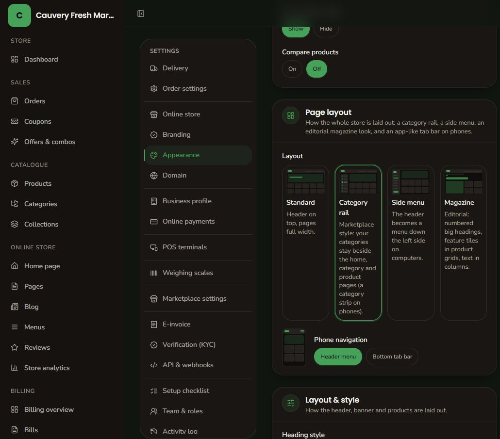

1. **Your business.** Check your trade. It sets the store's wording (such as the search box and section names). Tap **Use the (trade) look made for this trade** to start from the matching design.
2. **Start from a look.** Each look changes the layout, not only the colours. Pick one, then fine-tune the rest. The store looks below are samples.
3. **Colours.** Choose a **Brand colour** for buttons and highlights. Leave the others on **Auto** to follow it. Choose **Light**, **Dark** or **Follow the phone**.
4. **Fonts.** Choose a heading font and a body font, and a heading style (**Large**, **Small capitals** or **Underlined**). Logo, brand colours and fonts are shared with your bills and are edited in **Branding**.
5. **Page layout.** This is how the whole store is laid out: **Standard** (header on top), **Category rail** (your categories stay beside the pages, like a marketplace), **Side menu** (the header becomes a menu down the left on computers) or **Magazine** (editorial, with big numbered headings). **Phone navigation** can be a **Header menu** or a **Bottom tab bar**.
6. **Layout & style.** Choose the header (Classic, Centred logo, Minimal, Brand bar), the home banner (Slides, Text beside picture, Full screen, Short strip), product card style, picture shape, button shape, section style, background pattern and spacing.
7. **Header & footer.** Choose the header look, whether it stays on top while scrolling, the shop menu (with pictures or lists), the offer ribbon (can be closed, always shown, or scrolling) and the footer style.
8. **Product cards** and **Product page.** Choose the hover effect, when the Add and quick-view buttons show, how photos and details are arranged, the buy bar on phones, trust badges and similar products.
9. A sketch **Preview** (Home or Product page) updates as you change things. Tap **Save** when you are happy, then **Open store** to see it with your products.

## The home page editor

Open **Home page**. Your store shows a starter home page (shop name, categories, newest products) until you design your own.

To design your home page:

1. Tap **Use a ready layout** and change the words and pictures, or tap **Add a section** and pick a type from the gallery.
2. Open a section to edit it. Use the arrows to move it up or down, the eye to **hide from store** (hidden sections are saved with your draft but not shown), and the menu to remove it.
3. Watch the live preview on the right (**Phone**, **Tablet**, **Desktop**).
4. Tap **Save draft** to keep your work, and **Publish** (or **Save & publish**) when it should go live. The page shows **Live**, **Not published yet** or **Unpublished changes**.

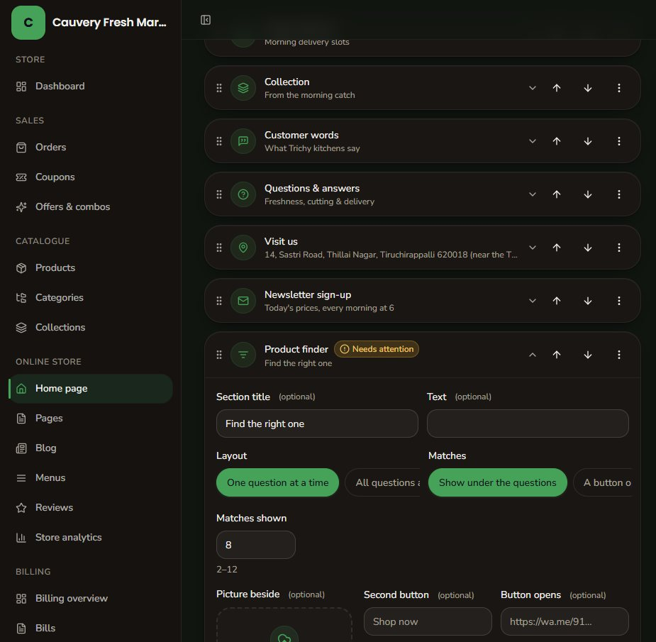

A home page holds up to a set number of sections, and the editor tells you when it is full. Some sections can be set to **Half** a row, so two sit side by side on computers and stack on phones.

### Section types

| Section | What shoppers see |
|---|---|
| **Banner slides**, **Split banner**, **Video banner** | Big pictures or a looping video with a heading and a button |
| **Categories**, **Category tiles**, **Category shelf** | Your categories as circles, cards, tiles, or a side list with products beside it |
| **Collection**, **Chosen products**, **Product tabs** | Products from a collection, picked by hand, or in tabs (new, best sellers, on sale) |
| **Best sellers**, **Recently viewed**, **Recommended for you** | Filled in automatically from orders and what the shopper viewed |
| **Offer & countdown** | A sale with a coupon code and a countdown, hides itself when it ends |
| **Flash sale** | A timed sale band over its products with a countdown. Choose the products by hand, the biggest discounts, or a collection |
| **Deal of the day** | One product, big, with a countdown and Add to cart |
| **Product finder** | Shoppers answer 1 to 3 questions (class, age, concern) and see what fits. One question at a time, or all at once |
| **Size finder**, **Shade finder**, **Shop by need** | Sizes that open the list in that size, colour swatches of a product's shades, or concern and occasion tiles |
| **Stories & reels** | Story bubbles or tall reels that open full screen |
| **Scrolling story** | A picture stays put while your story scrolls past, chapter by chapter |
| **Comparison table** | 2 to 4 products side by side, with your own rows |
| **Image banner**, **Image with text**, **Text**, **Photo gallery**, **Brand logos**, **Before & after** | Pictures and words about your shop |
| **Customer words**, **Customer reviews**, **Numbers**, **Our story**, **Team** | Proof and story |
| **Why shop with us**, **Questions & answers**, **Newsletter sign-up** | Trust points, FAQs and email sign-up |
| **Visit us**, **Menu board**, **Book an appointment**, **Plans & pricing**, **Today's gold rate**, **Instagram photos**, **Blog posts** | Trade extras (shown when the matching feature is on) |

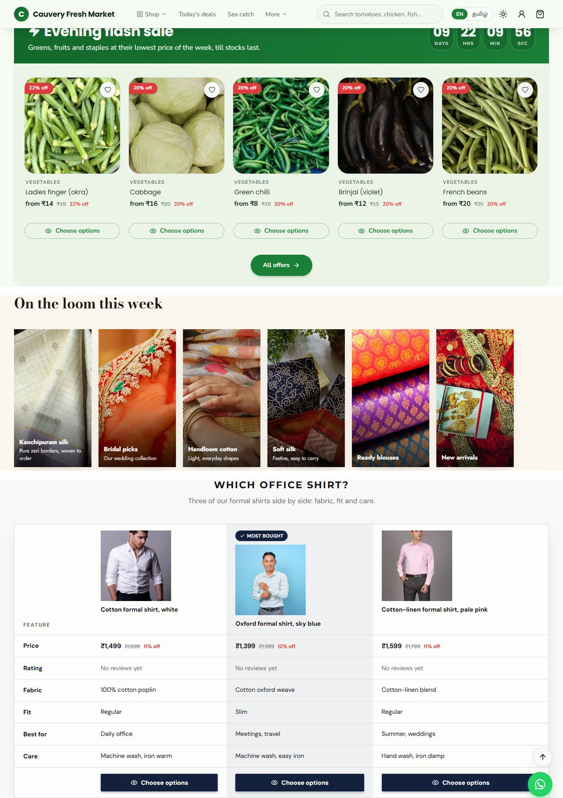

::: callout
**Start small.** A good home page has a banner, your categories, one or two product sections, and a section that explains why to shop with you. Add more later. Add pictures yourself; a section with no picture uses your brand colours.
:::

## Pages, menus and the blog

- **Pages** are About us, Contact, FAQs and similar. Tap **New page**, type a **Title**, build it from blocks (drag a block's top bar to reorder), and tap **Publish**. It stays a draft until then. **Unpublish** brings it back to draft.
- **Blog** works the same way: tap **New post**, add a **Short summary**, **Tags**, **Written by** and a **Cover picture**, and publish. Posts bring shoppers to your store.
- **Menus** are the links at the top and bottom of every page. Choose **Top menu** or **Bottom menu**, tap **Add a link**, name it, and choose what it opens: a web address, a page, a category, a collection or a blog post. Use the indent button to put a link under the one above, so it shows as a dropdown. Tap **Save menu**.

## Orders

Open **Orders** to see orders from your store and the ones you add yourself.

### The order flow

An order moves through these steps.

| Status | Meaning | Button to move on |
|---|---|---|
| **New** | The order has just come in | **Confirm** |
| **Confirmed** | You accepted it | **Mark packed** |
| **Packed** | Ready to send | **Mark shipped** |
| **Shipped** | With the courier | **Mark delivered** |
| **Delivered** | The customer has it | |
| **Cancelled** or **Returned** | Stopped, or came back | |

To work an order:

1. Open **Orders**. Switch between **List** and **Board** (columns by status). Search by order number, customer or phone, and filter by status, payment, channel and date.
2. Tap an order to see the items, the customer (with **Call** and **WhatsApp** buttons), the delivery address, the payment and a timeline.
3. Tap the next step button at the top. You can also tick several orders in the list and tap **Mark packed** or **Packing slips** for all of them.
4. To ship: tap **Mark shipped**. Type the **Courier** and **Tracking number** if you have them, and the customer gets the tracking link. Or tap **Create shipment** to book a courier through a connected courier account and print its label.

**Cancel order** needs a reason. The reserved stock goes back, the coupon is released, any bill is cancelled and the customer is told. **Mark returned** puts items back in stock and cancels the bill; record any refund separately under Payment.

### Payments and the bill

- On the order's **Payment** card you see the total, what you have received and the balance. Tap **Record payment** for money you got outside the online checkout, such as UPI to your phone or cash.
- A refund is recorded with **Record refund**. This only records it; send the money back to the customer yourself.
- A **GST bill** is made automatically from the order. In Settings, **Order settings**, choose **When confirmed** or **When delivered**. Choose delivered for cash-on-delivery shops, so no bill is made for orders that never reach the customer. Open it from the order with **Open bill** or **Bill PDF**. If creation failed, tap **Try creating the bill again**.
- You can also set the **order number prefix**, confirm new orders automatically, take orders when stock has run out, and be told about new orders.

### Take an order by phone or WhatsApp

Tap **New order**. Search and add items, type the customer's name and mobile, type the PIN code first (city and state fill in), choose how they pay, and tap **Create order**. Choose **Counter or pickup order** for no delivery.

## Shopper sign-in

Shoppers sign in to your store with **Google** or with their **mobile number and a one-time code (OTP)**. They sign in on one secure central page and are sent back to your store, and the items in their cart are kept. Nothing to set up on your side.

## Online food ordering

Restaurants, cloud kitchens and tea stalls can sell food on the Online Store. Each dish can have **Half** and **Full** portions, and shows a veg, egg or non-veg mark. Set the marks and mark a dish **sold out today** in Settings, **Restaurant**, under **Kitchen stations & menu**. At checkout the shopper chooses **Delivery** or **Pickup**, and the **minimum order value** is checked. A pickup order shows your pickup instructions. Orders go to **Orders** and appear on the **Kitchen display** at once.

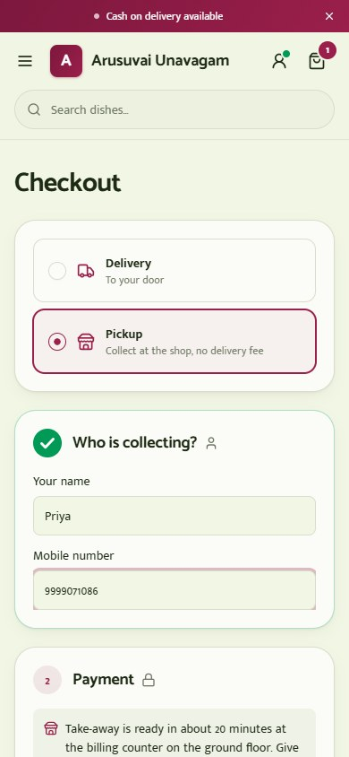

## Delivery zones

Open Settings, **Delivery**. With no zones, checkout offers one free "All India" option.

To add a zone:

1. Tap **Add zone** and name it, for example *Chennai city*.
2. Say what it covers: pick **states**, type **PIN code prefixes** (1 to 5 digits, such as 600), or paste **exact PIN codes**. A zone with none of these covers the rest of India.
3. Tap **Add rate**. Give it a name shown to customers (for example Standard). Choose how it is charged: **Flat**, **By weight** (weight slabs) or **Free above** an order value.
4. Set the delivery time in days, and whether **cash on delivery** is allowed and its fee.
5. Save.

A PIN code uses the most specific zone: exact PIN code first, then the longest prefix, then state, then the zone with no rules. A zone with no rates means customers there cannot check out.

## Coupons and offers

- **Coupons** are codes shoppers type at checkout. Tap **New coupon**, choose **Percent off**, **Amount off** or **Free delivery**, and type the **Code** (3 to 32 letters or digits, or tap **Make a random code**). Set a maximum discount, minimum order, dates, how many total uses and per customer, **First order only**, and where it works (online store, manual orders, counter, bills). Choose to apply it to everything, some categories or some products. Switch **Coupon is on** off to stop it.
- **Offers & combos** need no code: **Buy X get Y**, **Bulk / spend tiers**, **Free gift** and **Combo**. They show on product pages and apply by themselves in the cart.

## Reviews

Open **Reviews**. New reviews wait in **To check** until you decide. Tap **Approve** to show it on the product, or **Reject** to hide it. You can **Reply**, and your reply shows under the review. Under **Approval settings**, choose **Only after I approve**, **Verified buyers right away**, or **Everyone right away**.

You can also **Add review** that a customer gave you in the shop or on another site, saying where it came from. Add only real reviews, in the customer's words.

## Your own web address and store analytics

- **Domain** (Settings) lets you use your own address such as www.yourshop.in. Type it, add the two DNS records shown at your domain provider, and tap **Check now**. It can take a few minutes to a few hours. The default address keeps working.
- **Store analytics** shows visitors, orders, sales and conversion, a funnel from visit to order, where visitors come from, the most viewed products and what they searched for. Numbers update every hour.

## Common problems

| What you see | What to do |
|---|---|
| The store says it is closed | **Store open** is off in Settings, **Online store**. |
| Customers in one place cannot check out | That area has no delivery zone or the zone has no rates. |
| A coupon is rejected | The message says why: expired, minimum order, used up, wrong channel and so on. |
| The home page change is not visible | Tap **Publish**. A saved draft is not live. |
| Preview shows an error | Tap **Try again**, or **Open store** to see the real page. |
| An order has no bill | Check **Order settings**. The bill is made when confirmed or delivered. |

# 10. Chapters for your trade

These short chapters cover the extra screens each trade gets. Everything in chapters 1 to 9 still applies. If a screen is missing, ask the owner to check Settings, **Features**.

## Pharmacy

The Pharmacy app adds **Batches & expiry**, **Medicines**, **Prescriptions** and the **H1 register** to the menu.

### Receive a batch

Every pack on the shelf belongs to a batch with an expiry date. Record each batch when stock arrives.

1. Tap **Receive batch** (a quick action on the dashboard, or on the Batches page).
2. Choose the **Medicine**. It must already be an item. Add the medicine as an item first if it is not there.
3. Type the **Batch no.** and the **Expiry (month)**. A batch number you already have adds to that batch.
4. Type the **Quantity** (in the unit you sell, such as strips), the **MRP**, the **Purchase rate** (per unit, before GST) and the **Distributor**.
5. Tap **Receive**.

### Batches and expiry

Open **Batches & expiry** to see every batch with its expiry, quantity and MRP. Sales take the **soonest-expiring batch first**. The status shows **In stock**, **Expiring soon**, **Expired** or **Sold out**, and the dashboard's **Expiry watch** card counts what is expired or about to expire.

For a batch, use **Count / adjust** after counting the shelf, or **Write off** stock that is **Expired**, **Damaged** or **Returned to distributor**. **History** lists every change.

### Medicine details and schedules

Open **Medicines** and tap **Add details**. Pick the item you bill and add the **Composition (salt)**, **Manufacturer**, **Schedule**, **Units per pack**, how it is sold and the rack or shelf. Medicines with the same composition are offered as substitutes.

The schedule decides when a prescription is needed.

| Schedule | At the counter |
|---|---|
| **OTC** | Sold without a prescription |
| **Schedule G** | Sold without a prescription; the label warns to use under medical supervision |
| **Schedule H** | Prescription needed |
| **Schedule H1** | Prescription needed. Every sale goes in the H1 register (kept 3 years) |
| **Schedule X** | Prescription needed (kept 2 years). Every sale goes in the register |
| **Narcotic (NDPS)** | Prescription needed. Every sale goes in the register |

### Prescriptions and the H1 register

To record a prescription:

1. Open **Prescriptions** and tap **Record prescription**.
2. Choose the **Bill** the medicines were sold on.
3. Type the **patient** (name, age, phone, address) and the **prescriber** (doctor, registration number, clinic) and the prescription date.
4. Save.

The **H1 register** lists every sale of an H1, X or narcotic medicine with its batch, prescriber and patient. Rows with no prescription are marked **Missing prescription**, with an **Add** button to fix them. Tap **Print** to print the register.

## Restaurant

The Restaurant app adds **Tables**, **Kitchen display** and, if you take Zomato or Swiggy orders, **Online orders**.

### Set up tables

Open Settings, **Restaurant**.

1. Under **Areas & tables**, type an area (for example *AC hall*) and tap **Add area**.
2. Type a table name (for example *T7*), the number of **Seats** and tap **Add table**.
3. Each table has a **QR link**. Copy it and make a QR code to stick on the table. Guests scan it to see the menu and order. **New QR code** replaces it, and the old one stops working.
4. Under **Kitchen stations & menu**, choose which station makes each item (each station gets its own ticket), set veg marks, and mark items sold out today.

### Take an order (KOT)

1. Open **Tables** and tap a free table (**Free, tap to seat**). Choose the number of guests and tap **Start order**. For takeaway or delivery, tap **Takeaway** or **Delivery**.
2. Tap menu items to add them. Use **Note** for requests such as "less spicy".
3. Tap **Send to kitchen**. The kitchen gets a ticket (a KOT). You can keep adding items and send them in rounds.
4. To cancel one item, tap **Cancel item**. The kitchen sees it struck off.
5. To move guests, tap **Move / join tables**. A free table moves the order there; a table in use joins its order into this one.

### Kitchen display

Open **Kitchen display** on a screen in the kitchen. Tickets sit in three columns: **New**, **Cooking** and **Ready**. Tap **Start** when cooking begins, **Ready** when done, and **Served** when it goes out. **Move back** undoes a step. Each station sees only its own tickets. Turn the sound on to hear new tickets.

### Bill and split

1. In the order, tap **Bill**. All new items must first be sent to the kitchen.
2. Choose **One bill** or **Split** between guests. For a split, move items between **Bill 1**, **Bill 2** and so on, using **Another bill** to add more. Every bill needs at least one item.
3. Tap **Make bill** (or **Make N bills**). The table is free again.
4. Tap **Take payment** on each bill.

GST is added on the bill. An order with a bill cannot be cancelled.

### Online orders from Zomato and Swiggy

When connected in Settings, **Online platforms**, orders appear in **Online orders**. Tap **Accept** (set a preparation time), then **Food ready**, then **Handed to rider**. You can **Reject** with a reason. For food sold through these platforms, the platform collects and pays the GST under section 9(5), so the shop makes no tax bill; a monthly summary shows the value to report.

## Jewellery

The Jewellery section adds **Today's rates**, **Pieces** and **Old gold**.

### Set today's rates

Every morning:

1. Open **Today's rates**.
2. Type the rate per gram for **24K** and **22K** gold (or only 24K; other purities follow unless you type them), and silver or platinum if you sell them.
3. Tap **Save & reprice**. Every piece in stock is priced again from the new rate. The page tells you how many pieces were repriced.

The rate also shows on your online store if you added the **Today's gold rate** section.

### Pieces

Each piece is priced from its weight, purity and charges.

1. Open **Pieces** and tap **Add piece**.
2. Pick the **catalogue item**. Its catalogue price then follows the day's rate.
3. Choose the **Metal** and **Purity**. Type the **Tag no.**, the **Gross weight** and **Stone weight** (net weight is worked out), and the **Wastage %**.
4. Choose how **making** is charged (**Per gram**, **% of metal value** or **Flat amount**), type it, and add **Stone charges**.
5. Type the **HUID**, the 6-character hallmark ID from the BIS hallmark.
6. Save. The page shows the price at today's rate, with a breakdown: metal, wastage, making, stones, GST and what the customer pays.

Jewellery GST is 3% on the whole price (see Settings, **Jewellery**, where you also set the rounding and the old-gold buy-back percent). Use **Mark sold** or **Back in stock** on a piece.

### Old gold exchange

When a customer brings old gold:

1. Open **Old gold** and tap **New exchange**.
2. Type the customer's name and mobile.
3. For each item, type a description, weight, **purity** and the **Deduction %** for stones and dirt. It is valued at today's rate (less the buy-back percent, if you set one).
4. Tap **Save exchange**, and **Print receipt** to give the customer an old-gold receipt.
5. When you make the new bill, open the exchange and tap **Apply to a bill**. The amount is recorded on the bill as a payment (old gold).

**Cancel exchange** if the customer takes the gold back. It cannot be applied after that.

## Services

The Services app adds **Appointments**, **Job cards** and **Members** to the menu.

### Appointments

Open Settings, **Appointments** to add your **Services** (items you sell as services, with their time and a buffer), your **Staff** and your **Weekly hours** and **Time off**. Without this, nothing can be booked online.

To book a customer:

1. Open **Appointments** and tap **New appointment**, or click an empty time in the calendar.
2. Pick the **Services**, then who it is **With** (or **Anyone free**), the date, and a free slot.
3. Type the customer's name and phone and tap **Book**.

Switch the calendar between **Day** and **List**. Tap an appointment to **Confirm**, mark **Customer arrived**, **Start service**, **Mark done** or **No-show**. You can **Reschedule**, **Cancel appointment**, or tap **Make bill** to bill the services. Online bookings show as **Booked online**.

### Job cards

For repairs, tailoring and spectacle orders, a job card follows the work from the day you take the item in.

1. Open **Job cards** and tap **New job**. Choose the kind: **Device repair**, **Tailoring**, **Spectacles / lenses** or **General**.
2. Type the customer's name and phone, the due date and any **advance**. Then fill in the details for that kind: brand, model, serial and the problem for a device; garment, measurements and trial date for tailoring; prescription and lens type for spectacles. Never write a customer's passcode or pattern.
3. Tap **Create job card**. Print the job sheet for the customer.

Move the card along: **Received**, **Diagnosed**, **Awaiting approval**, **Approved**, **In progress**, **Trial**, **Ready**, **Delivered**. Add **Parts & labour** with their rates. When the estimate is ready, ask for approval and record the answer (**Customer approved** or **Customer declined**, and how it came: at the counter, phone, WhatsApp and so on). **Copy tracking link** gives the customer a page to follow progress. At the end, tap **Make bill**: it turns the parts and labour into a GST bill, with the advance already counted as paid.

### Memberships and packages

For gyms, spas and salons.

1. In Settings, **Memberships**, add **Plans**: a name, a length (months or days), either a number of **sessions** or unlimited visits, a price with GST, and **freeze days**.
2. Open **Members** and tap **Add member**. They get a member code. Sell a plan with **Sell plan**, and choose to **Make the GST bill now**.
3. At the front desk, open **Check in**, type the mobile number or member code and tap **Check in**. The screen shows the plan's end date or sessions left.
4. On a member you can **Renew**, **Freeze** and **Unfreeze** (the end date moves out by the days frozen), or **Cancel plan**. A refund is a credit note on the plan's bill.

## Electronics and mobiles: serial numbers and warranty

For phones and gadgets you track unit by unit.

1. Open **Serial settings**, tap **Track an item**, and choose the item. Set the **Warranty (months)**, tick **Two IMEIs per unit** for dual-SIM phones, and **Ask for the serial at billing**.
2. When stock arrives, tap **Receive units**, choose the item and scan or paste the serial numbers, one per line (IMEI 1 and IMEI 2 on one line for dual-SIM phones). RBMS checks each IMEI and flags duplicates. Add the purchase bill number, supplier and cost, then tap **Receive**.
3. At the counter, the sale asks for an IMEI or serial for each unit. The bill records it and starts the warranty from the sale date.
4. Open **Warranty lookup**, scan or type the IMEI or serial to see the sale, the customer and the warranty. To log a problem, open the unit and use **Log a claim**.

**Serial numbers** lists every unit with its status: **In stock**, **Sold**, **Returned**, **Defective** or **Written off**. If a bill is cancelled, the unit goes back in stock.

# 11. The Business mobile app (Android)

The Business mobile app puts your shop in your pocket. It is for owners and staff, on Android first. Use your own number or email, the same people and permissions as on the web.

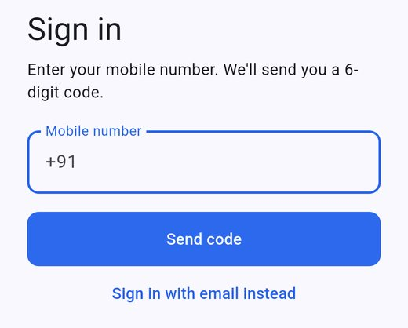

## Sign in and choose your shop

1. Open the app and type your **mobile number**. Tap **Send code**, type the 6-digit code and tap **Verify and sign in**. Or tap **Sign in with email instead**.
2. If you belong to more than one shop, **Choose a shop**. A shop that is suspended is marked.
3. You land on **Home**, with tabs **Home**, **Bill**, **Orders** and **More**.

**More** has **Switch shop**, **Language** (English or தமிழ்) and **Sign out**, and takes you to **Products**, **Stock**, **Customers**, **Credit book** and **Expenses**.

**Home** shows this month's billed, collected, bills and to-collect figures, overdue bills and your recent bills.

## Counter billing with the camera

To make a bill:

1. Open the **Bill** tab.
2. Add items: type a name or code in **Search items**, or tap **Scan barcode** and point the camera at the barcode.
3. Tap a line to change the quantity, price or discount. Changing price or discount needs the discount permission.
4. Tap **Customer** to search by mobile or name, **Add customer**, or **Bill as walk-in**.
5. Tap the charge button. Choose payment: **Cash received** (with change), **UPI**, **Card** or **On credit** (credit needs a saved customer). For UPI, confirm "UPI payment received".
6. Tap **Complete**. Then **Share on WhatsApp**, **Print** preview, or **New bill**.

At the top of the Bill tab, open the **till** to **Open day** with the cash in the drawer, record **Cash in / out**, see **Today (X report)** and **Close day** with a count. You can bill without opening the day, but those bills will not count in the till.

## POS terminal mode

A phone can be a paired counter or weighing station.

1. In Settings, **POS terminals** on the web, add a terminal and show its pairing code (chapter 5).
2. In the app's sign-in screen, tap **Use this phone as a POS terminal**.
3. Tap **Scan the pairing QR**, or type the **Pairing code** and tap **Pair**.
4. Each cashier unlocks with their PIN. **Lock** when you step away. The phone also locks after a while.
5. On a weighing terminal, pick an item, type the **Weight (kg)** and issue a **Weigh ticket**. On a billing terminal, scan the ticket to add its lines.

To go back to normal sign-in, tap **Sign in as owner or staff instead**.

## Products, stock, orders, credit book and expenses

- **Products** and **Stock** (More): search by name, SKU or barcode, filter by category, add a **New product**, and use **Adjust stock** (**Add**, **Remove**, **Set to**). Stock history lists every movement.
- **Orders**: the list refreshes by itself. Open an order to **Confirm**, **Mark packed**, **Mark shipped** (with courier and tracking), **Mark delivered**, **Cancel order**, **Mark returned**, **Record payment** or **Make invoice**. Marking a cash-on-delivery order delivered records the balance as paid.
- **Credit book**: see who owes you. Tap a customer to **Receive payment**, **Share statement**, **Send reminder** or open their **Ledger**.
- **Customers**: search, **Call**, add or edit a customer.
- **Expenses**: pick a period (**This month**, **Last month**, **This financial year** or **Pick dates**), tap **Add expense**, choose a category, type the amount and save.

::: callout
**What the app does not do yet.** Reports, GST summaries, purchases and e-invoice are on the web. Receipt printing shows a preview; Bluetooth printers are not connected yet. A sale cannot be completed while the phone is offline. If an update is needed, the app tells you to update from the store.
:::

## Common problems

| What you see | What to do |
|---|---|
| "Enter a valid 10-digit mobile number" | Type the 10 digits, without +91. |
| "You're not part of any shop yet" | Ask the owner to add your number. |
| "Camera permission needed" | Allow the camera for the app in the phone's settings, or type the code. |
| "Update the app" | This version is no longer supported. Update from the store. |
| "Can't reach the server" in terminal mode | Check the internet, then tap **Try again**. |

# 12. Troubleshooting and FAQ

## Sign-in and access

| Problem | Fix |
|---|---|
| I did not get a code | Choose WhatsApp instead of SMS, or sign in with email. Wait for the resend countdown. |
| "That code didn't work" | Request a new code and use the newest one. |
| "No access to (shop)" | The owner must invite you in Team & roles. |
| I cannot see a page my friend can | Your role does not include it. Ask the owner for the permission named on the page. |
| "Not available on your plan" or "Turned off" | The plan does not include it, or the owner switched it off. See Settings, **Plan & billing** and **Features**. |

## Billing

| Problem | Fix |
|---|---|
| I issued a bill with a mistake | You cannot edit an issued bill. Make a **credit note**, or **Cancel bill** and make a new one. |
| Tax shows IGST instead of CGST + SGST | Check **Place of supply** on the bill and the **State** in the business profile. |
| A customer paid twice | Open the bill and **Remove payment** for the wrong one, or keep the extra as advance by receiving it from the credit book. |
| I cannot find a bill | Open **Bills**, clear the filters, and search by number or customer. |
| Bill number prefix is wrong | Change it in Settings, **Business profile**. Existing bills keep their numbers. |

## Counter and devices

| Problem | Fix |
|---|---|
| Barcode scans but the item is not found | Add the barcode to the item, or use the on-the-spot **Add to catalogue** window. |
| The camera does not scan | Allow camera access for the site in the browser settings, or use a scanner. |
| Receipt does not print | Check the printer in the browser's print window. Terminals have a printer width and **Print automatically** setting. |
| Sale cannot be completed offline | Billing is saved on the server. Keep the cart and complete the sale when online. |
| Weighing scale will not connect | Use Chrome or Edge on a computer, check the cable and the speed, or type the weight by hand. |

## Stock and reports

| Problem | Fix |
|---|---|
| Stock is wrong | Use **Adjust**, **Set count** after a physical count. The **Stock history** shows what changed it. |
| Reports show nothing | Widen the date range. |
| Dues report does not match the credit book | Dues are shown as of the end of the date range you picked. |

## Questions people ask

**Do I need to install anything?**
No. The Billing app and the POS terminal open in the browser. Only the Business mobile app is installed, on Android.

**Can several people bill at once?**
Yes. Each counter has its own till, and each cashier signs in with their own PIN.

**Can I change the language?**
Yes, at any time, with the **EN** button. Tamil is available across the apps and your store.

**Does it work without internet?**
Searching your saved items works offline at the counter, but saving a sale needs the connection.

**Can I use my own web address for the store?**
Yes. See Domain in chapter 9.

**Who can see my data?**
Only people you invite. Roles control what each can see and do, and the activity log records changes.

**How do I get my data out?**
Settings, **Import & export**, **Export**. Reports also download as CSV.

**Where do I get help?**
Open **Support** from the menu (where your plan includes it), or ask the RBMS team.
